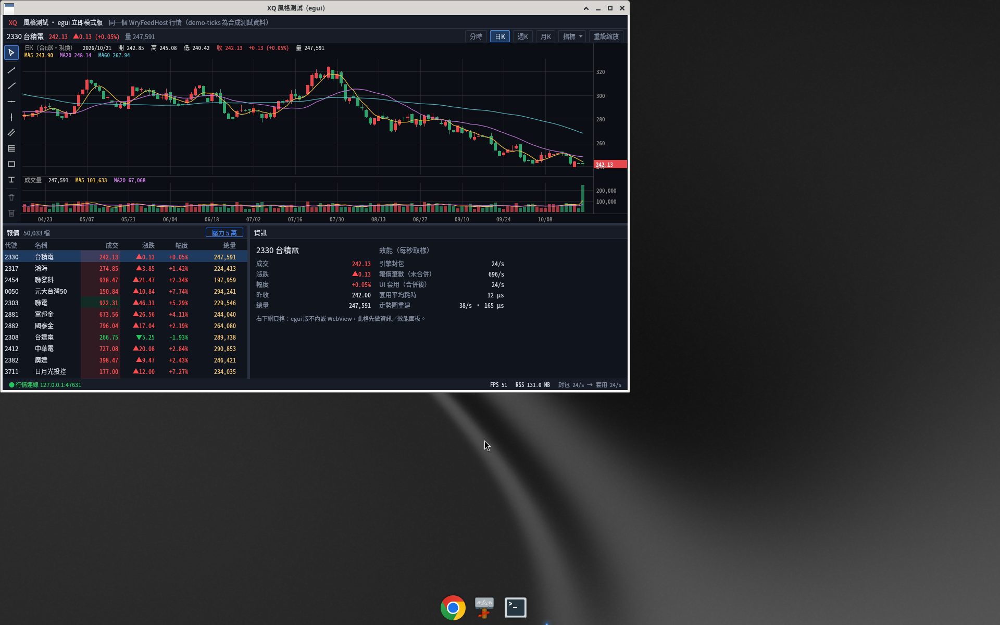
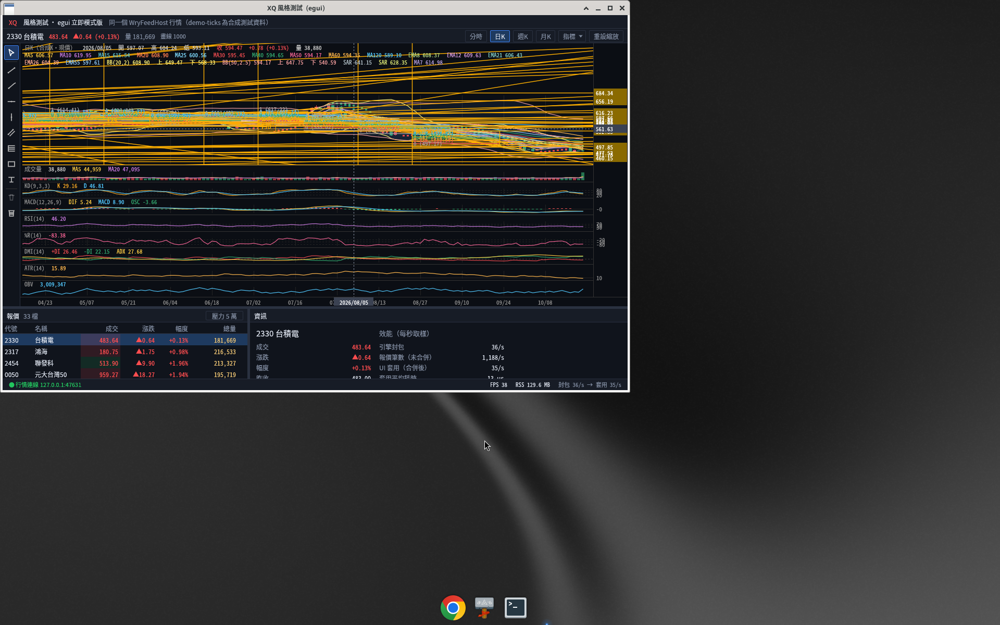
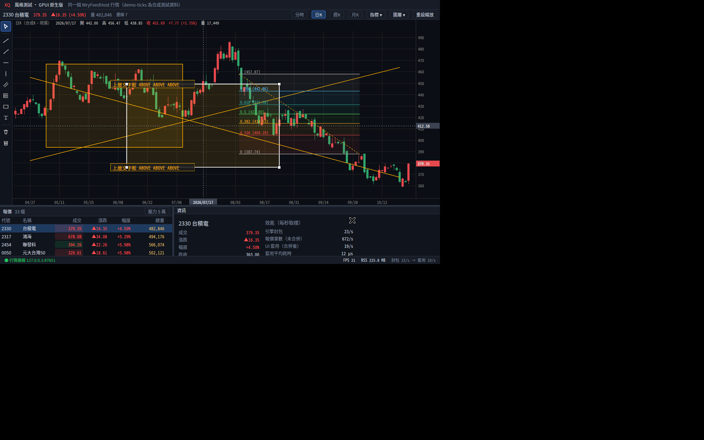

# egui-xq-demo — XQ 風格看盤（Rust + egui／eframe 立即模式版）

與 [`gpui-xq-demo`](https://github.com/tina-moneydj/gpui-xq-demo)（GPUI 原生繪圖）、[`wry-xq-demo`](https://github.com/tina-moneydj/wry-xq-demo)（tao + wry，HTML/JS）
**同版面、接同一個行情來源**：`WryFeedHost`（.NET，`127.0.0.1:47631`）。協議 crate `xq-feed` 直接沿用 gpui-xq-demo 的（Cargo git 依賴，鎖定 rev）。
走勢圖的狀態、指標、畫線邏輯（`model.rs`／`indicators.rs`／`drawings.rs`／`series.rs`）是從 GPUI 版**原樣移植**，三版算的東西一樣，只差畫面框架。

> **Mac 壓測包（mac-bench 分支）**：工具包放在 gpui-xq-demo 的 [bench/mac](https://github.com/tina-moneydj/gpui-xq-demo/tree/mac-bench/bench/mac)，會一起編這個 repo（兩個資料夾放同一層）。macOS 改動：蘋方-繁字型（CoreText 找檔案）、自身 RSS 用 `proc_pidinfo`、`XQ_WIN_RECTS` 指定視窗位置。CI：`.github/workflows/macos.yml` 編 egui（arm64）並組成完整 Mac 壓測包，發佈到本 repo 的 [mac-bench-latest](https://github.com/tina-moneydj/egui-xq-demo/releases/tag/mac-bench-latest) 預發行版（私人 repo，要登入才看得到）：下載 `xq-bench-mac.zip` → 解壓 → `xattr -dr com.apple.quarantine` → `./run-bench.command`。


| 5 萬列報價表壓測 | 重圖表（20 疊加＋8 副圖＋1000 畫線） |
|---|---|
|  |  |

## 功能（與 GPUI 版對照）

- 版面：上＝走勢圖、左下＝報價表、右下＝資訊／效能格；**上下、左右分隔線都可拖曳**；底部狀態列（連線、FPS、RSS、封包→套用）。
- 報價表：代號／名稱／成交／漲跌／幅度／總量，漲紅跌綠；自己做的虛擬化（`ScrollArea::show_viewport`，只為可見列產生圖元），
  「壓力 5 萬」加 5 萬列合成資料；點列切換走勢圖代號。
- 走勢圖：分時／日K／週K／月K、滾輪縮放、拖曳平移、重設縮放；主圖疊加最多 20 個（MA／EMA／布林／SAR）、副圖 8 種；
  「指標 ▾」選單（項目、勾選、參數欄與 GPUI 版相同，靠左對齊；▾ 用畫的，因為 Noto CJK 沒有這個字）；十字線＋讀值；每個「代號｜週期」的設定與畫線存到
  `~/.local/share/egui-xq-demo/state.json`（`XQ_EGUI_STATE` 可改）。
- 畫線：左側工具列 8 種工具＋刪除／全部清除；點選、拖曳整條或控制點、Delete、Esc、文字輸入。
  壓測注入的 1000 條畫線會畫出來、也能 hit-test（同 GPUI 的 64px 格狀空間索引）。

- 畫線圖層與上下順序（最多 200 層，顯示／隱藏、鎖定、上下移；`Ctrl+]`／`Ctrl+[`／`Ctrl+Shift+]`／`Ctrl+Shift+[`）：見[下面一節](#畫線圖層與上下順序2026-10-23-新增三版一起做)。
- 成交明細（`XQ_TAPE=1`）：與 GPUI main 同一個 `xq-tape` crate（Cargo git 依賴、鎖 rev）、同樣的行為——右側 276px 一欄、
  逐筆成交（總量差推導）、固定容量 5000 筆、`B` 只看大單、`[`／`]` 調門檻、`Home` 回最新、設定存 `~/.local/share/egui-xq-demo/tick_tape.json`；
  每幀最多套用一次（整批合併），可見列快取成 Mesh。
- 多視窗（`XQ_WINDOWS=N`）：immediate viewport，共用同一條行情連線與同一個報價表（含 Mesh 快取），每個視窗自己的走勢圖。

### 和 GPUI 版的對等狀況

完整的功能 × 三版對照清單在 [docs/parity.md](docs/parity.md)（含截圖）。目前只剩框架本身的差異：

| 項目 | 狀況 |
|---|---|
| 右下網頁格 | 同 GPUI，不做（放資訊格） |
| 局部重畫 | **做不到**：egui 每次重畫都是整個視窗重新送 GPU。這版做的是「沒事不重畫」＋「沒變的圖層沿用快取的三角形」 |
| `XQ_NO_VIEW_CACHE` | egui 沒有 view cache；對應成「每幀重建走勢圖／報價表的 Mesh 快取」 |
| `XQ_LAYER_MODE=split` | 對應成 egui 子圖層（`set_sublayer`）分開畫 |
| 搜尋框 | 三版 main 都不放（`ime-search-test` 分支另測） |

## 建置／執行

```bash
export PATH="$HOME/.cargo/bin:$PATH"
cargo build --release                      # rust-toolchain.toml＝stable（eframe 0.37 要 rustc ≥ 1.95）
DISPLAY=:2 XQ_METRICS=1 ./target/release/egui-xq-demo
XQ_RENDERER=wgpu ./target/release/egui-xq-demo   # 預設 glow（OpenGL），見下方「glow vs wgpu」
```

環境變數（與 GPUI 版同名同義，所以 `gpui-xq-demo/scripts/bench-*.sh` 可以直接驅動）：

| 變數 | 用途 |
|---|---|
| `XQ_FEED_ADDR` | 行情位址（預設 127.0.0.1:47631） |
| `XQ_METRICS=1` | 每秒印 fps／rss／封包／套用耗時 |
| `XQ_BENCH=1` | 第一幀／第一筆報價／第一個重圖表畫出後印 `BENCH ...` |
| `XQ_PERIOD=T/D/W/M` | 啟動週期 |
| `XQ_TOP_FRAC=0.56` | 上方走勢圖佔比 |
| `XQ_GROUP_STRESS=1`（＋`XQ_STRESS_TICK_HZ`／`_TICK_MS`／`_SCROLL_MS`） | 5 萬列＋合成跳價＋捲動壓測，印 `GROUPPERF|{json}` |
| `XQ_CHART_STRESS=1`（＋`XQ_CHART_DRAWINGS`／`_WARM_MS`／`_PHASE_MS`） | 重圖表壓測，印 `CHARTPERF|{json}`、`CHARTPHASE|...` |
| `XQ_TICK_BENCH=1` | 高頻進價量測（搭配 `xq-tickgen`），印 `TICKBENCH|{json}` |
| `XQ_RENDERER=glow/wgpu` | 繪圖後端（預設 glow） |
| `XQ_DEBUG_REPAINT=1` | 印每一幀是誰要求重畫的（找多餘重畫用） |
| `XQ_TAPE=1`（＋`XQ_TAPE_STATE`） | 成交明細面板（預設關閉，壓測版面不變） |
| `XQ_DEBUG=1` | 印滑鼠按下（同 GPUI） |
| `XQ_NO_VIEW_CACHE=1` | 每幀重建 Mesh 快取（對照用） |
| `XQ_LAYER_MODE=split` | 走勢圖圖層分子圖層畫（實驗） |
| `XQ_WINDOWS=N` | 開 N 個看盤視窗（最多 8）；`WINIT_X11_SCALE_FACTOR=2` 可開 2 倍縮放 |

## 架構與效能做法

```
src/bridge.rs     ← 背景執行緒合併（同代號只留最新）；Inbox 由空變非空才喚醒 UI，UI ≥16ms 才套用一次
src/table.rs      ← 報價表：自己虛擬化、可見列整批三角化成一個 Mesh 快取（列、捲動位置、選取、hover 沒變就沿用）
src/chart.rs      ← 走勢圖：plot／draw／live 三層各自快取 Mesh；平移時畫線層整批位移不重建；壓測驅動
src/model.rs …    ← 從 GPUI 版移植（版面、互動、指標增量、畫線幾何／空間索引）
src/gfx.rs        ← Sink：把矩形／線段／文字收集起來，一次三角化成 egui Mesh
src/tickbench.rs  ← 高頻量測（present＝下一幀開始，同 GPUI on_next_frame／wry 兩次 rAF，都是上界）
src/main.rs       ← 版面、分隔線、狀態列、資訊格、FPS/RSS 取樣、GROUPPERF 壓測
```

- **沒事不重畫**：沒有行情、沒有輸入就不畫（只有每秒一次的狀態列取樣）。行情進來時背景執行緒用
  `request_repaint_after(距離上次套用滿 16ms 的時間)` 叫醒 UI，所以行情再快也最多 ~60 次/秒。
- **避開 egui 的「多畫一幀」**：egui 的 `request_repaint()`（延遲 0）會排**兩次**重畫（讓東西穩定用），
  所以本程式一律用 `request_repaint_after(1µs)`；報價表也關掉 egui 的慣性捲動／捲軸動畫——實測跳價時約 60% 的幀是 `ScrollArea` 的慣性計算叫的。
  修掉後一般看盤 FPS 從 37 降到 19（＝每秒行情包數，一包一幀）。
- **快取三角形**：egui 每幀都要把圖形變成三角形（tessellate）。這版把沒變的圖層（K 棒＋指標、1000 條畫線、報價表可見列）
  三角化一次存成 `Arc<Mesh>`，下一幀直接沿用；只有資料、尺度、版面或字型改了才重建。
- 字型：Noto Sans CJK TC（mmap，不複製進記憶體）。

### glow vs wgpu

eframe 0.37 兩個後端都編進去，用 `XQ_RENDERER` 切換。同一台機器（沒有 GPU：glow＝Mesa llvmpipe OpenGL，wgpu＝Vulkan lavapipe）
重圖表壓測 2 次中位數（原始檔：[docs/bench/2026-10-21/renderer/](docs/bench/2026-10-21/renderer/)）：

| 重圖表 | glow | wgpu |
|---|---|---|
| FPS 跳價／十字線／平移 | **56.1／55.2／55.6** | 51.1／48.6／57.1 |
| CPU 扣軟體繪圖 (%) | **49.7／50.0／49.4** | 55.7／57.0／46.1 |
| RSS (MB) | **134／142／141** | 169／162／169 |

glow 記憶體少約 30 MB、FPS 大多較高，所以**預設 glow**，三方比較也用 glow。
（GPUI 在這台走 Vulkan lavapipe；egui 用 wgpu 時一樣走 lavapipe，數字差不多，可用 `EGUI_RENDERER=wgpu` 重跑比較。）

## 畫線圖層與上下順序（2026-10-23 新增，三版一起做）

像一般技術分析軟體一樣：畫線可以點選、拖曳，**可以調上下順序**，也可以分**圖層**（最多 200 層，可顯示／隱藏、鎖定、上下移）。

### 結論先看

- **三版功能對等，畫面順序正確。** 下層的線被上層蓋住、上層的線畫在下層之上、選取的控制點永遠在最上面；點選時抓「看得到的最上面那條」，隱藏或鎖定的圖層點不到。三版截圖見下。
- **100 層不會比較慢。** 1000 條畫線分 100 層 vs 全放 1 層，改順序／選取時重建畫面的時間幾乎一樣（差距 < 0.05 ms；wry 在 1 ms 內）。FPS 的差距比同一設定重測的誤差還小（例外：wry 跳價／十字線時 100 層慢約 15%，見下面「有沒有退步」）。
- **拖曳不重建。** 拖曳一條線時，其他 999 條用快取的「下層／上層」兩片，三版拖曳期間重建次數都是 0（只有開始時 1 次）。
- **反應最快：egui。** 點選或改順序到畫面更新：egui ≈ 17 ms、wry ≈ 47 ms、GPUI ≈ 64–80 ms。重建本身 egui、GPUI 都約 0.3 ms，wry 約 4–5 ms。
- **拖曳 FPS：egui 56 ＞ wry 28 ＞ GPUI 10**（這台沒顯卡，GPUI 的軟體繪圖最貴；而且這次 box 被另一個工作同時佔滿，GPUI 受影響最大，見下面注意事項）。

### 測了什麼、為什麼重要

壓測場景和「重圖表」相同（1000 條畫線＋20 個疊加指標＋8 個副圖、持續跳價），多加四段，每段 10 秒：

| 段落 | 做什麼 | 為什麼重要 |
|---|---|---|
| drag（拖曳） | 拖著第 500 條（在中間的第 50 層）來回移動 | 拖曳要順，不能每動一下就把 1000 條重畫 |
| select（選取） | 一直點選／取消選取中間那條 | 選取時那條要「浮」到上面並顯示控制點，其他線要拆成上下兩片快取 |
| reorder（改順序） | 一直 上移一層／下移一層／移到最上／移到最下、整個圖層上下移、圖層隱藏／顯示 | 這就是使用者按 Ctrl+] 等快捷鍵時的成本 |
| zshot（正確性） | 7 條互相重疊、分 3 層的畫線，拿中間那條當選取 | 截圖檢查誰蓋誰 |

同一套測法跑兩種設定：**100 層**（1000 條平均分到 100 層）和**不分層**（`XQ_CHART_LAYERS=1`，全部在 1 層），比較 100 層多花多少。

### 數字（交錯測 3 輪取中位數；括號內是不分層）

| 項目 | wry | GPUI | egui | 最好 |
|---|---|---|---|---|
| 拖曳 FPS | 27.7（40.9） | 9.9（11.0） | 55.8（49.7） | **egui** |
| 拖曳期間重建次數 | 0 | 0 | 0 | 三版相同 |
| 選取：重建 p50／p99 (ms) | 4／7（3／6） | 0.34／1.60（0.37／0.75） | 0.34／0.60（0.33／0.62） | **egui ≈ GPUI** |
| 選取：到畫面更新 p50／p99 (ms) | 47／67（33／73） | 80／145（96／144） | 17／37（19／28） | **egui** |
| 改順序：重建 p50／p99 (ms) | 5／12（5／9） | 0.32／0.58（0.36／0.57） | 0.36／0.55（0.32／0.51） | **egui ≈ GPUI** |
| 改順序：到畫面更新 p50／p99 (ms) | 49／73（51／76） | 64／131（81／128） | 18／25（17／26） | **egui** |
| 選取／改順序時 FPS | 21／20 | 13／14 | 56／54 | **egui** |
| 記憶體 RSS (MB) | 703（704） | 219（219） | 137（141） | **egui** |
| 重圖表 跳價／十字線／平移 FPS | 34.6／34.3／30.5 | 13.2／12.7／9.8 | 51.6／51.4／51.0 | **egui** |

- 「重建」＝改了順序或選取之後，把 1000 條重新排成上下兩片快取的 CPU 時間；「到畫面更新」＝從動作到下一幀開始（含等下一幀）。
- **100 層 vs 不分層：重建時間一樣**（排序用「圖層位置、陣列位置」兩個數字，100 層不會多跑迴圈）。表裡 FPS 的高低（例如 wry 拖曳 28 vs 41）在另一組完整重測裡是反過來的（43 vs 17），所以只是 box 雜訊，不是圖層造成的。
- wry 的時間是整數：WebKit 的 `performance.now()` 只精確到 1 ms。

### 和 10-21 重圖表比有沒有退步

| 跳價／十字線／平移 FPS | wry | GPUI | egui |
|---|---|---|---|
| 2026-10-21（安靜時） | 36.1／36.5／26.2 | 20.5／20.7／20.8 | 41.8／39.6／41.7 |
| 2026-10-23（box 被佔滿） | 34.6／34.3／30.5 | 13.2／12.7／9.8 | 51.6／51.4／51.0 |

上面兩列是不同時間測的，box 忙閒不同，不能直接比。下面是**同一時段、改版前後輪流跑**的對照（2026-10-23 早上，合成行情，1000 條畫線分 100 層，每段 6 秒，3 輪取中位數）。

**GPUI：確實退步過，已修好。**

| GPUI 跳價／十字線／平移 | FPS | CPU（整個程式，含軟體繪圖） | 每幀畫線批次 |
|---|---|---|---|
| 改版前（360cb93，沒有圖層） | 20.8／20.8／20.8 | 311%／323%／313% | 4 |
| 圖層版（0eeca4e） | 20.2／20.2／20.4（較忙時 17.9／18.2／18.3） | **480%／480%／473%** | 14 |
| 修正後（目前 main） | **20.8／20.8／20.8** | **298%／301%／307%** | **4** |

- 這台機器上 GPUI 重圖表最多約 21 FPS，改版前和修正後都頂到這個上限，所以要看 CPU：圖層版每秒多花約 1.6 顆 CPU，修正後回到改版前的水準（還略低一點）。
- 原因不是「上層那片多畫一次」（沒選取時那片本來就是空的），而是**畫線被切成很多批**：GPUI 每一批線條都要把整個視窗大小的暫存畫布清掉、畫、再貼回去，沒有顯卡時很貴。圖層版的價格軸標籤（水平線的價格）一個個夾在畫線中間，整個畫面每幀從 4 批變成 14 批。
- 修法：價格軸標籤整組放同一層；畫線開始前先放一個「隔板」，讓所有畫線的順位都排在圖上其他東西之上，連成一批。另外沒有選取時不再通知「選取那條」和「上層那片」重畫。
- 上下順序照樣正確：重跑正確性截圖，選取的中間層方框仍在上層文字框和線之下、下層線之上，控制點在最上面（和下面的截圖一致）。

**egui：沒有退步。** 改版前（3c5d06d）60.3／60.5／60.8 FPS、CPU 286%／289%／284%；圖層版 61.3／60.4／60.1 FPS、CPU 288%／289%／288%。egui 沒選取時本來就只畫一份畫線快取，不用改。

**wry：平移沒退步，但「100 層」時跳價、十字線變慢約 15%，原因不同、還沒修。**

| wry 跳價／十字線／平移 FPS | 中位數 |
|---|---|
| 改版前（d9e06ec，8 輪） | 23.5／21.9／33.0 |
| 圖層版，1000 條分 100 層（8 輪） | 19.0／19.3／34.8 |
| 圖層版，全部 1 層（4 輪） | 22.4／22.4／34.4 |

- wry 沒有 GPUI 那個「多一層」的問題（沒選取時上層那片本來就不畫）。
- 慢的只有「分 100 層」：壓測把 1000 條輪流分到 100 層，照順序畫時線、填色、文字、虛線一直交錯，瀏覽器畫布每條都要換一次畫筆設定；跳價和十字線時價格範圍一直變、整份畫線每幀重畫，所以吃到這個成本。平移只位移快取，不受影響；全部放 1 層就和改版前一樣。
- 實際使用時一個圖層裡通常是同類型的線，影響會比這個壓測小。要修可以學 GPUI：不重疊的同色線先併成一筆再畫。

### 正確性截圖

| wry | GPUI | egui |
|---|---|---|
|  |  |  |

看法：中間被選取的白框矩形（第 2 層）邊線被上層（第 3 層）的兩個文字框蓋住；上層的趨勢線畫在白框之上、下層的在白框之下；白色控制點在最上面。三版一致。
拖曳中截圖：`docs/bench/2026-10-23-layers/ilv/r3-<程式>-L100/<程式>-drag.png`。

### 還不一樣的地方（框架限制）

- **GPUI**：同一個區段裡的文字一定畫在線條上面（GPUI 把文字放在自己的圖層）。換到上一個區段（例如上層的線）就會正確蓋住。
- **wry**：平移時，水平線往兩邊延伸的部分在快取邊緣會晚一幀補上（其他種畫線也一樣）。
- **wry**：時間只精確到 1 ms（見上）。

### 注意事項

- **這台沒有顯卡**：畫面全靠 CPU 模擬（wry＝WebKit＋llvmpipe、GPUI＝Vulkan lavapipe、egui＝OpenGL llvmpipe），FPS 主要是軟體繪圖的速度；有顯卡時 FPS 會高很多，但「重建時間」這種 CPU 端數字不受影響。
- **這次 box 很吵**：測試時另一個工作同時在建置與壓測網頁版，系統負載一直在 6–10（8 核）。所以用**交錯測**：每輪內同一個程式 100 層／不分層緊接著跑，3 輪取中位數。**請看同一輪的相對高低與「重建時間」，不要拿 FPS 絕對值跟其他輪比。**
- 測試在 Xvfb `:5`、行情用獨立的 WryFeedHost（埠 47651，`FEED_PORT`／`XQ_FEED_ADDR`），不和其他工作搶連線。
- 原始資料：[docs/bench/2026-10-23-layers/](docs/bench/2026-10-23-layers/)（`ilv/summary-ilv.json` 是上表；`layers100/`、`flat/` 是第一次一口氣跑完的完整版，雜訊更大，僅供參考）。

### 怎麼用

- 選一條線 → `Ctrl+]` 上移一層、`Ctrl+[` 下移一層、`Ctrl+Shift+]` 移到最上、`Ctrl+Shift+[` 移到最下（mac 用 ⌘）；工具列「圖層 ▾」開圖層面板：同樣四個順序按鈕、「+ 新圖層」、每層的 顯示／隱藏、鎖定、▲▼ 上下移，點圖層名稱設為作用中圖層（新畫的線放這層），「移到作用中圖層」把選取的線搬過去。順序調整都在該線自己的圖層內。
- 存檔多一個 `layers` 欄位；舊存檔沒有這欄照樣能讀（全部放在預設圖層）。
- 壓測：`XQ_CHART_STRESS=1 XQ_CHART_LAYERS=100`（`1`＝不分層）；`scripts/bench-main-window.sh 3 heavy` 會多跑 drag／select／reorder／zshot。

## 效能比較（wry vs GPUI vs egui）

本 repo 是 egui／eframe 立即模式版（glow 後端）；對照組是 [GPUI 原生繪圖版](https://github.com/tina-moneydj/gpui-xq-demo) 和 [tao + wry（WebView）版](https://github.com/tina-moneydj/wry-xq-demo)（這兩個 repo 是公開的，本 repo 是私人的）。三版接同一個行情來源、顯示同樣內容。

> **測試機**：Linux（Debian 13）、8 核、**沒有顯示卡**——畫面全靠 CPU 模擬繪圖（wry＝WebKit＋llvmpipe、GPUI＝Vulkan lavapipe、egui＝OpenGL llvmpipe）。
> 三版都是 release build、視窗 1200×720，**2026-10-21 22:42–23:55（台北時間）同一時段輪流跑、每項 3 次取中位數**；多視窗 4K 情境 10-22 00:16–00:29。
> **這一輪是「功能對等版」**：egui 已補齊 GPUI main 的功能（成交明細、`XQ_DEBUG`／`XQ_NO_VIEW_CACHE`／`XQ_LAYER_MODE`、指標選單，見 [egui 的 parity.md](https://github.com/tina-moneydj/egui-xq-demo/blob/main/docs/parity.md)），
> 量測時三版都**不開**成交明細、**不放**搜尋框，畫面內容相同。
> **這台 box 很吵**：和上一輪比，程式沒改的 GPUI／wry 開啟時間慢了 10–40%、CPU 高了 20–60%（box 重開機過、背景有其他程序與桌面合成器）。
> **請比同一輪內三版的高低，不要跨輪比絕對值。** 原始檔：[docs/bench/2026-10-21-parity/](docs/bench/2026-10-21-parity/)。

### 結論先看

- **記憶體：egui 最省，GPUI 次之，wry 最多。** 主視窗 RSS egui 124、GPUI 185、wry 627 MB（PSS 87／150／402）；重圖表 140／220／697 MB。
- **開啟速度：egui 最快。** 第一筆報價上畫面 egui 0.15 秒、GPUI 0.41 秒、wry 0.89 秒；重圖表 0.48／0.68／1.23 秒。
- **CPU：egui 程式本身最省。** 主視窗扣掉軟體繪圖 egui 7%、GPUI 19%、wry 72%；含軟體繪圖 egui 56%、wry 171%、GPUI 247%。
- **重圖表：egui 42 FPS、wry 36、GPUI 21**；但「程式本身」CPU 是 GPUI 最省（33%，有局部重畫），egui 53%、wry 134%。
- **高頻報價延遲：egui 最低。** 每秒 1 千～10 萬筆延遲中位數 egui 30–31 ms、wry 46–51 ms、GPUI 74–75 ms；三版都 **0 掉筆**、不會越積越多。
- **高解析多視窗（4K、2 倍縮放、4 個視窗）：** 4 個視窗總 PSS egui 136、GPUI 440、wry 1,540 MB——每多一個視窗約 +10／+81／+329 MB；
  延遲中位數 egui 46、wry 92、GPUI 313 ms。三版都只用一條行情連線；egui／GPUI 共用同一份報價表資料，wry 每個視窗的網頁各存一份。
- **對等化沒有讓 egui 變慢**：補功能後（不開成交明細時）延遲、記憶體、CPU 和上一輪相差都在誤差內。

**怎麼選：** egui＝最省記憶體／CPU、開最快，多開視窗幾乎不加記憶體，但 UI 要自己畫（沒有網頁、沒有局部重畫）；
GPUI＝原生、元件模型完整、有局部重畫，程式本身 CPU 低，但這台沒顯卡時軟體繪圖最貴、高解析多視窗掉最多；
wry＝最快上線、沿用網頁 UI，記憶體是另外兩版的 3–5 倍，每多一個視窗再加約 300 MB。

### 名詞說明

| 名詞 | 白話意思 |
|---|---|
| RSS | 程式佔用的實體記憶體（MB）。多個程序共用的函式庫會被重複算，所以會偏高。 |
| PSS | 同上，但共用的部分按比例分攤，比 RSS 公平。多視窗比較看這個。 |
| p50／p99 | 所有量到的值由小排到大：p50 是中間值（一般情況），p99 是最慢的 1%（偶爾卡一下的程度）。 |
| FPS | 每秒畫面更新幾次。**算法不同**：wry 數瀏覽器畫面回呼（沒卡住就接近 60）；GPUI、egui 數真的畫出來的幀、**沒事不畫**，一般看盤時 ≈ 每秒行情包數。只當參考。 |
| CPU（扣掉軟體繪圖） | 100% = 一顆核心（這台最多 800%）。沒顯示卡時畫面由 CPU 模擬（llvmpipe／lavapipe），有顯示卡時這部分交給 GPU，所以另列「扣掉軟體繪圖」＝程式本身的工作量。 |
| 延遲 | 從報價送出到畫面更新完成（ms），越低越好。三版的「畫完」都取下一幀（上界）。 |
| 合併 vs 掉筆 | 合併：同一檔一幀內跳好幾次只畫最新，是刻意的。掉筆：報價根本沒收到，三版都是 0。 |
| 2 倍縮放（HiDPI） | 介面以 2 倍像素畫（像 4K 螢幕的 200% 縮放）：GPUI `GPUI_X11_SCALE_FACTOR=2`、egui `WINIT_X11_SCALE_FACTOR=2`、wry `GDK_SCALE=2`。 |

### 1. 開一個主視窗（一般看盤）

同樣內容（33 檔自選、2330 日線＋MA5/20/60＋量、報價表），模擬行情持續跳動（`WryFeedHost --demo-ticks`）。括號內是上一輪。

| 項目 | wry | GPUI | egui | 最好 |
|---|---|---|---|---|
| 開啟 → 第一個畫面 (ms) | 1,049（732） | 283（210） | 124（116） | **egui** |
| 開啟 → 第一筆報價 (ms) | 891（693） | 411（301） | 150（141） | **egui** |
| 記憶體 RSS，開 60 秒 (MB) | 627（614） | 185（182） | 124（124） | **egui** |
| 記憶體 PSS，開 60 秒 (MB) | 402（422） | 150（178） | 87（118） | **egui** |
| 程序數／執行緒 | 3／86 | 1／53 | 1／19 | **egui** |
| CPU 扣掉軟體繪圖 (%) | 72（52） | 19（11） | 7（4） | **egui** |
| CPU 全部 (%)（含軟體繪圖） | 171（133） | 247（155） | 56（42） | **egui** |
| FPS | 60（rAF） | 26.0 | 23.9 | — |
| 執行檔 (MB) | 1.7 | 25.5 | 13.0 | **wry** |

**5 萬列報價表＋每秒 3000 筆合成跳價＋邊跳邊捲：**

| 項目 | wry | GPUI | egui | 最好 |
|---|---|---|---|---|
| RSS／PSS，跳價中 (MB) | 622／397 | 189／154 | 131／93 | **egui** |
| CPU 跳價（全部／扣軟體繪圖）(%) | 182／67 | 299／22 | 126／12 | **egui** |
| CPU 捲動，全部 (%) | 187 | 296 | 190 | wry ≈ egui |
| FPS 跳價／捲動 | 60／60（rAF） | 32／32（40／54） | 55／85 | — |
| 捲動卡頓（幀間隔 > 32 ms） | 1 | 154（53） | 1 | wry、egui |

### 2. 重圖表（1000 條畫線＋20 個疊加指標＋8 個副圖）

把走勢圖塞到最重（圖面約 1166×505），一邊跳價、一邊移動十字線、一邊左右平移，各 10 秒。

| 項目（跳價那段） | wry | GPUI | egui | 最好 |
|---|---|---|---|---|
| 開啟 → 第一個重圖表 (ms) | 1,228 | 678 | 484 | **egui** |
| 記憶體 RSS／PSS (MB) | 697／472 | 220／185 | 140／103 | **egui** |
| CPU 扣掉軟體繪圖 (%) | 134 | 33 | 53 | **GPUI** |
| CPU 全部 (%) | 257 | 364 | 233 | **egui** |
| 每幀畫圖表時間 (ms) | 5.9 | 2.7 | 1.3 | **egui**（算法略不同） |
| FPS 跳價／十字線／平移 | 36.1／36.5／26.2 | 20.5／20.7／20.8 | 41.8／39.6／41.7 | **egui** |
| 平移時 RSS (MB) | 807 | 224 | 143 | **egui** |

### 3. 高頻報價（每秒 1 千～10 萬筆＋開盤爆量）

5 萬列報價表＋走勢圖（`xq-tickgen`），把報價速度一路加上去。三版都是「背景依代號合併、畫面每幀最多更新一次」。

| 每秒報價 | wry 延遲 p50／p99 (ms) | GPUI 延遲 p50／p99 (ms) | egui 延遲 p50／p99 (ms) | 最低 |
|---|---|---|---|---|
| 1 千 | 46.0／53.6 | 75.0／79.4 | **29.5／36.1** | **egui** |
| 1 萬 | 46.8／66.3 | 74.2／78.7 | **30.7／38.7** | **egui** |
| 5 萬 | 49.3／66.9 | 74.5／79.7 | **30.8／36.3** | **egui** |
| 10 萬 | 50.6／66.0 | 75.3／81.7 | **30.9／36.7** | **egui** |
| 開盤爆量 | 46.2／58.0 | 46.3／79.7 | **30.0／34.5** | **egui** |

| 每秒報價 | 記憶體 結束 (MB) wry／GPUI／egui | FPS wry／GPUI／egui | CPU 扣軟體繪圖 (%) wry／GPUI／egui | 點選切換 (ms) wry／GPUI／egui | 掉筆 |
|---|---|---|---|---|---|
| 1 千 | 644／198／**146** | 60／31／61 | 86／22／**14** | 36／47／**23** | 0 |
| 1 萬 | 681／200／**146** | 60／31／61 | 101／26／**17** | 50／47／**24** | 0 |
| 5 萬 | 762／199／**146** | 56／32／61 | 108／27／**20** | 55／53／**25** | 0 |
| 10 萬 | 795／199／**142** | 55／32／61 | 111／30／**24** | 52／47／**20** | 0 |
| 開盤爆量 | 688／198／**143** | 60／42／61 | 90／25／**14** | 29／40／**18** | 0 |

延遲大多是「等下一幀」：egui 約 61 FPS、套用到畫完約 16 ms；wry 多一道「轉成 JS 送進網頁」（約 18–20 ms）；GPUI 被軟體繪圖拖到約 32 FPS（約 44 ms）。
wry 記憶體在 30 秒內會漲（10 萬筆時到 795 MB），GPUI、egui 全程固定。

### 4. 高解析多視窗（4K 螢幕、2 倍縮放、1 個 vs 4 個視窗）

> **沒有 GPU，所以這裡的 FPS 不代表真機**（4K×2 倍全靠 CPU 光柵化，8 核幾乎被吃滿）；**記憶體與 CPU 的趨勢才有參考價值。**

- 獨立的 Xvfb 3840×2160、三版都開 2 倍縮放；每個視窗 1920×1080 實體像素（960×540 邏輯）、2×2 鋪滿不重疊。
- 每個視窗＝走勢圖（自選第 k 檔：2330／2317／2454／0050 日線＋MA＋量）＋5 萬 33 列報價表＋資訊格；`xq-tickgen` 每秒 1 萬筆、量 30 秒、3 次中位數。
- 開法：`XQ_WINDOWS=N`，**三版都是一個應用程式、只有一條行情連線**（行情解碼一次；wry 另有 WebKit 子程序）：
  - GPUI：多個視窗共用同一個 `QuoteTable` entity（同一份 5 萬列資料，只合併一次），每個視窗自己的走勢圖／資訊格 view。
  - egui：immediate viewport，共用同一個報價表（含 Mesh 快取），每個視窗自己的 `ChartView`。
  - wry：每個視窗一個 WebView；Rust 端同一包報價借用合併進每個視窗的批次（不重複配置），但 **WebView 架構使然，每個視窗的 JS 各存一份 5 萬列資料**。

| 項目（1 個 → 4 個視窗） | wry | GPUI | egui | 最好 |
|---|---|---|---|---|
| 總記憶體 PSS (MB) | 555 → 1,540 | 197 → 440 | 105 → 136 | **egui** |
| 總記憶體 RSS (MB) | 799 → 2,569 | 234 → 477 | 147 → 189 | **egui** |
| 每多一個視窗 PSS (MB) | +329 | +81 | +10 | **egui** |
| CPU 全部 (%)（滿載 800） | 333 → 578 | 485 → 613 | 285 → 507 | **egui** |
| CPU 扣掉軟體繪圖 (%) | 92 → 179 | 18 → 21 | 14 → 18 | **egui** |
| 每個視窗 FPS | 60 → 28／29／29／29 | 21 → 8／8／8／8 | 61 → 29／29／29／29 | — |
| 延遲 p50／p99，全部視窗合併 (ms) | 46／57 → 92／145 | 105／112 → 313／428 | 30／35 → 46／78 | **egui** |
| 最差視窗 p99 (ms) | 57 → 146 | 112 → 435 | 35 → 85 | **egui** |
| 掉筆 | 0 | 0 | 0 | — |
| 程序 | wry＋WebKit 網頁／網路程序 | 1 | 1 | — |

- **記憶體是最清楚的差別**：egui／GPUI 的多視窗共用資料，加視窗只加畫面本身（egui 約 10 MB、GPUI 約 81 MB，GPUI 多的是每個視窗的 GPU 繪圖資源）；
  wry 每個視窗是一個完整的網頁，約 +330 MB。
- **CPU**：程式本身（扣軟體繪圖）egui、GPUI 從 1 到 4 個視窗幾乎不變（行情只處理一次）；wry 加倍（每個網頁都要跑一次 JS 更新）。
  總 CPU 三版在 4 個視窗都接近吃滿 8 核，所以 FPS 一起掉——有 GPU 時這段光柵化不在 CPU 上。
- GPUI 在這台 4K 單視窗就只有 21 FPS（1200×720 時 31），4 個視窗 8 FPS、延遲 0.3 秒：lavapipe 每幀畫 4 個 4K 區塊最貴。
- egui 的 4 個視窗在同一幀依序畫，主視窗的「畫完」要等其他視窗也畫完才量到，所以主視窗延遲最高（約 68 ms，其他 34–51 ms）；合併值已含在內。
- 截圖：[wry](docs/bench/2026-10-21-parity/multi/multi-wry-4w.png)、[GPUI](docs/bench/2026-10-21-parity/multi/multi-gpui-4w.png)、[egui](docs/bench/2026-10-21-parity/multi/multi-egui-4w.png)（4 個視窗）；腳本 `gpui-xq-demo/scripts/bench-multi.sh`。

<details>
<summary>這一輪（對等版）和上一輪的差異</summary>

- **egui 補功能沒有變慢**（預設不開成交明細）：高頻延遲 p50 差 ≤ 1 ms（1 萬筆 p99 34.5 → 38.7 ms）、記憶體 +2–4 MB、CPU 扣軟體繪圖 +1–2 點；主視窗 PSS 118 → 87 MB。
- **GPUI／wry 程式沒改，但數字普遍變差**：開啟時間 +10–40%、主視窗 CPU +20–60%、GPUI 壓力捲動 54 → 32 FPS、卡頓 53 → 154——是 box 本身變吵（重開機後背景程序、桌面合成器），不是程式退步。
- **GPUI 開盤爆量**延遲 p50 74.9 → 46.3 ms（FPS 32 → 42），其他情境和上一輪相同；原因不明，可能也是 box 狀態。
- **排名與結論都沒變。**
- 量測紀錄：重圖表的 GPUI 有一輪程式意外結束，腳本自動重跑一輪（`heavy/gpui-failed-run.log`）；多視窗原本要用 Xvfb `:3`，但那個編號會被這台的桌面管理程式回收，改用 `:42`。

</details>

<details>
<summary>測試方法（這一輪）</summary>

- 主視窗＋5 萬列：`APPS_LIST=wry,gpui,egui FEED_RESTART=1 scripts/bench-main-window.sh 3 all`；重圖表：`… bench-main-window.sh 3 heavy`；
  高頻：`scripts/bench-ticks.sh 3 s1k,s10k,s50k,s100k,burst gpui,wry,egui`；多視窗：`scripts/bench-multi.sh 3 1,4 gpui,wry,egui`（腳本都在 gpui-xq-demo）。
  設定和上一輪完全相同（同腳本、同參數、Xvfb `:2` 1920×1200）。驅動腳本與標記檔：[run.sh](docs/bench/2026-10-21-parity/run.sh)。
- 多視窗的 CPU 用程序層級的 utime＋stime（含已結束的執行緒），軟體繪圖用 llvmpipe 執行緒加總；延遲取每個視窗的 TICKBENCH（`"win":k`）。
- 版本：gpui-xq-demo main、wry-xq-demo main、egui-xq-demo main（多視窗 `XQ_WINDOWS` 是之後才加的，預設 1 個視窗時路徑不變）。

</details>

<details>
<summary>上一輪：2026-10-21 19:48–21:42（egui 對等化之前）</summary>

> 上一輪的原始檔：[docs/bench/2026-10-21/](docs/bench/2026-10-21/)。

#### 結論先看

- **記憶體：egui 最省，GPUI 次之，wry 最多。** 一般開一個主視窗 egui 124 MB、GPUI 182 MB、wry 614 MB；重圖表 138／220／718 MB。egui 和 GPUI 都只有 1 個程序、不隨時間變大。
- **開啟速度：egui 最快。** 第一筆報價上畫面 egui 0.14 秒、GPUI 0.30 秒、wry 0.69 秒；重圖表 0.53／0.75／1.36 秒。
- **CPU：egui 程式本身最省。** 一般看盤扣掉軟體繪圖 egui 4%、GPUI 11%、wry 52%；含軟體繪圖 egui 42%、wry 133%、GPUI 155%（這台沒顯卡，GPUI 每幀用 CPU 畫整個視窗最貴）。
- **重圖表 FPS：egui 43、wry 33、GPUI 21。** egui 每幀畫圖表只要約 1.2 ms（快取好的三角形直接沿用），平移時也不掉（44 FPS；wry 掉到 25）。
- **高頻報價延遲：egui 最低。** 每秒 10 萬筆時延遲中位數 egui 31 ms、wry 50 ms、GPUI 75 ms；p99 35／66／80 ms。三版都是「同代號先合併、每幀最多更新一次」，差別主要在每幀多快畫完。
- **穩定性：三版從每秒 1 千到 10 萬筆、加上開盤爆量，都沒有掉筆、報價也不會越積越多。**

**怎麼選：** egui＝最省記憶體／CPU、開最快，但 UI 要自己畫（元件陽春、沒有網頁、沒有局部重畫）；GPUI＝原生、元件模型完整、有局部重畫，這台沒顯卡時最吃 CPU；wry＝最快上線、沿用網頁 UI，記憶體是另外兩版的 3–5 倍。

#### 名詞說明

| 名詞 | 白話意思 |
|---|---|
| RSS | 程式佔用的實體記憶體（MB）。多個程序共用的函式庫會被重複算，所以會偏高。 |
| PSS | 同上，但共用的部分按比例分攤，比 RSS 公平。 |
| p50／p99 | 把所有量到的值由小排到大：p50 是中間值（一般情況），p99 是最慢的 1%（偶爾卡一下的程度）。 |
| FPS | 每秒畫面更新幾次。**算法不同**：wry 數瀏覽器畫面回呼（沒卡住就接近 60）；GPUI、egui 數真的畫出來的幀，**沒事不畫**，所以一般看盤時 ≈ 每秒行情包數（約 20）。只能當參考。 |
| CPU（扣掉軟體繪圖） | 100% = 一顆核心。這台沒顯示卡，畫面由 CPU 模擬繪圖（llvmpipe／lavapipe），有顯示卡時這部分會交給 GPU，所以另外列「扣掉軟體繪圖」＝程式本身的工作量。 |
| 延遲 | 從報價送出到畫面更新完成的時間（ms），越低越好。三版的「畫完」都取下一幀（上界）。 |
| 合併 vs 掉筆 | 合併：同一檔一幀內跳了好幾次，只畫最新那筆，是刻意的。掉筆：報價根本沒收到，三版都是 0。 |

#### 1. 開一個主視窗（一般看盤）

同樣內容（33 檔自選、2330 日線＋MA5/20/60＋量、報價表），一般模擬行情持續跳動（`WryFeedHost --demo-ticks`）。

| 項目 | wry | GPUI | egui | 最好 |
|---|---|---|---|---|
| 開啟 → 第一個畫面 (ms) | 732 | 210 | 116 | **egui** |
| 開啟 → 第一筆報價 (ms) | 693 | 301 | 141 | **egui** |
| 記憶體 RSS，開 60 秒 (MB) | 614 | 182 | 124 | **egui** |
| 記憶體 PSS，開 60 秒 (MB) | 422 | 178 | 118 | **egui** |
| 程序數／執行緒 | 3／78 | 1／53 | 1／19 | **egui** |
| CPU 扣掉軟體繪圖 (%) | 52 | 11 | 4 | **egui** |
| CPU 全部 (%)（含軟體繪圖） | 133 | 155 | 42 | **egui** |
| FPS | 60（rAF） | 19.7 | 19.8 | — |

**5 萬列報價表＋每秒 3000 筆合成跳價 30 秒＋邊跳邊捲 10 秒：**

| 項目 | wry | GPUI | egui | 最好 |
|---|---|---|---|---|
| RSS／PSS，跳價中 (MB) | 612／419 | 186／181 | 131／125 | **egui** |
| CPU 跳價（全部／扣軟體繪圖）(%) | 144／50 | 315／20 | 129／11 | **egui** |
| CPU 捲動，全部 (%) | 160 | 408 | 180 | wry |
| FPS 跳價／捲動 | 60／60（rAF） | 40／54 | 62／87 | — |
| 捲動卡頓（幀間隔 > 32 ms） | 0 | 53 | 0 | wry、egui |

egui 捲動時 FPS 超過 60，是 16 ms 捲動計時器加上行情喚醒沒有對齊（沒有上限 60 的 vsync）；GPUI 同樣做法但被軟體繪圖拖在 ~54。

#### 2. 重圖表（1000 條畫線＋20 個疊加指標＋8 個副圖）

把走勢圖塞到最重（圖面約 1166×505），一邊跳價、一邊移動十字線、一邊左右平移，各 10 秒。

| 項目（跳價＋十字線那段） | wry | GPUI | egui | 最好 |
|---|---|---|---|---|
| 開啟 → 第一個重圖表 (ms) | 1,356 | 750 | 525 | **egui** |
| 記憶體 RSS (MB) | 713 | 221 | 138 | **egui** |
| CPU 扣掉軟體繪圖 (%) | 130 | 35 | 53 | **GPUI** |
| CPU 全部 (%) | 248 | 392 | 239 | **egui** |
| 每幀畫圖表時間 (ms) | 7.1 | 2.9 | 1.3 | **egui**（算法略不同） |
| FPS | 33.0 | 20.7 | 42.6 | **egui** |
| 平移時 FPS／RSS (MB) | 24.5／811 | 20.8／224 | 44.4／143 | **egui** |

GPUI 程式本身最省 CPU（有局部重畫）；egui 每幀要把整個視窗重新送給 GPU，程式本身 CPU 比 GPUI 多，但 OpenGL 軟體繪圖比 Vulkan lavapipe 便宜很多，所以總 CPU 最低、FPS 最高。

#### 3. 高頻報價（每秒 1 千～10 萬筆＋開盤爆量）

用 5 萬列報價表＋走勢圖（`xq-tickgen`），把報價速度一路加上去，看延遲、掉筆、卡住。三版都是「背景依代號合併、畫面每幀最多更新一次」。

| 每秒報價 | wry 延遲 p50／p99 (ms) | GPUI 延遲 p50／p99 (ms) | egui 延遲 p50／p99 (ms) | 延遲最低 |
|---|---|---|---|---|
| 1 千 | 46.4／56.0 | 74.4／79.7 | **29.2／34.6** | **egui** |
| 1 萬 | 46.8／58.8 | 73.1／78.2 | **29.8／34.5** | **egui** |
| 5 萬 | 47.9／66.1 | 75.0／79.3 | **30.8／34.3** | **egui** |
| 10 萬 | 49.5／66.4 | 75.2／79.5 | **30.9／35.0** | **egui** |
| 開盤爆量 | 47.0／60.5 | 74.9／79.3 | **30.0／34.8** | **egui** |

| 每秒報價 | 記憶體 結束 (MB) wry／GPUI／egui | FPS wry／GPUI／egui | CPU 扣軟體繪圖 (%) wry／GPUI／egui | 點選切換 (ms) wry／GPUI／egui | 掉筆 |
|---|---|---|---|---|---|
| 1 千 | 654／199／**142** | 60／32／61 | 82／22／**13** | 34／48／**20** | 0 |
| 1 萬 | 672／198／**144** | 60／31／61 | 100／27／**15** | 47／53／**21** | 0 |
| 5 萬 | 718／200／**142** | 59／32／61 | 106／26／**18** | 54／53／**20** | 0 |
| 10 萬 | 821／200／**144** | 56／32／61 | 110／30／**23** | 54／54／**22** | 0 |
| 開盤爆量 | 684／199／**143** | 60／32／61 | 97／25／**16** | 36／53／**21** | 0 |

**為什麼 egui 延遲最低？** 延遲大多是「等下一幀」。三版都是約 16 ms 套用一次，差在幀多快畫完：
egui 在這台約 61 FPS、套用到畫完約 16 ms；wry 約 60 FPS 但多一道「轉成 JS 送進網頁」（套用到畫完約 18–21 ms，總延遲約 47 ms）；
GPUI 被軟體繪圖拖到約 32 FPS（套用到畫完約 45 ms）。含軟體繪圖的總 CPU：wry 196–226%、GPUI 298–339%、egui 144–155%。
wry 記憶體在 30 秒內會漲（10 萬筆時 620 → 821 MB），GPUI、egui 全程固定。


<details>
<summary>2026-10-21 重測和先前 README 數字的差異</summary>

- **主視窗**：wry 第一個畫面 986 → 732 ms、第一筆報價 917 → 693 ms、RSS 674 → 614 MB、CPU 扣軟體繪圖 79 → 52%、全部 181 → 133%；
  GPUI 第一個畫面 285 → 210 ms、第一筆報價 398 → 301 ms、RSS 182 → 182 MB、CPU 扣軟體繪圖 22 → 11%、全部 246 → 155%。
  主要原因：這次每一輪前都重啟行情程式，demo-ticks 每秒約 18–21 包（先前約 30 包），GPUI／egui「有行情才畫」，幀數少 CPU 就低；
  另外 Xvfb 螢幕現在是 1920×1200（先前 1280×800），視窗大小一樣 1200×720。
- **重圖表**：和先前幾乎一樣（wry 1,294 → 1,356 ms、FPS 31.9 → 33.0；GPUI 763 → 750 ms、FPS 20.7 → 20.7、RSS 220 → 221 MB）。
- **高頻報價**：wry 延遲 p50 46–54 → 46–50 ms、GPUI 72 → 73–75 ms，記憶體與 FPS 差不多；結論不變。
- **作廢重跑**：量測中 box 被暫停過，高頻的 egui 1 千筆第 1 輪、wry 1 萬筆第 2 輪出現 4–6 分鐘的時間跳躍，已作廢並各補跑一輪
  （原始檔保留在 `ticks-results.with-suspended.json`）；主視窗 GPUI 第 3 輪的 CPU 計數異常（0%），CPU／FPS 中位數只取前兩輪。
- egui 的重圖表 FPS：改版前在同一台單獨試跑是約 55 FPS，這次三方輪流跑是 43 FPS（box 重開機過一次），以這次為準。

</details>

</details>

## 詳細數據與測試方法

（以下是上一輪 2026-10-21 19:48–21:42 的詳細數據；這一輪的原始檔在 [docs/bench/2026-10-21-parity/](docs/bench/2026-10-21-parity/)。）

<details>
<summary>展開測試方法、原始檔與注意事項</summary>

- **日期**：2026-10-21（Asia/Taipei）主視窗 19:48–20:09、重圖表 20:52–20:58、高頻 20:58–21:42。
- **環境**：Debian 13、8 vCPU、沒有 GPU；Xvfb `:2` 1920×1200＋xfwm4；三版 release build。
  wry＝WebKitGTK 2.54（`WEBKIT_DISABLE_COMPOSITING_MODE=1`、rustc 1.88）；GPUI＝Vulkan（Mesa 25.0.7 lavapipe）；egui＝eframe 0.37 glow（Mesa llvmpipe OpenGL）。
- **腳本**（在 gpui-xq-demo）：
  - `APPS_LIST=wry,gpui,egui FEED_RESTART=1 scripts/bench-main-window.sh 3 all`（主視窗＋5 萬列壓力）
  - `… scripts/bench-main-window.sh 3 heavy`（重圖表：`XQ_TOP_FRAC=0.8`、20 疊加、8 副圖、1000 畫線、暖身 3 s、三段各 10 s）
  - `scripts/bench-ticks.sh 3 s1k,s10k,s50k,s100k,burst gpui,wry,egui`（`xq-tickgen`；點選切換座標 egui 與 GPUI 相同：y=462／484）
- 三個程式輪流跑、一次只跑一個；主視窗與重圖表每一輪前重啟 `WryFeedHost --demo-ticks`；高頻時 feed 停掉、改用 `xq-tickgen`。
- **egui 的量測點**：FPS＝實際畫出的幀；「present」＝下一幀開始（eframe 沒有畫完回呼），和 GPUI `on_next_frame`、wry 兩次 rAF 一樣是上界。
  畫圖表時間＝自己三角化快取圖層的時間（沿用快取的幀很短），不含 egui 送 GPU 與光柵化。
- **原始檔**：[main/](docs/bench/2026-10-21/main/)（`summary.json`、`results.json`、log、截圖）、[heavy/](docs/bench/2026-10-21/heavy/)、
  [ticks/](docs/bench/2026-10-21/ticks/)（`ticks-summary.json`；`ticks-results.with-suspended.json` 含作廢的 2 輪）、[renderer/](docs/bench/2026-10-21/renderer/)（glow vs wgpu）。

</details>

