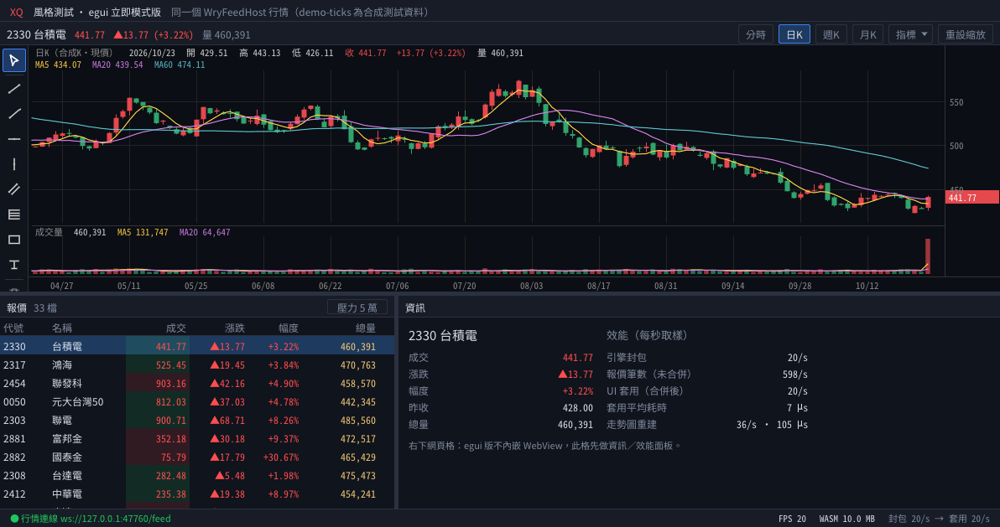
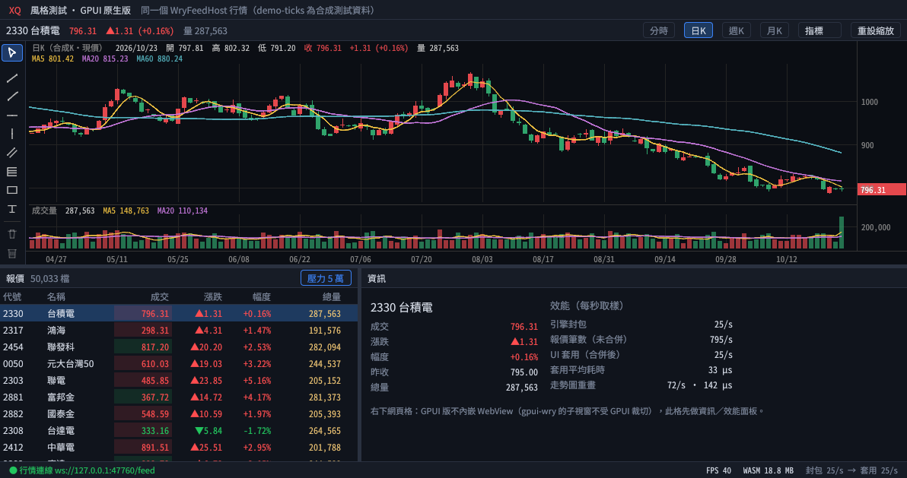
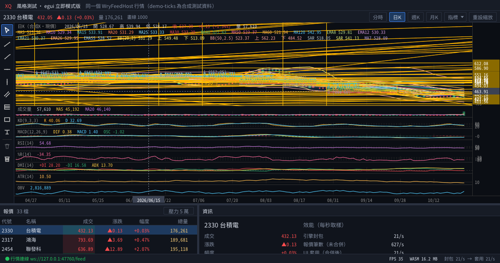
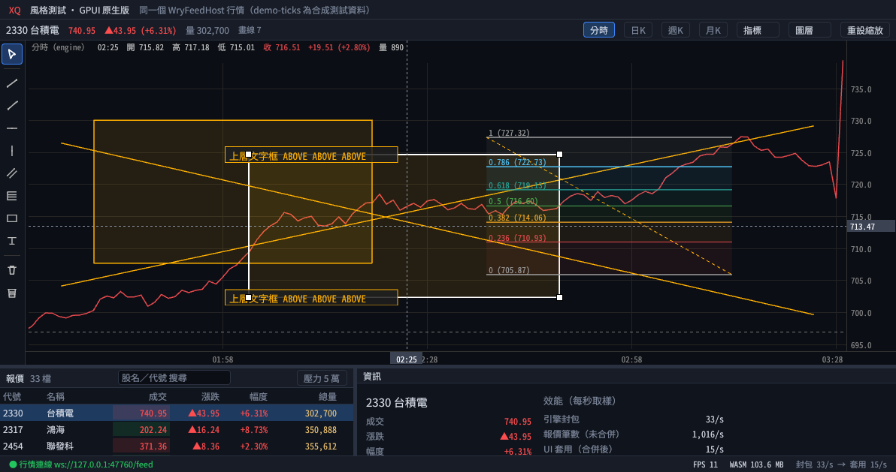
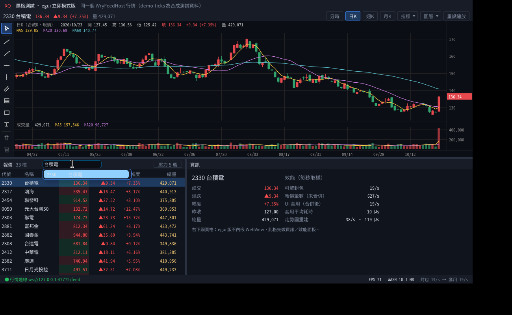
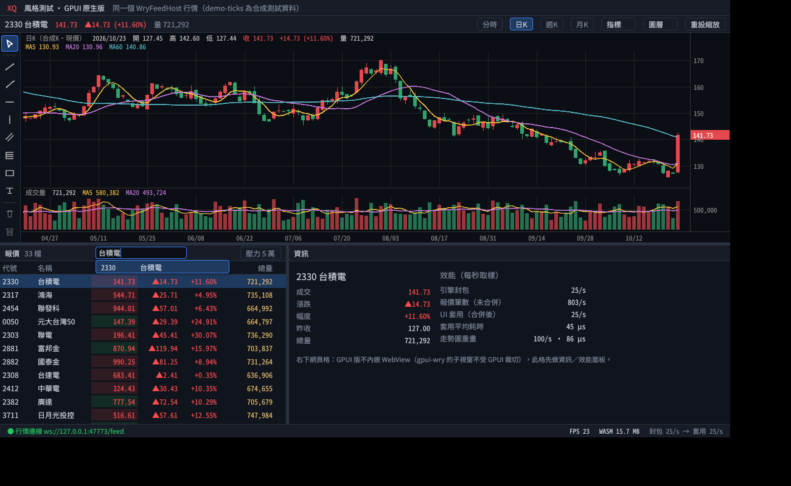
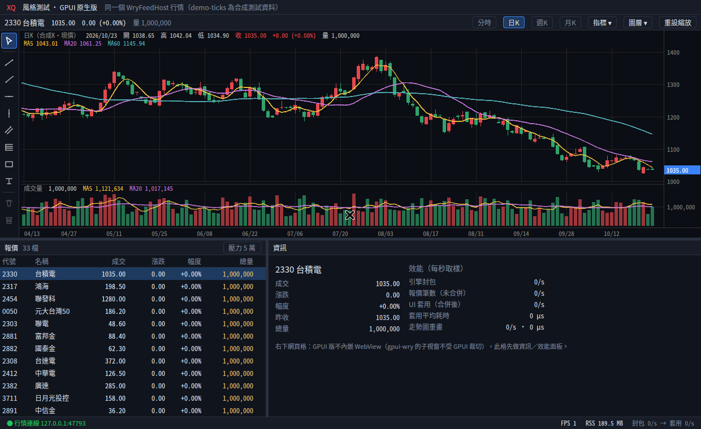
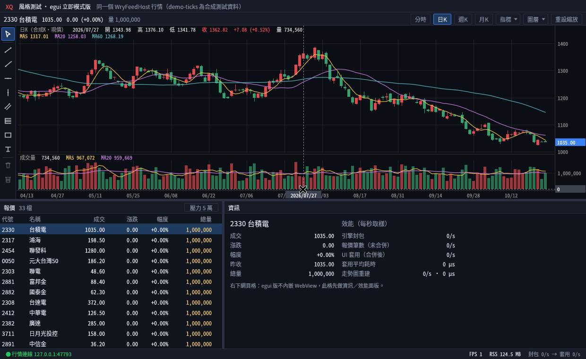
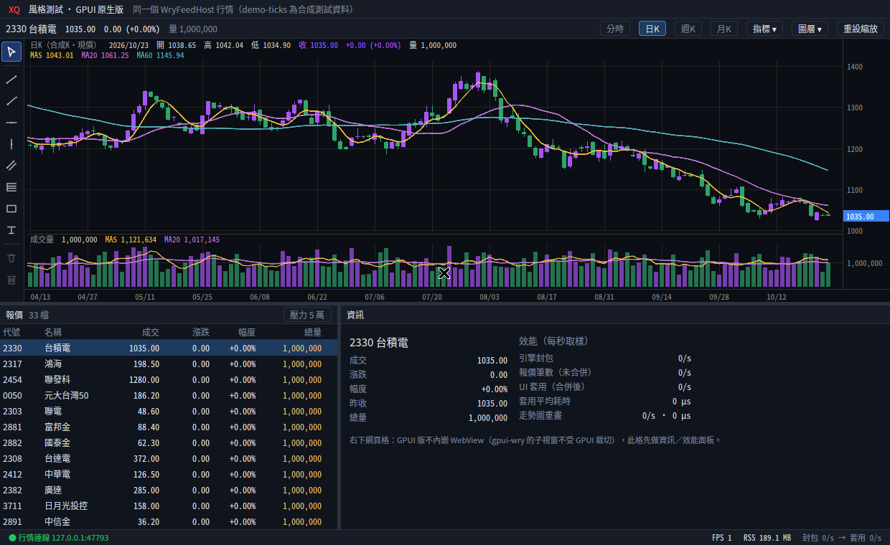
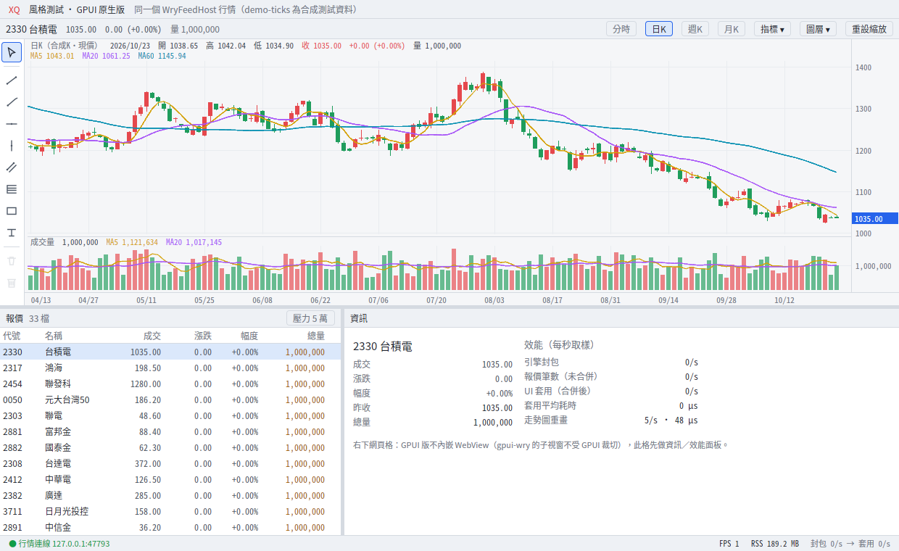

# egui-xq-demo — XQ 風格看盤（Rust + egui／eframe 立即模式版）

與 [`gpui-xq-demo`](https://github.com/tina-moneydj/gpui-xq-demo)（GPUI 原生繪圖）、[`wry-xq-demo`](https://github.com/tina-moneydj/wry-xq-demo)（tao + wry，HTML/JS）
**同版面、接同一個行情來源**：`WryFeedHost`（.NET，`127.0.0.1:47631`）。協議 crate `xq-feed` 直接沿用 gpui-xq-demo 的（Cargo git 依賴，鎖定 rev）。
走勢圖的狀態、指標、畫線邏輯（`model.rs`／`indicators.rs`／`drawings.rs`／`series.rs`）是從 GPUI 版**原樣移植**，三版算的東西一樣，只差畫面框架。

> **main 現在有什麼（2026-10-24 合併，台北時間）**
> - **egui 拍板前的四項驗證（10-25 深夜）**：中文字與輸入法、視覺（含 egui 和網頁元件共用 token）、多視窗、大型程式結構，驗證清單與雲端結果見 [docs/egui-weakness-check.md](docs/egui-weakness-check.md)；驗證小程式 `cargo run --release --example probe`。
> - **最新（10-25 晚上）**：「[Mac 只跑重圖表](#mac-只跑重圖表記憶體修正確認2026-10-25-晚上)」確認記憶體修正有效，GPUI 重圖表 321 → 115 MB，變成最省。
> - **選型最新結論（10-25 下午）**先看「[Windows 重跑＋Mac 第三次](#windows-重跑mac-第三次2026-10-25-下午gpui-vs-egui-門檻判定)」：延遲兩台都追平到 egui 的 2–3 ms 內，Windows 效率（CPU 約 2 倍、捲動卡頓）還沒過，維持「GPUI 有條件」。第一次實測見「[一般客戶電腦實測：Mac／Windows](#一般客戶電腦實測macwindows2026-10-23gpui-vs-egui)」：在 Tina 的兩台一般客戶電腦（Mac M4 內建 GPU、Windows 入門獨顯 GTX 1650）上，GPUI 和 egui 的 FPS、單視窗延遲打平；**CPU／GPU 用量和多視窗是 egui 明顯較好**。
> - 同一份程式碼現在可以編成三種：**桌面版**、**網頁版**（WebAssembly，見「[網頁版](#網頁版webassemblyegui-與-gpui-都有)」）、**Android／iOS 手機版**（`mobile/`，iOS 見「[手機版（iOS）](#手機版ios2026-10-25-新增egui-和-gpui-一起做)」；見「[手機版](#手機版android2026-10-23-新增egui-和-gpui-一起做)」）。
> - 顏色、字級等改讀和 GPUI 版**共用的設計 token**（見「[設計 token](#設計-token一套設計規範eguigpui-兩版共用2026-10-23)」），按 F8 切深色／淺色。


| 5 萬列報價表壓測 | 重圖表（20 疊加＋8 副圖＋1000 畫線） |
|---|---|
|  |  |

## Mac 只跑重圖表：記憶體修正確認（2026-10-25 晚上）

### 結論先看

- 🏆 **Mac 重圖表記憶體問題解決，Tina 的 M4 上確認**：GPUI 重圖表 RSS **321 → 115 MB**，實體記憶體 **370 → 159 MB**；vmmap 那塊 201 MB 的「Malloc Large (empty)」消失。
- 🏆 **GPUI 變成重圖表最省記憶體**（3 輪中位數，跳價段）：

  | 項目 | GPUI（修正開） | GPUI 修正關（對照） | egui wgpu | egui OpenGL |
  |---|---:|---:|---:|---:|
  | RSS | **115.2 MB** 🏆 | 321.2 MB | 131.5 MB | 134.0 MB |
  | 實體記憶體 | **158.5 MB** 🏆 | 370.4 MB | 189.5 MB | 203.3 MB |
  | FPS | 60 ＝ | 60 ＝ | 60 ＝ | 62.8 ＝ |
  | CPU | 32.0 % | 31.1 % | 35.6 % | **25.3 %** 🏆 |

- **代價**：CPU 多 1–6 個百分點（十字線段 35.6 vs 29.7 %），FPS 不變，每幀繪圖多 0.1–0.4 ms。CPU 最省的仍是 egui OpenGL。
- **對選型**：「Mac 重圖表記憶體 GPUI 2.4 倍」這個缺點消除。剩下沒過的是 Windows 效率（CPU／GPU 約 2 倍、5 萬列捲動卡頓），整體仍是「**GPUI 有條件**」。
- 細節：[docs/bench/real-hw/2026-10-25-mac-heavy/](docs/bench/real-hw/2026-10-25-mac-heavy/README.md)。

## Windows 重跑＋Mac 第三次（2026-10-25 下午）：GPUI vs egui 門檻判定

### 結論先看

- **判定：延遲過關、效率沒過 → 維持「GPUI 有條件」。** 不翻盤成 egui（多視窗已追平到差 2–3 ms），但 Windows 的 CPU 和捲動卡頓沒解決，也還不能正式定 GPUI。
- 4 個視窗（Tina 的兩台電腦，3 輪中位數）：

  | 項目 | GPUI | egui OpenGL | egui wgpu |
  |---|---:|---:|---:|
  | Windows 延遲 p99 | 36.0 ms（10-23：64.3） | **33.4 ms** 🏆 | **33.9 ms** 🏆 |
  | Windows 最慢視窗 p99 | 37.3 ms | **33.9 ms** 🏆 | 44.8 ms |
  | Windows CPU | 44.1 % | **27.7 %** 🏆 | 32.1 % |
  | Windows GPU 3D | 21.7 % | **4.6 %** 🏆 | 8.7 % |
  | Mac 延遲 p99 | 35.6 ms | **34.1 ms** 🏆 | **33.6 ms** 🏆 |
  | Mac 最慢視窗 p99 | 36.4 ms | 36.9 ms | **34.5 ms** 🏆 |

- **Windows 5 萬列捲動**：GPUI 51 FPS、卡頓 63 次（沒改善）；egui OpenGL 6 輪有 4 輪掉到約 12 FPS；🏆 egui wgpu 6 輪都 60 FPS、0 次。
- **0.5 秒停頓結案**：不是 GPUI 卡住（Mac 看門狗「只有主執行緒卡住」0 次）。
- **Mac 重圖表多 200 MB 找到原因**：不是 Metal，是 malloc 已 free 但沒還給系統的大塊（201 MB），可以在我們這層修。（**10-25 晚上已修好並在 M4 確認**：321 → 115 MB，見上一節。）
- 細節：[Windows](docs/bench/real-hw/2026-10-25-windows/README.md)、[Mac 第三次](docs/bench/real-hw/2026-10-25-mac-2/README.md)。

## Mac 重跑＋GPUI 優化第 3 批（2026-10-25）

### 結論先看

- 🏆 **多視窗修好，Mac 勉強通過門檻**：MacBook Air M4 上 4 個視窗，GPUI 和 egui 的比較：

  | 項目 | GPUI 第一次 | GPUI 這次 | egui wgpu | egui OpenGL |
  |---|---:|---:|---:|---:|
  | 延遲 p50 | 44.8 ms | 31.1 ms | 25.3 ms | 18.0 ms |
  | 延遲 p99 | 49.6 ms | 35.4 ms | 33.5 ms | 33.4 ms |
  | 最慢視窗 p99 | 50.1 ms | 35.8 ms | 35.3 ms | 35.9 ms |

  最慢視窗已經和 egui 平手。**Windows 還沒重跑**。
- **「GPUI 每次高頻測試停 0.3–0.5 秒」不是畫面真的卡住**，有兩個來源：
  - GPUI 版量測程式的假象：報價停了之後，最後一包要等到每秒一次的取樣才補記時間（本 repo 的 egui 版會主動排重畫，所以沒有）。已在 Linux 重現並修好。
  - 壓測包自己的 vmmap 暫停程式約 0.5 秒，發生在量測區間外。
  - p50／p99 不受影響。
- **重圖表記憶體還是 GPUI 輸**（321 vs 131 MB）。（**10-25 晚上已修**：GPUI 115 MB，變成最省。）（10-25 下午更正：多出來的是 malloc 已 free 但沒還給系統的大塊，不是 Metal，見上一節。）
- 新加的：
  - 所有視窗關掉 GPUI 的背景視窗限速（`inactive_frame_interval: None`）。
  - macOS 申請延遲敏感模式。
  - 停頓看門狗（卡住就自動抓呼叫堆疊）。
  - 壓測包多一欄「GPUI 舊設定」對照。
- 細節：[docs/bench/real-hw/2026-10-25-mac/](docs/bench/real-hw/2026-10-25-mac/README.md)。

## 一般客戶電腦實測：Mac／Windows（2026-10-23，GPUI vs egui）

> Tina 在兩台一般客戶等級的電腦上跑壓測包，**不是高階顯卡機**：MacBook Air M4（Apple 內建 GPU、Retina 60 Hz）、Dell Inspiron 3020 桌機（i7-13700；由 **NVIDIA GTX 1650 入門獨立顯卡**繪圖，另有 Intel UHD 770 內顯未使用；2 個 1920×1200 螢幕、59 Hz）。
> 每項 3 輪取中位數；差距 5% 以內算平手；FPS 兩邊都到螢幕上限算平手。完整數字與診斷：[docs/bench/real-hw/](docs/bench/real-hw/README.md)。

### 結論先看

| 項目 | Mac M4 | Windows i7-13700 |
|---|---|---|
| 單視窗報價延遲 p50／p99 | **平手**：GPUI 30.6–32.7／35.2–36.2 ms；egui 30.4–32.1／33.4–36.7 ms | **平手**：兩邊約 31／34 ms |
| 重圖表 1000 條畫線、100 層 FPS | **平手**：三版都 60 | 壓測包逾時沒有正式數字；log 裡兩邊都約 60 |
| 開啟到第一筆報價 | 🏆 **GPUI** 190.5 ms（egui 246–248） | 🏆 **egui** 192 ms（GPUI 316） |
| 一般畫面記憶體 | 🏆 **GPUI** RSS 101 MB（egui 116–121） | 大致平手（Working Set 74 vs 77.5 MB） |
| 重圖表記憶體 | 🏆 **egui** 131–141 MB（GPUI 321–329；**10-25 晚上修好後 GPUI 115–121 MB 🏆**） | 🏆 **egui** 約 78 MB（GPUI 100–115，取自 log） |
| CPU（高頻報價） | 🏆 **egui OpenGL** 6–7%（GPUI 30–35%；egui wgpu 23–35%） | 🏆 **egui** 8.9–13.6%（GPUI 20.8–25.2%） |
| GPU 使用率／GPU 記憶體 | 整機數字，只當參考 | 🏆 **egui**：GPUI 是 2.3–5 倍／2.3–2.8 倍 |
| 4 個視窗 延遲 p50／p99 | 🏆 **egui** 17.6／33.4 ms（GPUI 44.8／49.6） | 🏆 **egui** 21.8／33.7 ms（GPUI 43／64.3，57–58 FPS） |
| 5 萬列捲動 | 都到 60 FPS；卡頓 GPUI 2 次、egui 0 | 🏆 **egui** 60 FPS、0 次（GPUI 51.7 FPS、70 次） |

- **和 Linux 沒顯卡的結果比**：GPUI 的 FPS 和單視窗延遲差距**在一般電腦上消失了**（Linux GPUI 延遲中位數 74–75 ms、重圖表約 21 FPS → 這裡約 31 ms、60 FPS）。但 **CPU／GPU 用量和多視窗**，egui 仍然明顯較好，Windows 上最明顯。
- **選型建議改成「GPUI 有條件」**：GPUI 沒有做不到的事（60 FPS、0 掉筆、延遲一樣），但效率約差 2 倍、多視窗落後。先修我們自己程式的三項（多視窗晚一幀、報價表改自己畫、水平垂直線改矩形），再請 Tina 在同兩台重跑；如果多視窗和 Windows CPU 還是明顯落後，看盤核心就改用 egui。
- **GPUI 每次高頻測試有一次 0.3–0.47 秒停頓**（egui 沒有）。**10-25 查明：GPUI 版量測假象＋壓測包 vmmap，畫面沒有真的卡住**（見上面）。
- 細節、框架限制 vs 可修項目、測試包本身的錯（Windows 重圖表逾時、Mac 摘要勝負標錯）：見 [docs/bench/real-hw/README.md](docs/bench/real-hw/README.md)。

## 網頁版（WebAssembly，egui 與 GPUI 都有）

> 2026-10-24 已合併到 main。同一份程式碼編成 `wasm32-unknown-unknown`，在瀏覽器裡跑同一個主畫面：
> 5 萬列報價表、重圖表、可拖曳分隔線、狀態列、搜尋框（注音可打）、內嵌中文字型。行情透過 `xq-ws-bridge`（TCP 47631 ⇄ WebSocket）進瀏覽器，**解碼還是原生那份 `xq-feed`**。

### 結論先看

- **兩個都真的跑得起來，而且功能跟原生一樣。** GPUI 網頁版不是實驗品：Zed 官方 2026-02 已合併 `gpui_web`（證據見下）。這台沒顯卡，兩版都走 WebGL2（Chrome 的 ANGLE＋軟體 llvmpipe）。
- **下載量：egui 較小 🏆** — gzip 後 egui **4.2 MB**、GPUI **6.0 MB**（其中 2.5 MB 是兩版共用的中文字型子集）。
- **開啟速度：egui 較快 🏆** — 瀏覽器已開好、檔案在本機時，到第一筆報價 egui 0.40 秒、GPUI 0.60 秒（原生 0.15／0.41 秒）。
- **報價延遲：egui 較低 🏆** — 中位數 egui 網頁 **32 ms**（≈ egui 原生 31 ms）、GPUI 網頁 **48–51 ms**（**比 GPUI 原生 74–75 ms 還快**：這台的瀏覽器 WebGL 比原生的軟體 Vulkan 快）。每秒 10 萬筆兩版都 **0 掉筆**。p99 網頁版約 60–70 ms（原生 36–39 ms），多了瀏覽器排程的抖動。
- **捲動順暢：GPUI 較好 🏆** — 5 萬列邊跳價邊捲，卡頓次數 GPUI 20、egui 167（egui 原生只有 1）；捲動 FPS GPUI 49、egui 42。
- **重圖表 FPS：egui 較高 🏆** — 33 vs 26（原生 42 vs 21）。
- **記憶體：網頁版都比原生多很多，也比 wry 多** — 整個 Chrome 加起來 egui 546、GPUI 580 MB PSS（原生 87／150、wry 402）。但**空白 Chrome 本身就 423 MB**，扣掉後程式本身約 egui 120、GPUI 150 MB；wasm 記憶體只有 10／15 MB（重圖表 16／54 MB）。
- **圖層／上下順序在網頁版正常**（截圖見下），但拖曳／改順序比原生慢很多：單次冒煙測試拖曳 FPS egui 10、GPUI 5（原生 56／10），每次重建約 3 ms（原生約 0.3 ms）。只跑一次、每段 3 秒，**當方向參考，不是正式數字**。
- **怎麼選：** 要網頁版的話 egui 比較划算（小、快、延遲低）；GPUI 網頁版能用，捲動較順，但檔案大、延遲較高。**網頁版共同的代價**是多一個瀏覽器的記憶體、只有一個視窗、要有 WebSocket 轉接（見「做不到的地方」）。

> **注意事項（重要）**：這台 **沒有 GPU**，Chrome 155 用 WebGL2 on ANGLE＋Mesa llvmpipe（軟體繪圖）；FPS 和「CPU 全部」主要反映軟體繪圖速度，有顯卡時會高很多、低很多。
> 「CPU 扣軟體繪圖」＝扣掉 llvmpipe 執行緒後的 CPU。開啟時間是「瀏覽器已開、檔案在本機（不含網路下載時間）」，原生是「程式啟動→」，兩者起點不同。
> 記憶體用 **PSS**（共用頁面按比例分攤，Chrome 多行程時才不會重複算），RSS 也列了。
> 測試期間 VM 有數次暫停（box 時間跳 4–5 分鐘），受影響的 3 個場次已重跑；另一組「box 很吵時」的數據（同時有別的壓測，負載 6–10）放在 `2026-10-23-contended/`，結論相同。

### 數字（3 輪中位數，box 安靜時；`docs/bench/web/2026-10-23-quiet/`）

原生三欄取自 `docs/bench/2026-10-21-parity`（同一台、同樣的場景）。

#### 主視窗（33 檔自選、日K＋MA＋量，demo-ticks 行情）

| 項目 | egui 網頁 | GPUI 網頁 | egui 原生 | GPUI 原生 | wry（WebKitGTK） |
|---|---|---|---|---|---|
| 開啟→第一筆報價 (秒) | 0.40 | 0.60 | 0.15 | 0.41 | 0.89 |
| PSS 60 秒 (MB) | 546 | 580 | 87 | 150 | 402 |
| RSS 60 秒 (MB) | 1,233 | 1,268 | 124 | 185 | 627 |
| 　其中 wasm 記憶體 (MB) | 10 | 15 | — | — | — |
| CPU 全部 (%) | 128 | 221 | 56 | 247 | 171 |
| CPU 扣軟體繪圖 (%) | 14 | 20 | 4 | 19 | 70 |
| FPS | 19.4 | 19.8 | 23.9 | 26.0 | 59.7 |

#### 5 萬列報價表（每秒 3000 筆合成跳價 30 秒，再邊跳邊捲 10 秒）

| 項目 | egui 網頁 | GPUI 網頁 | egui 原生 | GPUI 原生 | wry（WebKitGTK） |
|---|---|---|---|---|---|
| 跳價 FPS | 33.5 | 40.4 | 54.5 | 32.2 | 59.7 |
| 捲動 FPS | 42.0 | 49.1 | 85.4 | 32.4 | 59.9 |
| 捲動卡頓次數（>16.7ms×2） | 167 | 20 | 1 | 154 | 1 |
| 跳價 CPU 全部／扣軟體繪圖 (%) | 232／25 | 447／35 | 126／12 | 299／22 | 182／67 |
| PSS 跳價中 (MB) | 546 | 582 | 93 | 154 | 397 |

#### 重圖表（20 疊加＋8 副圖＋1000 條畫線，每幀跳價／十字線／平移各 10 秒）

| 項目 | egui 網頁 | GPUI 網頁 | egui 原生 | GPUI 原生 | wry（WebKitGTK） |
|---|---|---|---|---|---|
| 開啟→重圖表第一幀 (秒) | 0.80 | 1.00 | 0.48 | 0.68 | 1.23 |
| FPS 跳價／十字線／平移 | 32.7／33.3／33.8 | 26.4／26.9／25.9 | 41.8／39.6／41.7 | 20.5／20.7／20.8 | 36.1／36.5／26.2 |
| CPU 全部 (%)（十字線段） | 488 | 559 | 226 | 353 | 255 |
| CPU 扣軟體繪圖 (%)（十字線段） | 61 | 60 | 53 | 33 | 131 |
| PSS（十字線段，MB） | 634 | 658 | 104 | 186 | 485 |
| 　其中 wasm 記憶體 (MB) | 16 | 54 | — | — | — |

#### 高頻報價（xq-tickgen，5 萬列表＋2330 日K；延遲＝產生器送出→畫面，中位數／p99，ms）

| 項目 | egui 網頁 | GPUI 網頁 | egui 原生 | GPUI 原生 | wry（WebKitGTK） |
|---|---|---|---|---|---|
| 每秒 1 千筆 延遲 | 32／65 | 48／60 | 30／36 | 75／79 | 46／54 |
| 每秒 1 萬筆 延遲 | 32／64 | 49／61 | 31／39 | 74／79 | 47／66 |
| 每秒 5 萬筆 延遲 | 32／64 | 51／72 | 31／36 | 74／80 | 49／67 |
| 每秒 10 萬筆 延遲 | 32／64 | 49／64 | 31／37 | 75／82 | 51／66 |
| 開盤爆量（前 3 秒約 30 萬筆） 延遲 | 31／64 | 49／61 | 30／34 | 46／80 | 46／58 |
| 每秒 10 萬筆 掉筆 | 0 | 0 | 0 | 0 | 0 |
| 每秒 10 萬筆 CPU 全部／扣軟體繪圖 (%) | 331／52 | 407／53 | 154／24 | 300／30 | 225／111 |
| 每秒 10 萬筆 FPS | 54.0 | 39.0 | 61.0 | 32.0 | 55.0 |
| 每秒 10 萬筆 PSS 結束 (MB) | 554 | 603 | 105 | 164 | 571 |

### 下載量（`dist/web`，wasm-opt -O3 之後）

| | wasm | wasm gzip | js（膠水碼） | js gzip | 其中中文字型 |
|---|---|---|---|---|---|
| **egui 網頁** 🏆 | 7.5 MB | **4.2 MB** | 86 KB | 12 KB | 3.0 MB（gzip 2.5 MB） |
| GPUI 網頁 | 13.0 MB | 6.0 MB | 160 KB | 23 KB | 同上 |
| 參考：原生執行檔 | egui 13.0 MB／GPUI 25.5 MB／wry 1.7 MB（另需系統 WebKitGTK） | | | | |

- 字型：Noto Sans CJK TC 子集（Big5 常用字 5,401 字＋Big5 符號＋注音＋程式裡出現的所有字，共 6,762 字），另加 13 KB 的等寬英數字。罕用字會變方塊；完整字型約 16 MB。
- 數字是合併 main（畫線圖層）之後重建的大小；壓測時用的是合併前的版本（egui 7,475,729／GPUI 12,908,932 bytes，差不到 1%）。

### 截圖

| egui 網頁 | GPUI 網頁 |
|---|---|
|  |  |
|  |  |
|  |  |
| 圖層正確性（上層文字框蓋住選取中的矩形）<br> | <br> |
| 注音輸入（fcitx5＋新酷音，打「台積電」）<br> | <br> |
| 選字後搜尋結果<br> | <br> |

**注音輸入**：兩版都可以在網頁搜尋框用注音打字（Linux Chrome＋fcitx5 新酷音，`GTK_IM_MODULE=fcitx`），打「台積電」後出現 2330。這次只測了直接送字；候選字視窗的位置沒有驗證（這台截圖看不到 fcitx 的候選窗）。

### GPUI 網頁版：實際狀況（查證＋實測）

先更正之前的說法（「GPUI 網頁版還不能拿來做產品、只有社群實驗移植」）——**這已經過時**：

| 證據 | 內容 |
|---|---|
| Zed 官方 PR [#50228 GPUI on the web](https://github.com/zed-industries/zed/pull/50228) | 2026-02-26（台北時間 02-27）由 Zed 員工合併，新增 `crates/gpui_web`：`wasm32-unknown-unknown`、一張 canvas＝一個視窗、**WebGPU 優先、自動退回 WebGL2**、可選的 Web Worker 多執行緒模式 |
| 我們用的 `gpui-pre 0.3.7` | 同一組快照就有 `gpui-pre-web 0.3.7`（crates.io；最新 0.3.9），不用換 GPUI 版本 |
| 長橋 gpui-kit（原 gpui-component） | PR [#2102](https://github.com/longbridge/gpui-component/pull/2102)（huacnlee，2026-02-27）用 gpui_web 做網頁版元件展示；現在官網 [gpui-kit.com/gallery](https://gpui-kit.com/gallery/) 就是 wasm。當時 PR 自己列的待辦：沒有 app 選單（`set_menus`）、tree-sitter 編不進 wasm、**中文字型要自己內嵌** |
| 社群打包 | `gpui-web-gpui-unofficial`（gpui-archipelago，跟著 Zed 版本自動發佈，1.25.2） |

**我們的實測：GPUI 版 demo 整套編得過、跑得起來，功能跟原生一樣**（報價表 5 萬列、重圖表 1000 畫線、分隔線拖曳、搜尋框、行情）。過程中遇到、已解決的：

1. 第一次直接 `cargo build --target wasm32-unknown-unknown` 失敗：
   ```
   error[E0554]: `#![feature]` may not be used on the stable release channel
    --> wasm_thread-0.3.3/src/lib.rs:1:37
   ```
   原因：`gpui_platform` 會開 `gpui_web` 的預設 feature `multithreaded`（`wasm_thread`，要 nightly＋atomics＋SharedArrayBuffer）。
   解法：wasm 時不經過 `gpui_platform`，直接依賴 `gpui_web`（`default-features = false`），用 `WebPlatform::new(false)` 單執行緒。
   （長橋官網的 wasm 也是用 nightly 編多執行緒版。）
2. `std::time::Instant::now()`、`SystemTime::now()` 在 wasm32 會 panic → 換成 web-time（`plat.rs`）。
3. 原生的行情是背景執行緒＋TCP → 網頁版改成 WebSocket（`xq-ws-bridge` 轉送），解碼還是同一份 `xq-feed`。
4. 瀏覽器沒有系統的 Noto Sans CJK → 內嵌子集字型（`cx.text_system().add_fonts`）。
   gpui_web 其實會在缺字時退回瀏覽器 canvas 畫字（`CanvasFontFallback`），但為了跟原生同字型、同排版，這裡兩版都內嵌同一份子集。
5. 這台沒有 GPU：Chrome 有 `navigator.gpu` 但拿不到 adapter，gpui_web 印 `WebGPU initialization failed; falling back to WebGL2` 後改用 WebGL2（ANGLE＋Mesa llvmpipe）；
   另外 `Dual-source blending not available … Subpixel text antialiasing will be disabled`（文字少了次像素反鋸齒，原生 Linux 也一樣是灰階）。
   另外試了 Chrome 的軟體 WebGPU（`--enable-unsafe-webgpu --use-webgpu-adapter=swiftshader`）：gpui_web 印 `Browser graphics initialized successfully with BrowserWebGpu`，但截圖整片白（`docs/bench/web/webgpu-swiftshader-try.png`，只在 gpui repo），沒再深究、也沒壓測；上面的數字都是 WebGL2。

gpui_web 目前**做不到**的（原始碼 `gpui_web/src/platform.rs`）：第二個視窗／彈出視窗／浮動視窗（回 `WebWindowError`）、原生選單（`set_menus` 空實作）、
檔案對話框（`prompt_for_paths` 回「not supported on the web」）、`reveal_path`、防休眠、結束程式。輸入法走隱藏 `<textarea>`（`ime_mirror.rs`）。

### 一頁嵌多個 egui 元件（2026-10-25 可行性）

**有條件可行**：同一個 html 頁面放 4 個 `<canvas>`、各一個 `eframe::WebRunner`（報價表、K 線、兩個計數器），四格都會畫、都會動，共用同一份 wasm 時總下載量和一個元件一樣（gzip 約 4.2 MB）。
條件：eframe 的全域 panic hook 會讓「一格 panic 全部停」，要在全部啟動後換掉 hook；移除元件要呼叫 `destroy()`。細節、數字、沒驗的事：[docs/web-multi.md](docs/web-multi.md)；範例：[`examples/web-multi/`](examples/web-multi/)。
也可以和一般 HTML 穿插（預設版面：左上報價、右上／左下網頁、右下 K 線）；同樣的頁面 GPUI 也做了（每個元件各自一份 wasm instance，穿插版面記憶體 24.8 MB 對 egui 8.9 MB），並放進 Mac／Windows 實機壓測包的 `web` 情境。

### 網頁版做不到、或跟原生不一樣的地方（兩版共通）

| 原生有 | 網頁版 |
|---|---|
| 多視窗（`XQ_WINDOWS=N`） | **不行**：一個分頁只有一張 canvas。要多視窗只能開多個分頁／視窗，各自一份 wasm＋一條行情連線（不共用報價表）。程式裡強制 1 |
| 直接連行情 TCP 127.0.0.1:47631 | 瀏覽器不能開 TCP → 要 `xq-ws-bridge`（或引擎本身提供 WebSocket）。多一跳，本機實測 <1 ms（網頁版與原生的延遲差都在 ±1 ms 內） |
| 系統字型（mmap Noto Sans CJK，0 下載） | 要內嵌或下載字型：子集 3.0 MB（Big5 常用字＋注音），罕用字會變方塊；完整字型約 16 MB |
| 背景執行緒解碼行情 | 單執行緒：解碼、合併、畫面都在瀏覽器主執行緒（多執行緒 wasm 要 nightly＋COOP/COEP，未做） |
| 存檔 `~/.local/share/...` | 沒有檔案系統（這版不存；要存得改用 localStorage／IndexedDB） |
| 記憶體只有程式本身 | 要加上整個瀏覽器：**空白分頁的 Chrome 本身就 423 MB PSS**（開一張 WebGL2 canvas 431 MB；3 次中位數，`2026-10-23-chrome-baseline/`） |
| 原生選單、系統匣、檔案對話框、內嵌網頁格 | 沒有（瀏覽器本身就是網頁，所以「內嵌網頁」反而可以用一般 HTML 疊上去，但 canvas 上的元件無法和 DOM 混排） |
| 無障礙、文字選取、Ctrl+F 搜尋頁面 | 整個畫面是一張圖，瀏覽器看不到裡面的文字（egui 有實驗性 AccessKit→DOM，這版沒開） |
| 沒有 GPU／驅動被 Chrome 列入黑名單的電腦 | **畫面全黑**：Chrome 預設不讓軟體 OpenGL 開 WebGL（`WebGL2 blocklisted`），要加 `--ignore-gpu-blocklist` 才會畫（本測試有加）。一般有顯卡的電腦沒問題，但虛擬桌面／遠端桌面環境要先試 |


### 怎麼建置、怎麼跑

```bash
# 一次性：wasm 目標、wasm-bindgen（版本要跟 Cargo.lock 一樣，現在是 0.2.129）、binaryen 的 wasm-opt（可省略，省略就不最佳化）
rustup target add wasm32-unknown-unknown
cargo install wasm-bindgen-cli --version 0.2.129

# 建置（stable Rust 即可；輸出到 dist/web/）
WASM_OPT=/path/to/wasm-opt ./web/build.sh

# 轉接＋網頁伺服器（在 gpui-xq-demo repo：crates/xq-ws-bridge）
cargo run --release -p xq-ws-bridge -- --listen 127.0.0.1:8080 --feed 127.0.0.1:47631 --www dist/web
# 瀏覽器開 http://127.0.0.1:8080/index.html
```

- **網址參數＝原生的環境變數**：例如 `?XQ_PERIOD=D`、`?XQ_BENCH=1`、`?XQ_CHART_STRESS=1&XQ_CHART_LAYERS=100`、`?XQ_FEED_WS=ws://主機:埠/feed`（預設連同一個網址的 `/feed`）、`?XQ_SEARCH=0`（關搜尋框）。
- `xq-ws-bridge`：同一個埠同時提供網頁檔（`--www`，帶 `Cache-Control: no-store` 與 COOP/COEP 標頭）和 WebSocket 轉接（原封不動轉送位元組）。
- 壓測（在 gpui-xq-demo repo 的 `scripts/web/`，用 puppeteer-core 開系統 Chrome）：`OUT=輸出資料夾 ./run-all.sh 3` → `summarize.py 輸出資料夾` → `tables.py 輸出資料夾/summary.json docs/bench/2026-10-21-parity`。
  單場：`node bench-web.js <egui|gpui> <main|stress|heavy|ticks:s1k|…|ticks:burst> <輪次> <輸出資料夾>`。另有 `chrome-baseline.js`（空白 Chrome 記憶體）、`layers-smoke.js`（圖層冒煙測試）、`ime-web.sh`（注音）、`webgpu-try.js`（WebGPU 試跑）。
- 原始數據：`docs/bench/web/`（`results.jsonl` 每場一行、`summary.json` 中位數、`progress.log`、每場瀏覽器 console log、`contention.log` 每 10 秒的系統負載）。

## 手機版（iOS）（2026-10-25 新增，egui 和 GPUI 一起做）

**結論**：兩個 app 都有 iOS 版，已合進 `main`。GitHub 雲端 Mac（Xcode 26.6、iOS 26.2 模擬器）每次都會編模擬器版和 iPhone 版，並在模擬器裡把 app 打開截圖；兩版都能正常開、中文正常、行情會跳。**還沒在真的 iPhone 上試過，也還沒用 Xcode 27 編過**（雲端還沒有）。

- **怎麼裝到自己的 iPhone（非開發者也可以）**：照 [bench/ios/README.md](bench/ios/README.md)。裝好 Xcode 後，在「終端機」貼一行：
  ```
  curl -fsSL https://raw.githubusercontent.com/tina-moneydj/gpui-xq-demo/main/bench/ios/get.sh | bash -s egui
  ```
  它會下載程式碼、裝 Rust、先編一次、打開 Xcode 專案；接著在 Xcode 選自己的 Apple ID（免費 Personal Team）、接上 iPhone、按 ▶。免費帳號每 7 天要重按一次 ▶；公司付費帳號可以改走 TestFlight（說明附錄 B，需要的金鑰之後再設）。
- **只想先看看**：[ios-latest](https://github.com/tina-moneydj/egui-xq-demo/releases/tag/ios-latest) 有模擬器用的 app（`XQEGUI-simulator.zip`，只能裝到 Mac 上的 iPhone 模擬器）和雲端模擬器截圖。由 `main` 自動更新。
- **跟 Android 版一樣**：報價表、點一列進走勢圖、單指拖／雙指縮放／長按十字線、搜尋框、FPS／記憶體、封包計數；共用 `../src` 的程式碼與設計 token。
- **行情**：手機上沒有電腦的行情服務，app 內建合成行情（假資料）。要連 Mac 上的行情服務設 `XQ_FEED_ADDR`（見說明）。
- **中文字**：iOS 26 的蘋方是 egui 畫不出來的新格式（hvgl），所以中文用系統內建的冬青黑體＋app 內附的 Noto Sans TC 補字，都用 mmap，不整個讀進記憶體。
- **畫面更新不看焦點**：控制中心、通知蓋住時照畫，只有進背景才停（Android 版「失焦就凍住」的問題不會發生；待真機確認）。
- **接法**：eframe／winit 還不支援 iOS 27 規定的 UIScene，所以不用 eframe：Swift UIScene 外殼建 CAMetalLayer，`mobile/src/ioshost.rs` 用 egui 核心＋egui-wgpu（Metal）直接畫。Xcode 專案由 XcodeGen 產生並放進 repo（`mobile/ios/XQEGUI.xcodeproj`），一鍵腳本 `mobile/ios/setup-mac.command`。
- **還缺**：真機測試、Xcode 27 建置、「自訂指標腳本」（兩個 repo 都還沒有這功能）、egui 的注音／拼音組字、直向 iPhone 上走勢圖工具列會壓到股價文字。CI：`.github/workflows/ios.yml`。

## 手機版（Android）（2026-10-23 新增，egui 和 GPUI 一起做）

> 程式在 `mobile/` 資料夾（2026-10-24 合併到 main）。原始數據在 [`docs/bench/mobile/2026-10-23/`](docs/bench/mobile/2026-10-23/)（`summary.md` 是中位數表，`results.jsonl` 是每一輪原始值）。

### 結論先看

1. **兩個都能在 Android 上跑，功能一樣**：5 萬列報價表（手指甩動捲動）、點一列進走勢圖、雙指縮放、單指平移、長按出十字線、1000 條畫線／100 層的重圖表、中文字型、搜尋框。GPUI 用的是長橋（Longbridge）社群版 `gpui-mobile`，**不是 Zed 官方**；圖表邏輯照搬，沒有改寫。
2. **在這台模擬器上，egui 幾乎每一項都贏** 🏆：畫面更新快 2～4 倍、記憶體約一半、APK 約一半、每秒 1 千筆時的報價延遲約 1/4。啟動速度差不多（egui 12.2 秒、GPUI 13.7 秒）。
3. **不只是 GL 和 Vulkan 的差別**：egui 改用和 GPUI 一樣的 wgpu／Vulkan 畫圖（下表「egui（wgpu）」），大部分項目還是比 GPUI 快。
4. **重圖表 GPUI 只有約 1.4 fps，在模擬器上等於不能用**；egui 約 5 fps，也不順。
5. ⚠️ **這些都不是手機上的真實數字**。這台機器**沒有顯示卡**，硬體虛擬化（KVM）也壞了，所以：
   - 模擬器整顆手機 CPU 都是用軟體模擬，比真的慢很多倍；
   - 每一幀都由 CPU 用軟體畫（SwiftShader），沒有 GPU。

   真手機有 GPU。GPUI 又是靠 GPU 吃重活的設計，**到真機上差距可能縮小，甚至反過來**。這裡只能看「同一個環境下誰比較快」，而且這個排名到真機上也要重測才算數。

### 數字（3 輪取中位數；括號內 n＝有效輪數，不到 3 的原因見下面「沒做到／要注意」）

| 項目 | egui（glow） | egui（wgpu） | GPUI | 誰好 |
|---|---|---|---|---|
| APK 大小 x86_64（模擬器用） | **7.9 MB** | 13.7 MB | 17.0 MB | egui |
| APK 大小 arm64（真手機用） | **6.7 MB** | — | 15.4 MB | egui |
| 啟動 → 第一筆報價 | **12.2 秒** | 26.9 秒 | 13.7 秒 | 差不多 |
| 記憶體 PSS（報價表） | **58 MB**（n=1） | 69 MB（n=1） | 105 MB（n=2） | egui |
| 記憶體 PSS（走勢圖） | **53 MB**（n=2） | 64 MB（n=1） | 101 MB | egui |
| 畫面更新 fps：報價表跳價 | **6.3** | 5.5 | 3.3（n=2） | egui |
| 　報價表手指甩動 | **7.7** | 4.9 | 3.9（n=2） | egui |
| 　走勢圖跳價 | **13.3** | 5.1 | 3.1（n=2） | egui |
| 　走勢圖平移／雙指縮放／長按十字線 | **8.7／10.6／8.6** | 5.1／5.8／4.6 | 3.7／3.5／3.0（n=2） | egui |
| 重圖表（1000 畫線／100 層）跳價 fps | **5.0** | 3.6 | 1.4 | egui |
| 　重圖表每幀繪圖時間 | **55 ms** | 97 ms | 207 ms | egui |
| 耗電參考：app 每分鐘用掉的 CPU 秒（報價表） | **70 秒** | 81 秒 | 98 秒（n=2） | egui |
| 　同上（走勢圖） | **64 秒** | 72 秒 | 66 秒（n=2） | 差不多 |
| 模擬器整體 CPU（含軟體畫圖），報價表 | **202%** | 598% | 649%（n=2） | egui |
| 報價→畫面延遲，每秒 1 千筆（中位數／最慢 5%） | **101／164 ms** | 270／547 ms（n=2） | 443／600 ms | egui |
| 　每秒 1 萬筆 | 320／741 ms | **271／421 ms**（n=2） | 565／849 ms | egui |
| 　每秒 10 萬筆 | 8.9 秒 | 17.8 秒 | 10.0 秒（n=2） | 都跟不上 |
| 指標計算：每筆 tick 只補最後一根 | 19.6 µs | 20.0 µs | 22.3 µs | 一樣（同一份程式） |
| 指標計算：整段重算（1200 根、20 疊加＋8 副圖） | 122 ms | 210 ms | 189 ms | 見說明 |

怎麼看這張表：
- **fps**：每秒畫幾張畫面，越高越順。手機一般要 60。這裡全部都很低，原因就是上面講的軟體模擬。
- **PSS**：這個 app 真正分到的記憶體，Android 判斷要不要砍背景 app 就看它。
- **耗電參考**：app 每分鐘用掉幾秒 CPU。CPU 用越多越耗電。但模擬器裡畫圖是外面的主機代畫，**這個數字不含畫圖的電**。含畫圖的成本要看「模擬器整體 CPU」那一列：egui（glow）約 2 顆核心，wgpu 那兩個約 6 顆。
- **延遲**：從行情送出到畫面出現的時間。模擬器和主機的時鐘對不準，所以用「所有封包裡最快那一包」當基準來校正，數字算是**下界**（實際只會更長）。另外記了一個只用模擬器時鐘的「收到→畫面」，排名一樣，見 `summary.md` 的 `recvToPresent*`。
- **每秒 10 萬筆**：三個都積壓到好幾秒，產生器也被 TCP 擋住送不完（三邊中位數 168～193 萬筆／應送 200 萬）。資料最後都有收到，沒有掉，只是慢。這一項在模擬器上沒有參考價值。
- **指標計算**：兩邊是**同一份 Rust 程式**（`model.rs`），所以：
  - 每筆 tick 只補最後一根的時間三邊一樣，約 20 µs，跳價時指標不是瓶頸；
  - 「整段重算」是在 app 剛啟動、圖表剛建好時量的，那時候 GPUI／wgpu 還在初始化 Vulkan、載字型，CPU 被搶，所以比較慢。這個差距**反映的是當時 CPU 多忙，不是指標程式的快慢**。

截圖（左三張 egui：報價表、縮放後走勢圖、重圖表；右三張 GPUI 同樣三個畫面）：


GPUI 長按出十字線（左：長按中；右：放開後）：


### 兩邊怎麼做的

| | egui | GPUI |
|---|---|---|
| Android 支援 | eframe 官方支援（`android-native-activity`） | 社群：長橋 `gpui-mobile`（rev c24a130）＋ `gpui-pre` 0.3.9 |
| 畫圖 | glow（OpenGL ES）；可選 wgpu（Vulkan） | wgpu（Vulkan）；GLES 在模擬器上開不起來（見下） |
| 觸控 | egui 內建：甩動慣性、雙指 `zoom_delta`；長按 400ms 自己判斷 | 0.3.9 內建手勢：拖曳→捲動事件（含甩動慣性）、`on_pinch`、`LongPressEvent` |
| 中文字型 | 直接 mmap 系統的 NotoSansCJK（不吃記憶體） | gpui-mobile 啟動時把所有系統字型**整個讀進記憶體**（光 CJK 就 32 MB），這是 PSS 高的原因之一 |
| 輸入法 | NativeActivity 沒有組字（中文輸入法候選字）介面 | `GpuiInputActivity` 有 InputConnection，理論上可組字 |

### 沒做到／要注意

- **沒有真手機測試**，全部是模擬器。box 上的 KVM 一開就讓主機核心報錯（`kvm_spurious_fault`，vCPU 直接當掉），只能用純軟體模擬（`-accel off`）。
- **GPUI 不能改用 OpenGL ES**：設 `XQ_GPU=gl` 時，wgpu 要求的 `max_compute_workgroups_per_dimension=65535` 超過模擬器 GLES 的上限，視窗開不起來（log：`docs/bench/mobile/2026-10-23/gpui-gles-fail.log`）。所以 GPUI 只有 Vulkan。模擬器的 Vulkan 和 GLES 其實都是外面主機的 SwiftShader 代畫。
- **GPUI 第 3 輪畫面停住**：報價照收（每秒約 20 次更新），但畫面 0 fps；後面重圖表也停在 drag 段，跑不完。原因沒查到（可能是 gpui-mobile 的問題，也可能是模擬器螢幕狀態），要重現才知道。這幾列都**排除不算**，所以 GPUI 很多項是 n=2。
- **egui（wgpu）第 3 輪**每秒 1 千／1 萬筆兩項沒收到延遲樣本，排除不算（n=2）。
- 有幾次讀記憶體（dumpsys）逾時，所以部分 PSS 是 n=1。
- 測試期間（2026-10-23 12:45～20:08，Asia/Taipei）box 重開機兩次：
  - 第 1、2 輪的行情來自 box 上原本在跑的 127.0.0.1:47631 行情服務；
  - 第 3 輪是重開機後另外開的 `WryFeedHost --demo-ticks`；
  - 同一台 box 上還有別的工作在編譯／壓測，主機負載不固定，每一列都記了 `load1`。
- 「卡頓（jank）」沒有放進表：幀率低於每秒 4 張時這個定義沒意義。
- **中文輸入法沒測**：模擬器映像只有英文 LatinIME。搜尋框的比對功能有做，但沒用輸入法實際打中文。
- 第 1～2 輪原本有在跑的行情服務是哪種模式（真實或模擬）沒有記錄到，只確定是 127.0.0.1:47631 上的 dotnet 服務。

### iOS 呢？

- 需要 macOS＋Xcode，這台 Linux box 不能建。
- GPUI：Zed 官方已合併實驗性的 `gpui_ios`（zed PR #63068，2026-10-15 合併，Asia/Taipei），有 UIKit 觸控、手勢、輸入法橋接，但官方說明還不是完整功能。
- egui：官方沒有 iOS 目標（egui issue #3117 還開著），要靠社群補丁（winit／eframe 分支），鍵盤輸入過去一直有問題。

### 建置／執行

```bash
# 需要：Android SDK（platform 35、build-tools 35）、NDK 28.2、JDK 17 以上、cargo-ndk、
#       rustup target add x86_64-linux-android aarch64-linux-android
cd mobile
./build-apk.sh x86_64                 # 模擬器；真手機用 arm64-v8a；兩個都要用 "x86_64,arm64-v8a"
adb install -r android/app/build/outputs/apk/release/app-release.apk
adb reverse tcp:47631 tcp:47631       # 讓手機連到電腦上的行情服務（127.0.0.1:47631）
# 設定用 system property 傳（debug.xq.e0～e9 各放一個 KEY=VAL），例如：
adb shell setprop debug.xq.e0 XQ_METRICS=1     # 每秒在 logcat（tag xq）印 FRAMES|{fps, 記憶體, 指標計算時間…}
```

- egui 要 wgpu 版：`CARGO_FEATURES=wgpu ./build-apk.sh x86_64`，再設 `XQ_RENDERER=wgpu`。
- GPUI 要試 GLES：`XQ_GPU=gl`。真機可以試，模擬器開不起來。
- 壓測：`scripts/mobile/bench-android.py`，需要 adb root。觸控手勢用 `scripts/mobile/mt.c`，用 NDK 編成靜態執行檔，直接寫多點觸控事件，所以能做雙指縮放。
- 統計：`scripts/mobile/summarize.py docs/bench/mobile/2026-10-23` 產生中位數表。排除規則寫在程式開頭：畫面停住、沒有延遲樣本、重圖表沒跑完。

## 設計 token：一套設計規範，egui／GPUI 兩版共用（2026-10-23）

### 結論先看

- ✅ **可行，而且畫面完全沒變**：兩版的顏色、字級、圓角、線寬、版面尺寸都改成讀**同一份** token 檔
  （放在 gpui-xq-demo 的 [`crates/xq-tokens/tokens/`](https://github.com/tina-moneydj/gpui-xq-demo/tree/main/crates/xq-tokens/tokens)，W3C DTCG 2025.10 格式，Figma 原生就能匯入／匯出）。
  用預設 token 截圖和 main 逐像素比對：**除了狀態列每秒變動的 RSS 數字，其他 0 個像素不同**（兩版都是）。
- ✅ **改一個 token，兩個 App 一起變**：只把 `color.chart.up`（K 棒漲色）從 `#e5484d` 改成 `#a855f7`，兩版都沒改程式，K 棒和成交量柱的漲色一起變紫（約 1.8 萬個像素）。
- ✅ **深色／淺色主題**：按 **F8** 即時切換，或 `XQ_THEME=light` 啟動；切換後的畫面和直接用淺色啟動一樣（只差每秒變的計數）。
- ✅ **熱更新**：`XQ_TOKENS_DIR=資料夾 XQ_TOKENS_WATCH=1` 執行時，程式每 0.3 秒檢查一次檔案，設計師存檔後畫面就換色（實測存檔後 2.5 秒截圖已是新顏色），不用重編。
- ✅ **效能沒變差**：主視窗中位數 GPUI 52.0→50.2 FPS、egui 61.3→60.9 FPS，每幀 CPU、走勢圖繪製時間、記憶體的差距都比同一版每輪之間的起伏小（記憶體多約 0.4–0.7 MB，是兩份主題的 token 表）。
- ✅ **改錯會被擋**：token 少一個或格式錯，`cargo build` 直接失敗並寫出是哪個 token（例：`[light] token「color.market.up」缺少`）。
- ⚠️ **盤點時發現兩版本來就不一致**：按鈕圓角 GPUI 4px、egui 2px；K 棒漲色（`#e5484d`）和報價表漲色（`#ff4d4f`）也是兩個不同的紅。先各給一個 token 保持畫面不變，之後由設計師決定要不要統一。

### 設計師怎麼改（不用懂程式）

1. 打開 gpui-xq-demo 的 `crates/xq-tokens/tokens/`：`color.dark.tokens.json`（深色）、`color.light.tokens.json`（淺色）、`base.tokens.json`（字級、間距、圓角、尺寸）。
2. **用 Figma**：第一次把這三個檔拖進 Figma 的 Variables 視窗匯入（名稱會變成 `color/market/up` 這種斜線分層）。之後在 Figma 改，
   在 collection 上按右鍵 → **Export modes**，每個 mode 一個 JSON，改成上面的檔名蓋回去、送 PR。
   **不用 Figma**：直接改 JSON 裡的 `"hex": "#ff4d4f"`（和旁邊的 `components`）也可以。
3. 想先看效果：`XQ_TOKENS_DIR=你的資料夾 XQ_TOKENS_WATCH=1 ./target/release/gpui-xq-demo`（egui 版同樣），邊改邊看。
4. 合進去後兩個 App 重編就會帶新值（token 內嵌在執行檔裡，不用另外附檔案）。

### 兩個 App 怎麼拿到

- GPUI 版直接依賴 workspace 裡的 `crates/xq-tokens`；egui 版用 Cargo git 依賴同一個 crate（鎖定 rev，和 `xq-feed` 的做法一樣）。
- 程式裡原本寫死的 `0xff4d4f`、`px(11.)`、`ROW_H = 22.0` 等，改成 `tk().market.up`、`tk().font.sm`、`tk().layout.table_row`。
  讀一個 token 只是一次原子讀取，沒有鎖、沒有查表。
- 換主題或熱更新時版本號 +1；App 看到就把烤了顏色的快取（走勢圖畫線、報價表列）丟掉重畫。
- 詳細格式、Figma 限制、完整盤點表：[`crates/xq-tokens/README.md`](https://github.com/tina-moneydj/gpui-xq-demo/blob/main/crates/xq-tokens/README.md)。

### 截圖（[docs/bench/2026-10-23-tokens/](docs/bench/2026-10-23-tokens/)）

| | GPUI | egui |
|---|---|---|
| 預設 token（和 main 一樣） |  |  |
| 只改 `color.chart.up` → 紫色 |  |  |
| 淺色主題（F8） |  |  |

逐像素比對數字在 `shots-diff.json`；行情用 `xq-tickgen --rate 0 --seed 1`（只送一次快照，畫面固定才能逐像素比）。

### 效能（主視窗、每秒 2000 筆跳價、量 30 秒，main 與 token 版交錯跑 5 輪取中位數）

| 指標（中位數） | GPUI main | GPUI token | egui main | egui token |
|---|---|---|---|---|
| FPS | 52.0 | 50.2 | 61.3 | 60.9 |
| 記憶體 RSS (MB) | 190.5 | 191.2 | 124.8 | 125.2 |
| CPU（100%＝1 核） | 350.2% | 350.2% | 133.8% | 137.9% |
| 每幀 CPU (ms) | 60.89 | 61.70 | 21.83 | 22.63 |
| 走勢圖繪製 (µs/次) | 66 | 64 | 58 | 60 |

怎麼看：**差距都在雜訊內**。這台測試機沒有 GPU（軟體繪圖），而且同時跑著其他測試，GPUI 同一版 5 輪的 FPS 就在 31–61 之間跳（token 版 32–61），
所以 FPS 要看「每幀 CPU」比較穩：GPUI 差 1.3%、egui 差 3.7%，而 egui 同一版每輪自己就在 20.6–24.7 ms 之間。
egui 被螢幕更新率卡在約 60 FPS。原始資料：`docs/bench/2026-10-23-tokens/perf.json`；量測腳本 `tokbench.py`（獨立 Xvfb :73、行情埠 47793）。

### 還沒做的

- 間距 token 已定義，但 GPUI 的 `px_2()`／`gap_1()` 這類簡寫和 egui 的 `item_spacing` 還沒全部換；畫布上的小幾何（標籤高 16、控制點 9×9）和透明度係數也還寫在程式裡。
- egui 的字型是讀字型**檔**，字型名稱 token 目前只有 GPUI 用。
- 淺色主題的配色是我先排的初稿，要請設計師定稿。
- 網頁版、Android 版合併後也讀同一份 token（共用的報價表、走勢圖顏色都跟著變）；但手機版自己的版面（字級、列高等）還寫在 `mobile/src/` 裡，沒有換成 token。

## 功能（與 GPUI 版對照）

- 版面：上＝走勢圖、左下＝報價表、右下＝資訊／效能格；**上下、左右分隔線都可拖曳**；底部狀態列（連線、FPS、RSS、封包→套用）。
- 報價表：代號／名稱／成交／漲跌／幅度／總量，漲紅跌綠；自己做的虛擬化（`ScrollArea::show_viewport`，只為可見列產生圖元），
  「壓力 5 萬」加 5 萬列合成資料；點列切換走勢圖代號。
- 走勢圖：分時／日K／週K／月K、滾輪縮放、拖曳平移、重設縮放；主圖疊加最多 20 個（MA／EMA／布林／SAR）、副圖 8 種；
  「指標 ▾」選單（項目、勾選、參數欄與 GPUI 版相同，靠左對齊；▾ 用畫的，因為 Noto CJK 沒有這個字）；十字線＋讀值；每個「代號｜週期」的設定與畫線存到
  `~/.local/share/egui-xq-demo/state.json`（`XQ_EGUI_STATE` 可改）。
- 畫線：左側工具列 8 種工具＋刪除／全部清除；點選、拖曳整條或控制點、Delete、Esc、文字輸入。
  壓測注入的 1000 條畫線會畫出來、也能 hit-test（同 GPUI 的 64px 格狀空間索引）。

- 畫線圖層與上下順序（最多 200 層，顯示／隱藏、鎖定、上下移；`Ctrl+]`／`Ctrl+[`／`Ctrl+Shift+]`／`Ctrl+Shift+[`）：見[下面一節](#畫線圖層與上下順序2026-10-23-新增三版一起做)。
- 成交明細（`XQ_TAPE=1`）：與 GPUI main 同一個 `xq-tape` crate（Cargo git 依賴、鎖 rev）、同樣的行為——右側 276px 一欄、
  逐筆成交（總量差推導）、固定容量 5000 筆、`B` 只看大單、`[`／`]` 調門檻、`Home` 回最新、設定存 `~/.local/share/egui-xq-demo/tick_tape.json`；
  每幀最多套用一次（整批合併），可見列快取成 Mesh。
- 多視窗（`XQ_WINDOWS=N`）：immediate viewport，共用同一條行情連線與同一個報價表（含 Mesh 快取），每個視窗自己的走勢圖。

### 和 GPUI 版的對等狀況

完整的功能 × 三版對照清單在 [docs/parity.md](docs/parity.md)（含截圖）。目前只剩框架本身的差異：

| 項目 | 狀況 |
|---|---|
| 右下網頁格 | 同 GPUI，不做（放資訊格） |
| 局部重畫 | **做不到**：egui 每次重畫都是整個視窗重新送 GPU。這版做的是「沒事不重畫」＋「沒變的圖層沿用快取的三角形」 |
| `XQ_NO_VIEW_CACHE` | egui 沒有 view cache；對應成「每幀重建走勢圖／報價表的 Mesh 快取」 |
| `XQ_LAYER_MODE=split` | 對應成 egui 子圖層（`set_sublayer`）分開畫 |
| 搜尋框 | 網頁版預設開；原生版預設關（版面和壓測不變），`XQ_SEARCH=1` 才開 |

## 建置／執行

```bash
export PATH="$HOME/.cargo/bin:$PATH"
cargo build --release                      # rust-toolchain.toml＝stable（eframe 0.37 要 rustc ≥ 1.95）
DISPLAY=:2 XQ_METRICS=1 ./target/release/egui-xq-demo
XQ_RENDERER=wgpu ./target/release/egui-xq-demo   # 預設 glow（OpenGL），見下方「glow vs wgpu」
```

環境變數（與 GPUI 版同名同義，所以 `gpui-xq-demo/scripts/bench-*.sh` 可以直接驅動）：

| 變數 | 用途 |
|---|---|
| `XQ_FEED_ADDR` | 行情位址（預設 127.0.0.1:47631） |
| `XQ_METRICS=1` | 每秒印 fps／rss／封包／套用耗時 |
| `XQ_BENCH=1` | 第一幀／第一筆報價／第一個重圖表畫出後印 `BENCH ...` |
| `XQ_PERIOD=T/D/W/M` | 啟動週期 |
| `XQ_TOP_FRAC=0.56` | 上方走勢圖佔比 |
| `XQ_GROUP_STRESS=1`（＋`XQ_STRESS_TICK_HZ`／`_TICK_MS`／`_SCROLL_MS`） | 5 萬列＋合成跳價＋捲動壓測，印 `GROUPPERF|{json}` |
| `XQ_CHART_STRESS=1`（＋`XQ_CHART_DRAWINGS`／`_WARM_MS`／`_PHASE_MS`） | 重圖表壓測，印 `CHARTPERF|{json}`、`CHARTPHASE|...` |
| `XQ_TICK_BENCH=1` | 高頻進價量測（搭配 `xq-tickgen`），印 `TICKBENCH|{json}` |
| `XQ_RENDERER=glow/wgpu` | 繪圖後端（預設 glow） |
| `XQ_DEBUG_REPAINT=1` | 印每一幀是誰要求重畫的（找多餘重畫用） |
| `XQ_TAPE=1`（＋`XQ_TAPE_STATE`） | 成交明細面板（預設關閉，壓測版面不變） |
| `XQ_DEBUG=1` | 印滑鼠按下（同 GPUI） |
| `XQ_NO_VIEW_CACHE=1` | 每幀重建 Mesh 快取（對照用） |
| `XQ_LAYER_MODE=split` | 走勢圖圖層分子圖層畫（實驗） |
| `XQ_WINDOWS=N` | 開 N 個看盤視窗（最多 8）；`WINIT_X11_SCALE_FACTOR=2` 可開 2 倍縮放 |

## 架構與效能做法

```
src/bridge.rs     ← 背景執行緒合併（同代號只留最新）；Inbox 由空變非空才喚醒 UI，UI ≥16ms 才套用一次
src/table.rs      ← 報價表：自己虛擬化、可見列整批三角化成一個 Mesh 快取（列、捲動位置、選取、hover 沒變就沿用）
src/chart.rs      ← 走勢圖：plot／draw／live 三層各自快取 Mesh；平移時畫線層整批位移不重建；壓測驅動
src/model.rs …    ← 從 GPUI 版移植（版面、互動、指標增量、畫線幾何／空間索引）
src/gfx.rs        ← Sink：把矩形／線段／文字收集起來，一次三角化成 egui Mesh
src/tickbench.rs  ← 高頻量測（present＝下一幀開始，同 GPUI on_next_frame／wry 兩次 rAF，都是上界）
src/main.rs       ← 版面、分隔線、狀態列、資訊格、FPS/RSS 取樣、GROUPPERF 壓測
```

- **沒事不重畫**：沒有行情、沒有輸入就不畫（只有每秒一次的狀態列取樣）。行情進來時背景執行緒用
  `request_repaint_after(距離上次套用滿 16ms 的時間)` 叫醒 UI，所以行情再快也最多 ~60 次/秒。
- **避開 egui 的「多畫一幀」**：egui 的 `request_repaint()`（延遲 0）會排**兩次**重畫（讓東西穩定用），
  所以本程式一律用 `request_repaint_after(1µs)`；報價表也關掉 egui 的慣性捲動／捲軸動畫——實測跳價時約 60% 的幀是 `ScrollArea` 的慣性計算叫的。
  修掉後一般看盤 FPS 從 37 降到 19（＝每秒行情包數，一包一幀）。
- **快取三角形**：egui 每幀都要把圖形變成三角形（tessellate）。這版把沒變的圖層（K 棒＋指標、1000 條畫線、報價表可見列）
  三角化一次存成 `Arc<Mesh>`，下一幀直接沿用；只有資料、尺度、版面或字型改了才重建。
- 字型：Noto Sans CJK TC（mmap，不複製進記憶體）。

### glow vs wgpu

eframe 0.37 兩個後端都編進去，用 `XQ_RENDERER` 切換。同一台機器（沒有 GPU：glow＝Mesa llvmpipe OpenGL，wgpu＝Vulkan lavapipe）
重圖表壓測 2 次中位數（原始檔：[docs/bench/2026-10-21/renderer/](docs/bench/2026-10-21/renderer/)）：

| 重圖表 | glow | wgpu |
|---|---|---|
| FPS 跳價／十字線／平移 | **56.1／55.2／55.6** | 51.1／48.6／57.1 |
| CPU 扣軟體繪圖 (%) | **49.7／50.0／49.4** | 55.7／57.0／46.1 |
| RSS (MB) | **134／142／141** | 169／162／169 |

glow 記憶體少約 30 MB、FPS 大多較高，所以**預設 glow**，三方比較也用 glow。
（GPUI 在這台走 Vulkan lavapipe；egui 用 wgpu 時一樣走 lavapipe，數字差不多，可用 `EGUI_RENDERER=wgpu` 重跑比較。）

## 畫線圖層與上下順序（2026-10-23 新增，三版一起做）

像一般技術分析軟體一樣：畫線可以點選、拖曳，**可以調上下順序**，也可以分**圖層**（最多 200 層，可顯示／隱藏、鎖定、上下移）。

### 結論先看

- **三版功能對等，畫面順序正確。** 下層的線被上層蓋住、上層的線畫在下層之上、選取的控制點永遠在最上面；點選時抓「看得到的最上面那條」，隱藏或鎖定的圖層點不到。三版截圖見下。
- **100 層不會比較慢。** 1000 條畫線分 100 層 vs 全放 1 層，改順序／選取時重建畫面的時間幾乎一樣（差距 < 0.05 ms；wry 在 1 ms 內）。FPS 的差距比同一設定重測的誤差還小（例外：wry 跳價／十字線時 100 層慢約 15%，見下面「有沒有退步」）。
- **拖曳不重建。** 拖曳一條線時，其他 999 條用快取的「下層／上層」兩片，三版拖曳期間重建次數都是 0（只有開始時 1 次）。
- **反應最快：egui。** 點選或改順序到畫面更新：egui ≈ 17 ms、wry ≈ 47 ms、GPUI ≈ 64–80 ms。重建本身 egui、GPUI 都約 0.3 ms，wry 約 4–5 ms。
- **拖曳 FPS：egui 56 ＞ wry 28 ＞ GPUI 10**（這台沒顯卡，GPUI 的軟體繪圖最貴；而且這次 box 被另一個工作同時佔滿，GPUI 受影響最大，見下面注意事項）。

### 測了什麼、為什麼重要

壓測場景和「重圖表」相同（1000 條畫線＋20 個疊加指標＋8 個副圖、持續跳價），多加四段，每段 10 秒：

| 段落 | 做什麼 | 為什麼重要 |
|---|---|---|
| drag（拖曳） | 拖著第 500 條（在中間的第 50 層）來回移動 | 拖曳要順，不能每動一下就把 1000 條重畫 |
| select（選取） | 一直點選／取消選取中間那條 | 選取時那條要「浮」到上面並顯示控制點，其他線要拆成上下兩片快取 |
| reorder（改順序） | 一直 上移一層／下移一層／移到最上／移到最下、整個圖層上下移、圖層隱藏／顯示 | 這就是使用者按 Ctrl+] 等快捷鍵時的成本 |
| zshot（正確性） | 7 條互相重疊、分 3 層的畫線，拿中間那條當選取 | 截圖檢查誰蓋誰 |

同一套測法跑兩種設定：**100 層**（1000 條平均分到 100 層）和**不分層**（`XQ_CHART_LAYERS=1`，全部在 1 層），比較 100 層多花多少。

### 數字（交錯測 3 輪取中位數；括號內是不分層）

| 項目 | wry | GPUI | egui | 最好 |
|---|---|---|---|---|
| 拖曳 FPS | 27.7（40.9） | 9.9（11.0） | 55.8（49.7） | **egui** |
| 拖曳期間重建次數 | 0 | 0 | 0 | 三版相同 |
| 選取：重建 p50／p99 (ms) | 4／7（3／6） | 0.34／1.60（0.37／0.75） | 0.34／0.60（0.33／0.62） | **egui ≈ GPUI** |
| 選取：到畫面更新 p50／p99 (ms) | 47／67（33／73） | 80／145（96／144） | 17／37（19／28） | **egui** |
| 改順序：重建 p50／p99 (ms) | 5／12（5／9） | 0.32／0.58（0.36／0.57） | 0.36／0.55（0.32／0.51） | **egui ≈ GPUI** |
| 改順序：到畫面更新 p50／p99 (ms) | 49／73（51／76） | 64／131（81／128） | 18／25（17／26） | **egui** |
| 選取／改順序時 FPS | 21／20 | 13／14 | 56／54 | **egui** |
| 記憶體 RSS (MB) | 703（704） | 219（219） | 137（141） | **egui** |
| 重圖表 跳價／十字線／平移 FPS | 34.6／34.3／30.5 | 13.2／12.7／9.8 | 51.6／51.4／51.0 | **egui** |

- 「重建」＝改了順序或選取之後，把 1000 條重新排成上下兩片快取的 CPU 時間；「到畫面更新」＝從動作到下一幀開始（含等下一幀）。
- **100 層 vs 不分層：重建時間一樣**（排序用「圖層位置、陣列位置」兩個數字，100 層不會多跑迴圈）。表裡 FPS 的高低（例如 wry 拖曳 28 vs 41）在另一組完整重測裡是反過來的（43 vs 17），所以只是 box 雜訊，不是圖層造成的。
- wry 的時間是整數：WebKit 的 `performance.now()` 只精確到 1 ms。

### 和 10-21 重圖表比有沒有退步

| 跳價／十字線／平移 FPS | wry | GPUI | egui |
|---|---|---|---|
| 2026-10-21（安靜時） | 36.1／36.5／26.2 | 20.5／20.7／20.8 | 41.8／39.6／41.7 |
| 2026-10-23（box 被佔滿） | 34.6／34.3／30.5 | 13.2／12.7／9.8 | 51.6／51.4／51.0 |

上面兩列是不同時間測的，box 忙閒不同，不能直接比。下面是**同一時段、改版前後輪流跑**的對照（2026-10-23 早上，合成行情，1000 條畫線分 100 層，每段 6 秒，3 輪取中位數）。

**GPUI：確實退步過，已修好。**

| GPUI 跳價／十字線／平移 | FPS | CPU（整個程式，含軟體繪圖） | 每幀畫線批次 |
|---|---|---|---|
| 改版前（360cb93，沒有圖層） | 20.8／20.8／20.8 | 311%／323%／313% | 4 |
| 圖層版（0eeca4e） | 20.2／20.2／20.4（較忙時 17.9／18.2／18.3） | **480%／480%／473%** | 14 |
| 修正後（目前 main） | **20.8／20.8／20.8** | **298%／301%／307%** | **4** |

- 這台機器上 GPUI 重圖表最多約 21 FPS，改版前和修正後都頂到這個上限，所以要看 CPU：圖層版每秒多花約 1.6 顆 CPU，修正後回到改版前的水準（還略低一點）。
- 原因不是「上層那片多畫一次」（沒選取時那片本來就是空的），而是**畫線被切成很多批**：GPUI 每一批線條都要把整個視窗大小的暫存畫布清掉、畫、再貼回去，沒有顯卡時很貴。圖層版的價格軸標籤（水平線的價格）一個個夾在畫線中間，整個畫面每幀從 4 批變成 14 批。
- 修法：價格軸標籤整組放同一層；畫線開始前先放一個「隔板」，讓所有畫線的順位都排在圖上其他東西之上，連成一批。另外沒有選取時不再通知「選取那條」和「上層那片」重畫。
- 上下順序照樣正確：重跑正確性截圖，選取的中間層方框仍在上層文字框和線之下、下層線之上，控制點在最上面（和下面的截圖一致）。

**egui：沒有退步。** 改版前（3c5d06d）60.3／60.5／60.8 FPS、CPU 286%／289%／284%；圖層版 61.3／60.4／60.1 FPS、CPU 288%／289%／288%。egui 沒選取時本來就只畫一份畫線快取，不用改。

**wry：平移沒退步，但「100 層」時跳價、十字線變慢約 15%，原因不同、還沒修。**

| wry 跳價／十字線／平移 FPS | 中位數 |
|---|---|
| 改版前（d9e06ec，8 輪） | 23.5／21.9／33.0 |
| 圖層版，1000 條分 100 層（8 輪） | 19.0／19.3／34.8 |
| 圖層版，全部 1 層（4 輪） | 22.4／22.4／34.4 |

- wry 沒有 GPUI 那個「多一層」的問題（沒選取時上層那片本來就不畫）。
- 慢的只有「分 100 層」：壓測把 1000 條輪流分到 100 層，照順序畫時線、填色、文字、虛線一直交錯，瀏覽器畫布每條都要換一次畫筆設定；跳價和十字線時價格範圍一直變、整份畫線每幀重畫，所以吃到這個成本。平移只位移快取，不受影響；全部放 1 層就和改版前一樣。
- 實際使用時一個圖層裡通常是同類型的線，影響會比這個壓測小。要修可以學 GPUI：不重疊的同色線先併成一筆再畫。

### 正確性截圖

| wry | GPUI | egui |
|---|---|---|
|  |  |  |

看法：中間被選取的白框矩形（第 2 層）邊線被上層（第 3 層）的兩個文字框蓋住；上層的趨勢線畫在白框之上、下層的在白框之下；白色控制點在最上面。三版一致。
拖曳中截圖：`docs/bench/2026-10-23-layers/ilv/r3-<程式>-L100/<程式>-drag.png`。

### 還不一樣的地方（框架限制）

- **GPUI**：同一個區段裡的文字一定畫在線條上面（GPUI 把文字放在自己的圖層）。換到上一個區段（例如上層的線）就會正確蓋住。
- **wry**：平移時，水平線往兩邊延伸的部分在快取邊緣會晚一幀補上（其他種畫線也一樣）。
- **wry**：時間只精確到 1 ms（見上）。

### 注意事項

- **這台沒有顯卡**：畫面全靠 CPU 模擬（wry＝WebKit＋llvmpipe、GPUI＝Vulkan lavapipe、egui＝OpenGL llvmpipe），FPS 主要是軟體繪圖的速度；有顯卡時 FPS 會高很多，但「重建時間」這種 CPU 端數字不受影響。
- **這次 box 很吵**：測試時另一個工作同時在建置與壓測網頁版，系統負載一直在 6–10（8 核）。所以用**交錯測**：每輪內同一個程式 100 層／不分層緊接著跑，3 輪取中位數。**請看同一輪的相對高低與「重建時間」，不要拿 FPS 絕對值跟其他輪比。**
- 測試在 Xvfb `:5`、行情用獨立的 WryFeedHost（埠 47651，`FEED_PORT`／`XQ_FEED_ADDR`），不和其他工作搶連線。
- 原始資料：[docs/bench/2026-10-23-layers/](docs/bench/2026-10-23-layers/)（`ilv/summary-ilv.json` 是上表；`layers100/`、`flat/` 是第一次一口氣跑完的完整版，雜訊更大，僅供參考）。

### 怎麼用

- 選一條線 → `Ctrl+]` 上移一層、`Ctrl+[` 下移一層、`Ctrl+Shift+]` 移到最上、`Ctrl+Shift+[` 移到最下（mac 用 ⌘）；工具列「圖層 ▾」開圖層面板：同樣四個順序按鈕、「+ 新圖層」、每層的 顯示／隱藏、鎖定、▲▼ 上下移，點圖層名稱設為作用中圖層（新畫的線放這層），「移到作用中圖層」把選取的線搬過去。順序調整都在該線自己的圖層內。
- 存檔多一個 `layers` 欄位；舊存檔沒有這欄照樣能讀（全部放在預設圖層）。
- 壓測：`XQ_CHART_STRESS=1 XQ_CHART_LAYERS=100`（`1`＝不分層）；`scripts/bench-main-window.sh 3 heavy` 會多跑 drag／select／reorder／zshot。

## 效能比較（wry vs GPUI vs egui）

本 repo 是 egui／eframe 立即模式版（glow 後端）；對照組是 [GPUI 原生繪圖版](https://github.com/tina-moneydj/gpui-xq-demo) 和 [tao + wry（WebView）版](https://github.com/tina-moneydj/wry-xq-demo)（三個 repo 都是公開的）。三版接同一個行情來源、顯示同樣內容。

> **測試機**：Linux（Debian 13）、8 核、**沒有顯示卡**——畫面全靠 CPU 模擬繪圖（wry＝WebKit＋llvmpipe、GPUI＝Vulkan lavapipe、egui＝OpenGL llvmpipe）。
> 三版都是 release build、視窗 1200×720，**2026-10-21 22:42–23:55（台北時間）同一時段輪流跑、每項 3 次取中位數**；多視窗 4K 情境 10-22 00:16–00:29。
> **這一輪是「功能對等版」**：egui 已補齊 GPUI main 的功能（成交明細、`XQ_DEBUG`／`XQ_NO_VIEW_CACHE`／`XQ_LAYER_MODE`、指標選單，見 [egui 的 parity.md](https://github.com/tina-moneydj/egui-xq-demo/blob/main/docs/parity.md)），
> 量測時三版都**不開**成交明細、**不放**搜尋框，畫面內容相同。
> **這台 box 很吵**：和上一輪比，程式沒改的 GPUI／wry 開啟時間慢了 10–40%、CPU 高了 20–60%（box 重開機過、背景有其他程序與桌面合成器）。
> **請比同一輪內三版的高低，不要跨輪比絕對值。** 原始檔：[docs/bench/2026-10-21-parity/](docs/bench/2026-10-21-parity/)。

### 結論先看

- **記憶體：egui 最省，GPUI 次之，wry 最多。** 主視窗 RSS egui 124、GPUI 185、wry 627 MB（PSS 87／150／402）；重圖表 140／220／697 MB。
- **開啟速度：egui 最快。** 第一筆報價上畫面 egui 0.15 秒、GPUI 0.41 秒、wry 0.89 秒；重圖表 0.48／0.68／1.23 秒。
- **CPU：egui 程式本身最省。** 主視窗扣掉軟體繪圖 egui 7%、GPUI 19%、wry 72%；含軟體繪圖 egui 56%、wry 171%、GPUI 247%。
- **重圖表：egui 42 FPS、wry 36、GPUI 21**；但「程式本身」CPU 是 GPUI 最省（33%，有局部重畫），egui 53%、wry 134%。
- **高頻報價延遲：egui 最低。** 每秒 1 千～10 萬筆延遲中位數 egui 30–31 ms、wry 46–51 ms、GPUI 74–75 ms；三版都 **0 掉筆**、不會越積越多。
- **高解析多視窗（4K、2 倍縮放、4 個視窗）：** 4 個視窗總 PSS egui 136、GPUI 440、wry 1,540 MB——每多一個視窗約 +10／+81／+329 MB；
  延遲中位數 egui 46、wry 92、GPUI 313 ms。三版都只用一條行情連線；egui／GPUI 共用同一份報價表資料，wry 每個視窗的網頁各存一份。
- **對等化沒有讓 egui 變慢**：補功能後（不開成交明細時）延遲、記憶體、CPU 和上一輪相差都在誤差內。

**怎麼選：** egui＝最省記憶體／CPU、開最快，多開視窗幾乎不加記憶體，但 UI 要自己畫（沒有網頁、沒有局部重畫）；
GPUI＝原生、元件模型完整、有局部重畫，程式本身 CPU 低，但這台沒顯卡時軟體繪圖最貴、高解析多視窗掉最多；
wry＝最快上線、沿用網頁 UI，記憶體是另外兩版的 3–5 倍，每多一個視窗再加約 300 MB。

### 名詞說明

| 名詞 | 白話意思 |
|---|---|
| RSS | 程式佔用的實體記憶體（MB）。多個程序共用的函式庫會被重複算，所以會偏高。 |
| PSS | 同上，但共用的部分按比例分攤，比 RSS 公平。多視窗比較看這個。 |
| p50／p99 | 所有量到的值由小排到大：p50 是中間值（一般情況），p99 是最慢的 1%（偶爾卡一下的程度）。 |
| FPS | 每秒畫面更新幾次。**算法不同**：wry 數瀏覽器畫面回呼（沒卡住就接近 60）；GPUI、egui 數真的畫出來的幀、**沒事不畫**，一般看盤時 ≈ 每秒行情包數。只當參考。 |
| CPU（扣掉軟體繪圖） | 100% = 一顆核心（這台最多 800%）。沒顯示卡時畫面由 CPU 模擬（llvmpipe／lavapipe），有顯示卡時這部分交給 GPU，所以另列「扣掉軟體繪圖」＝程式本身的工作量。 |
| 延遲 | 從報價送出到畫面更新完成（ms），越低越好。三版的「畫完」都取下一幀（上界）。 |
| 合併 vs 掉筆 | 合併：同一檔一幀內跳好幾次只畫最新，是刻意的。掉筆：報價根本沒收到，三版都是 0。 |
| 2 倍縮放（HiDPI） | 介面以 2 倍像素畫（像 4K 螢幕的 200% 縮放）：GPUI `GPUI_X11_SCALE_FACTOR=2`、egui `WINIT_X11_SCALE_FACTOR=2`、wry `GDK_SCALE=2`。 |

### 1. 開一個主視窗（一般看盤）

同樣內容（33 檔自選、2330 日線＋MA5/20/60＋量、報價表），模擬行情持續跳動（`WryFeedHost --demo-ticks`）。括號內是上一輪。

| 項目 | wry | GPUI | egui | 最好 |
|---|---|---|---|---|
| 開啟 → 第一個畫面 (ms) | 1,049（732） | 283（210） | 124（116） | **egui** |
| 開啟 → 第一筆報價 (ms) | 891（693） | 411（301） | 150（141） | **egui** |
| 記憶體 RSS，開 60 秒 (MB) | 627（614） | 185（182） | 124（124） | **egui** |
| 記憶體 PSS，開 60 秒 (MB) | 402（422） | 150（178） | 87（118） | **egui** |
| 程序數／執行緒 | 3／86 | 1／53 | 1／19 | **egui** |
| CPU 扣掉軟體繪圖 (%) | 72（52） | 19（11） | 7（4） | **egui** |
| CPU 全部 (%)（含軟體繪圖） | 171（133） | 247（155） | 56（42） | **egui** |
| FPS | 60（rAF） | 26.0 | 23.9 | — |
| 執行檔 (MB) | 1.7 | 25.5 | 13.0 | **wry** |

**5 萬列報價表＋每秒 3000 筆合成跳價＋邊跳邊捲：**

| 項目 | wry | GPUI | egui | 最好 |
|---|---|---|---|---|
| RSS／PSS，跳價中 (MB) | 622／397 | 189／154 | 131／93 | **egui** |
| CPU 跳價（全部／扣軟體繪圖）(%) | 182／67 | 299／22 | 126／12 | **egui** |
| CPU 捲動，全部 (%) | 187 | 296 | 190 | wry ≈ egui |
| FPS 跳價／捲動 | 60／60（rAF） | 32／32（40／54） | 55／85 | — |
| 捲動卡頓（幀間隔 > 32 ms） | 1 | 154（53） | 1 | wry、egui |

### 2. 重圖表（1000 條畫線＋20 個疊加指標＋8 個副圖）

把走勢圖塞到最重（圖面約 1166×505），一邊跳價、一邊移動十字線、一邊左右平移，各 10 秒。

| 項目（跳價那段） | wry | GPUI | egui | 最好 |
|---|---|---|---|---|
| 開啟 → 第一個重圖表 (ms) | 1,228 | 678 | 484 | **egui** |
| 記憶體 RSS／PSS (MB) | 697／472 | 220／185 | 140／103 | **egui** |
| CPU 扣掉軟體繪圖 (%) | 134 | 33 | 53 | **GPUI** |
| CPU 全部 (%) | 257 | 364 | 233 | **egui** |
| 每幀畫圖表時間 (ms) | 5.9 | 2.7 | 1.3 | **egui**（算法略不同） |
| FPS 跳價／十字線／平移 | 36.1／36.5／26.2 | 20.5／20.7／20.8 | 41.8／39.6／41.7 | **egui** |
| 平移時 RSS (MB) | 807 | 224 | 143 | **egui** |

### 3. 高頻報價（每秒 1 千～10 萬筆＋開盤爆量）

5 萬列報價表＋走勢圖（`xq-tickgen`），把報價速度一路加上去。三版都是「背景依代號合併、畫面每幀最多更新一次」。

| 每秒報價 | wry 延遲 p50／p99 (ms) | GPUI 延遲 p50／p99 (ms) | egui 延遲 p50／p99 (ms) | 最低 |
|---|---|---|---|---|
| 1 千 | 46.0／53.6 | 75.0／79.4 | **29.5／36.1** | **egui** |
| 1 萬 | 46.8／66.3 | 74.2／78.7 | **30.7／38.7** | **egui** |
| 5 萬 | 49.3／66.9 | 74.5／79.7 | **30.8／36.3** | **egui** |
| 10 萬 | 50.6／66.0 | 75.3／81.7 | **30.9／36.7** | **egui** |
| 開盤爆量 | 46.2／58.0 | 46.3／79.7 | **30.0／34.5** | **egui** |

| 每秒報價 | 記憶體 結束 (MB) wry／GPUI／egui | FPS wry／GPUI／egui | CPU 扣軟體繪圖 (%) wry／GPUI／egui | 點選切換 (ms) wry／GPUI／egui | 掉筆 |
|---|---|---|---|---|---|
| 1 千 | 644／198／**146** | 60／31／61 | 86／22／**14** | 36／47／**23** | 0 |
| 1 萬 | 681／200／**146** | 60／31／61 | 101／26／**17** | 50／47／**24** | 0 |
| 5 萬 | 762／199／**146** | 56／32／61 | 108／27／**20** | 55／53／**25** | 0 |
| 10 萬 | 795／199／**142** | 55／32／61 | 111／30／**24** | 52／47／**20** | 0 |
| 開盤爆量 | 688／198／**143** | 60／42／61 | 90／25／**14** | 29／40／**18** | 0 |

延遲大多是「等下一幀」：egui 約 61 FPS、套用到畫完約 16 ms；wry 多一道「轉成 JS 送進網頁」（約 18–20 ms）；GPUI 被軟體繪圖拖到約 32 FPS（約 44 ms）。
wry 記憶體在 30 秒內會漲（10 萬筆時到 795 MB），GPUI、egui 全程固定。

### 4. 高解析多視窗（4K 螢幕、2 倍縮放、1 個 vs 4 個視窗）

> **沒有 GPU，所以這裡的 FPS 不代表真機**（4K×2 倍全靠 CPU 光柵化，8 核幾乎被吃滿）；**記憶體與 CPU 的趨勢才有參考價值。**

- 獨立的 Xvfb 3840×2160、三版都開 2 倍縮放；每個視窗 1920×1080 實體像素（960×540 邏輯）、2×2 鋪滿不重疊。
- 每個視窗＝走勢圖（自選第 k 檔：2330／2317／2454／0050 日線＋MA＋量）＋5 萬 33 列報價表＋資訊格；`xq-tickgen` 每秒 1 萬筆、量 30 秒、3 次中位數。
- 開法：`XQ_WINDOWS=N`，**三版都是一個應用程式、只有一條行情連線**（行情解碼一次；wry 另有 WebKit 子程序）：
  - GPUI：多個視窗共用同一個 `QuoteTable` entity（同一份 5 萬列資料，只合併一次），每個視窗自己的走勢圖／資訊格 view。
  - egui：immediate viewport，共用同一個報價表（含 Mesh 快取），每個視窗自己的 `ChartView`。
  - wry：每個視窗一個 WebView；Rust 端同一包報價借用合併進每個視窗的批次（不重複配置），但 **WebView 架構使然，每個視窗的 JS 各存一份 5 萬列資料**。

| 項目（1 個 → 4 個視窗） | wry | GPUI | egui | 最好 |
|---|---|---|---|---|
| 總記憶體 PSS (MB) | 555 → 1,540 | 197 → 440 | 105 → 136 | **egui** |
| 總記憶體 RSS (MB) | 799 → 2,569 | 234 → 477 | 147 → 189 | **egui** |
| 每多一個視窗 PSS (MB) | +329 | +81 | +10 | **egui** |
| CPU 全部 (%)（滿載 800） | 333 → 578 | 485 → 613 | 285 → 507 | **egui** |
| CPU 扣掉軟體繪圖 (%) | 92 → 179 | 18 → 21 | 14 → 18 | **egui** |
| 每個視窗 FPS | 60 → 28／29／29／29 | 21 → 8／8／8／8 | 61 → 29／29／29／29 | — |
| 延遲 p50／p99，全部視窗合併 (ms) | 46／57 → 92／145 | 105／112 → 313／428 | 30／35 → 46／78 | **egui** |
| 最差視窗 p99 (ms) | 57 → 146 | 112 → 435 | 35 → 85 | **egui** |
| 掉筆 | 0 | 0 | 0 | — |
| 程序 | wry＋WebKit 網頁／網路程序 | 1 | 1 | — |

- **記憶體是最清楚的差別**：egui／GPUI 的多視窗共用資料，加視窗只加畫面本身（egui 約 10 MB、GPUI 約 81 MB，GPUI 多的是每個視窗的 GPU 繪圖資源）；
  wry 每個視窗是一個完整的網頁，約 +330 MB。
- **CPU**：程式本身（扣軟體繪圖）egui、GPUI 從 1 到 4 個視窗幾乎不變（行情只處理一次）；wry 加倍（每個網頁都要跑一次 JS 更新）。
  總 CPU 三版在 4 個視窗都接近吃滿 8 核，所以 FPS 一起掉——有 GPU 時這段光柵化不在 CPU 上。
- GPUI 在這台 4K 單視窗就只有 21 FPS（1200×720 時 31），4 個視窗 8 FPS、延遲 0.3 秒：lavapipe 每幀畫 4 個 4K 區塊最貴。
- egui 的 4 個視窗在同一幀依序畫，主視窗的「畫完」要等其他視窗也畫完才量到，所以主視窗延遲最高（約 68 ms，其他 34–51 ms）；合併值已含在內。
- 截圖：[wry](docs/bench/2026-10-21-parity/multi/multi-wry-4w.png)、[GPUI](docs/bench/2026-10-21-parity/multi/multi-gpui-4w.png)、[egui](docs/bench/2026-10-21-parity/multi/multi-egui-4w.png)（4 個視窗）；腳本 `gpui-xq-demo/scripts/bench-multi.sh`。

<details>
<summary>這一輪（對等版）和上一輪的差異</summary>

- **egui 補功能沒有變慢**（預設不開成交明細）：高頻延遲 p50 差 ≤ 1 ms（1 萬筆 p99 34.5 → 38.7 ms）、記憶體 +2–4 MB、CPU 扣軟體繪圖 +1–2 點；主視窗 PSS 118 → 87 MB。
- **GPUI／wry 程式沒改，但數字普遍變差**：開啟時間 +10–40%、主視窗 CPU +20–60%、GPUI 壓力捲動 54 → 32 FPS、卡頓 53 → 154——是 box 本身變吵（重開機後背景程序、桌面合成器），不是程式退步。
- **GPUI 開盤爆量**延遲 p50 74.9 → 46.3 ms（FPS 32 → 42），其他情境和上一輪相同；原因不明，可能也是 box 狀態。
- **排名與結論都沒變。**
- 量測紀錄：重圖表的 GPUI 有一輪程式意外結束，腳本自動重跑一輪（`heavy/gpui-failed-run.log`）；多視窗原本要用 Xvfb `:3`，但那個編號會被這台的桌面管理程式回收，改用 `:42`。

</details>

<details>
<summary>測試方法（這一輪）</summary>

- 主視窗＋5 萬列：`APPS_LIST=wry,gpui,egui FEED_RESTART=1 scripts/bench-main-window.sh 3 all`；重圖表：`… bench-main-window.sh 3 heavy`；
  高頻：`scripts/bench-ticks.sh 3 s1k,s10k,s50k,s100k,burst gpui,wry,egui`；多視窗：`scripts/bench-multi.sh 3 1,4 gpui,wry,egui`（腳本都在 gpui-xq-demo）。
  設定和上一輪完全相同（同腳本、同參數、Xvfb `:2` 1920×1200）。驅動腳本與標記檔：[run.sh](docs/bench/2026-10-21-parity/run.sh)。
- 多視窗的 CPU 用程序層級的 utime＋stime（含已結束的執行緒），軟體繪圖用 llvmpipe 執行緒加總；延遲取每個視窗的 TICKBENCH（`"win":k`）。
- 版本：gpui-xq-demo main、wry-xq-demo main、egui-xq-demo main（多視窗 `XQ_WINDOWS` 是之後才加的，預設 1 個視窗時路徑不變）。

</details>

<details>
<summary>上一輪：2026-10-21 19:48–21:42（egui 對等化之前）</summary>

> 上一輪的原始檔：[docs/bench/2026-10-21/](docs/bench/2026-10-21/)。

#### 結論先看

- **記憶體：egui 最省，GPUI 次之，wry 最多。** 一般開一個主視窗 egui 124 MB、GPUI 182 MB、wry 614 MB；重圖表 138／220／718 MB。egui 和 GPUI 都只有 1 個程序、不隨時間變大。
- **開啟速度：egui 最快。** 第一筆報價上畫面 egui 0.14 秒、GPUI 0.30 秒、wry 0.69 秒；重圖表 0.53／0.75／1.36 秒。
- **CPU：egui 程式本身最省。** 一般看盤扣掉軟體繪圖 egui 4%、GPUI 11%、wry 52%；含軟體繪圖 egui 42%、wry 133%、GPUI 155%（這台沒顯卡，GPUI 每幀用 CPU 畫整個視窗最貴）。
- **重圖表 FPS：egui 43、wry 33、GPUI 21。** egui 每幀畫圖表只要約 1.2 ms（快取好的三角形直接沿用），平移時也不掉（44 FPS；wry 掉到 25）。
- **高頻報價延遲：egui 最低。** 每秒 10 萬筆時延遲中位數 egui 31 ms、wry 50 ms、GPUI 75 ms；p99 35／66／80 ms。三版都是「同代號先合併、每幀最多更新一次」，差別主要在每幀多快畫完。
- **穩定性：三版從每秒 1 千到 10 萬筆、加上開盤爆量，都沒有掉筆、報價也不會越積越多。**

**怎麼選：** egui＝最省記憶體／CPU、開最快，但 UI 要自己畫（元件陽春、沒有網頁、沒有局部重畫）；GPUI＝原生、元件模型完整、有局部重畫，這台沒顯卡時最吃 CPU；wry＝最快上線、沿用網頁 UI，記憶體是另外兩版的 3–5 倍。

#### 名詞說明

| 名詞 | 白話意思 |
|---|---|
| RSS | 程式佔用的實體記憶體（MB）。多個程序共用的函式庫會被重複算，所以會偏高。 |
| PSS | 同上，但共用的部分按比例分攤，比 RSS 公平。 |
| p50／p99 | 把所有量到的值由小排到大：p50 是中間值（一般情況），p99 是最慢的 1%（偶爾卡一下的程度）。 |
| FPS | 每秒畫面更新幾次。**算法不同**：wry 數瀏覽器畫面回呼（沒卡住就接近 60）；GPUI、egui 數真的畫出來的幀，**沒事不畫**，所以一般看盤時 ≈ 每秒行情包數（約 20）。只能當參考。 |
| CPU（扣掉軟體繪圖） | 100% = 一顆核心。這台沒顯示卡，畫面由 CPU 模擬繪圖（llvmpipe／lavapipe），有顯示卡時這部分會交給 GPU，所以另外列「扣掉軟體繪圖」＝程式本身的工作量。 |
| 延遲 | 從報價送出到畫面更新完成的時間（ms），越低越好。三版的「畫完」都取下一幀（上界）。 |
| 合併 vs 掉筆 | 合併：同一檔一幀內跳了好幾次，只畫最新那筆，是刻意的。掉筆：報價根本沒收到，三版都是 0。 |

#### 1. 開一個主視窗（一般看盤）

同樣內容（33 檔自選、2330 日線＋MA5/20/60＋量、報價表），一般模擬行情持續跳動（`WryFeedHost --demo-ticks`）。

| 項目 | wry | GPUI | egui | 最好 |
|---|---|---|---|---|
| 開啟 → 第一個畫面 (ms) | 732 | 210 | 116 | **egui** |
| 開啟 → 第一筆報價 (ms) | 693 | 301 | 141 | **egui** |
| 記憶體 RSS，開 60 秒 (MB) | 614 | 182 | 124 | **egui** |
| 記憶體 PSS，開 60 秒 (MB) | 422 | 178 | 118 | **egui** |
| 程序數／執行緒 | 3／78 | 1／53 | 1／19 | **egui** |
| CPU 扣掉軟體繪圖 (%) | 52 | 11 | 4 | **egui** |
| CPU 全部 (%)（含軟體繪圖） | 133 | 155 | 42 | **egui** |
| FPS | 60（rAF） | 19.7 | 19.8 | — |

**5 萬列報價表＋每秒 3000 筆合成跳價 30 秒＋邊跳邊捲 10 秒：**

| 項目 | wry | GPUI | egui | 最好 |
|---|---|---|---|---|
| RSS／PSS，跳價中 (MB) | 612／419 | 186／181 | 131／125 | **egui** |
| CPU 跳價（全部／扣軟體繪圖）(%) | 144／50 | 315／20 | 129／11 | **egui** |
| CPU 捲動，全部 (%) | 160 | 408 | 180 | wry |
| FPS 跳價／捲動 | 60／60（rAF） | 40／54 | 62／87 | — |
| 捲動卡頓（幀間隔 > 32 ms） | 0 | 53 | 0 | wry、egui |

egui 捲動時 FPS 超過 60，是 16 ms 捲動計時器加上行情喚醒沒有對齊（沒有上限 60 的 vsync）；GPUI 同樣做法但被軟體繪圖拖在 ~54。

#### 2. 重圖表（1000 條畫線＋20 個疊加指標＋8 個副圖）

把走勢圖塞到最重（圖面約 1166×505），一邊跳價、一邊移動十字線、一邊左右平移，各 10 秒。

| 項目（跳價＋十字線那段） | wry | GPUI | egui | 最好 |
|---|---|---|---|---|
| 開啟 → 第一個重圖表 (ms) | 1,356 | 750 | 525 | **egui** |
| 記憶體 RSS (MB) | 713 | 221 | 138 | **egui** |
| CPU 扣掉軟體繪圖 (%) | 130 | 35 | 53 | **GPUI** |
| CPU 全部 (%) | 248 | 392 | 239 | **egui** |
| 每幀畫圖表時間 (ms) | 7.1 | 2.9 | 1.3 | **egui**（算法略不同） |
| FPS | 33.0 | 20.7 | 42.6 | **egui** |
| 平移時 FPS／RSS (MB) | 24.5／811 | 20.8／224 | 44.4／143 | **egui** |

GPUI 程式本身最省 CPU（有局部重畫）；egui 每幀要把整個視窗重新送給 GPU，程式本身 CPU 比 GPUI 多，但 OpenGL 軟體繪圖比 Vulkan lavapipe 便宜很多，所以總 CPU 最低、FPS 最高。

#### 3. 高頻報價（每秒 1 千～10 萬筆＋開盤爆量）

用 5 萬列報價表＋走勢圖（`xq-tickgen`），把報價速度一路加上去，看延遲、掉筆、卡住。三版都是「背景依代號合併、畫面每幀最多更新一次」。

| 每秒報價 | wry 延遲 p50／p99 (ms) | GPUI 延遲 p50／p99 (ms) | egui 延遲 p50／p99 (ms) | 延遲最低 |
|---|---|---|---|---|
| 1 千 | 46.4／56.0 | 74.4／79.7 | **29.2／34.6** | **egui** |
| 1 萬 | 46.8／58.8 | 73.1／78.2 | **29.8／34.5** | **egui** |
| 5 萬 | 47.9／66.1 | 75.0／79.3 | **30.8／34.3** | **egui** |
| 10 萬 | 49.5／66.4 | 75.2／79.5 | **30.9／35.0** | **egui** |
| 開盤爆量 | 47.0／60.5 | 74.9／79.3 | **30.0／34.8** | **egui** |

| 每秒報價 | 記憶體 結束 (MB) wry／GPUI／egui | FPS wry／GPUI／egui | CPU 扣軟體繪圖 (%) wry／GPUI／egui | 點選切換 (ms) wry／GPUI／egui | 掉筆 |
|---|---|---|---|---|---|
| 1 千 | 654／199／**142** | 60／32／61 | 82／22／**13** | 34／48／**20** | 0 |
| 1 萬 | 672／198／**144** | 60／31／61 | 100／27／**15** | 47／53／**21** | 0 |
| 5 萬 | 718／200／**142** | 59／32／61 | 106／26／**18** | 54／53／**20** | 0 |
| 10 萬 | 821／200／**144** | 56／32／61 | 110／30／**23** | 54／54／**22** | 0 |
| 開盤爆量 | 684／199／**143** | 60／32／61 | 97／25／**16** | 36／53／**21** | 0 |

**為什麼 egui 延遲最低？** 延遲大多是「等下一幀」。三版都是約 16 ms 套用一次，差在幀多快畫完：
egui 在這台約 61 FPS、套用到畫完約 16 ms；wry 約 60 FPS 但多一道「轉成 JS 送進網頁」（套用到畫完約 18–21 ms，總延遲約 47 ms）；
GPUI 被軟體繪圖拖到約 32 FPS（套用到畫完約 45 ms）。含軟體繪圖的總 CPU：wry 196–226%、GPUI 298–339%、egui 144–155%。
wry 記憶體在 30 秒內會漲（10 萬筆時 620 → 821 MB），GPUI、egui 全程固定。


<details>
<summary>2026-10-21 重測和先前 README 數字的差異</summary>

- **主視窗**：wry 第一個畫面 986 → 732 ms、第一筆報價 917 → 693 ms、RSS 674 → 614 MB、CPU 扣軟體繪圖 79 → 52%、全部 181 → 133%；
  GPUI 第一個畫面 285 → 210 ms、第一筆報價 398 → 301 ms、RSS 182 → 182 MB、CPU 扣軟體繪圖 22 → 11%、全部 246 → 155%。
  主要原因：這次每一輪前都重啟行情程式，demo-ticks 每秒約 18–21 包（先前約 30 包），GPUI／egui「有行情才畫」，幀數少 CPU 就低；
  另外 Xvfb 螢幕現在是 1920×1200（先前 1280×800），視窗大小一樣 1200×720。
- **重圖表**：和先前幾乎一樣（wry 1,294 → 1,356 ms、FPS 31.9 → 33.0；GPUI 763 → 750 ms、FPS 20.7 → 20.7、RSS 220 → 221 MB）。
- **高頻報價**：wry 延遲 p50 46–54 → 46–50 ms、GPUI 72 → 73–75 ms，記憶體與 FPS 差不多；結論不變。
- **作廢重跑**：量測中 box 被暫停過，高頻的 egui 1 千筆第 1 輪、wry 1 萬筆第 2 輪出現 4–6 分鐘的時間跳躍，已作廢並各補跑一輪
  （原始檔保留在 `ticks-results.with-suspended.json`）；主視窗 GPUI 第 3 輪的 CPU 計數異常（0%），CPU／FPS 中位數只取前兩輪。
- egui 的重圖表 FPS：改版前在同一台單獨試跑是約 55 FPS，這次三方輪流跑是 43 FPS（box 重開機過一次），以這次為準。

</details>

</details>

## 詳細數據與測試方法

（以下是上一輪 2026-10-21 19:48–21:42 的詳細數據；這一輪的原始檔在 [docs/bench/2026-10-21-parity/](docs/bench/2026-10-21-parity/)。）

<details>
<summary>展開測試方法、原始檔與注意事項</summary>

- **日期**：2026-10-21（Asia/Taipei）主視窗 19:48–20:09、重圖表 20:52–20:58、高頻 20:58–21:42。
- **環境**：Debian 13、8 vCPU、沒有 GPU；Xvfb `:2` 1920×1200＋xfwm4；三版 release build。
  wry＝WebKitGTK 2.54（`WEBKIT_DISABLE_COMPOSITING_MODE=1`、rustc 1.88）；GPUI＝Vulkan（Mesa 25.0.7 lavapipe）；egui＝eframe 0.37 glow（Mesa llvmpipe OpenGL）。
- **腳本**（在 gpui-xq-demo）：
  - `APPS_LIST=wry,gpui,egui FEED_RESTART=1 scripts/bench-main-window.sh 3 all`（主視窗＋5 萬列壓力）
  - `… scripts/bench-main-window.sh 3 heavy`（重圖表：`XQ_TOP_FRAC=0.8`、20 疊加、8 副圖、1000 畫線、暖身 3 s、三段各 10 s）
  - `scripts/bench-ticks.sh 3 s1k,s10k,s50k,s100k,burst gpui,wry,egui`（`xq-tickgen`；點選切換座標 egui 與 GPUI 相同：y=462／484）
- 三個程式輪流跑、一次只跑一個；主視窗與重圖表每一輪前重啟 `WryFeedHost --demo-ticks`；高頻時 feed 停掉、改用 `xq-tickgen`。
- **egui 的量測點**：FPS＝實際畫出的幀；「present」＝下一幀開始（eframe 沒有畫完回呼），和 GPUI `on_next_frame`、wry 兩次 rAF 一樣是上界。
  畫圖表時間＝自己三角化快取圖層的時間（沿用快取的幀很短），不含 egui 送 GPU 與光柵化。
- **原始檔**：[main/](docs/bench/2026-10-21/main/)（`summary.json`、`results.json`、log、截圖）、[heavy/](docs/bench/2026-10-21/heavy/)、
  [ticks/](docs/bench/2026-10-21/ticks/)（`ticks-summary.json`；`ticks-results.with-suspended.json` 含作廢的 2 輪）、[renderer/](docs/bench/2026-10-21/renderer/)（glow vs wgpu）。

</details>

