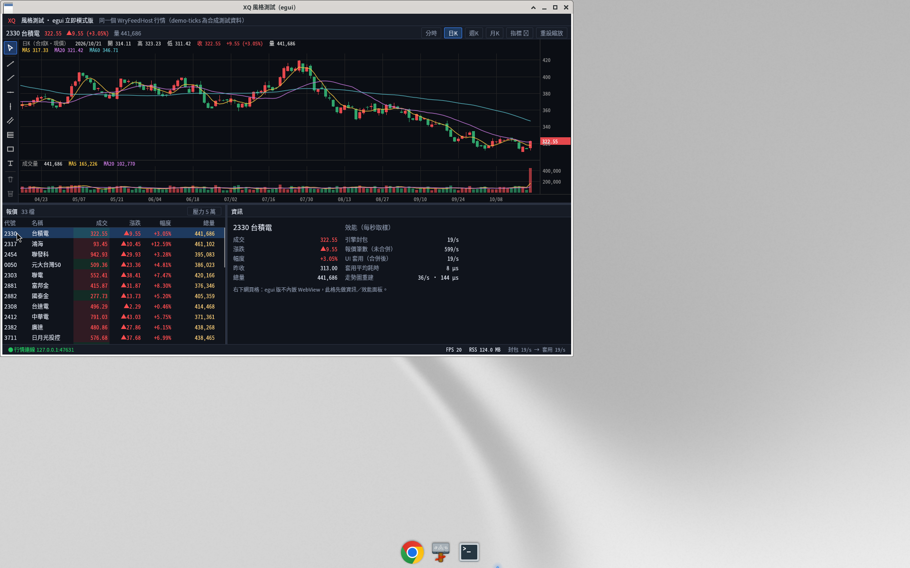
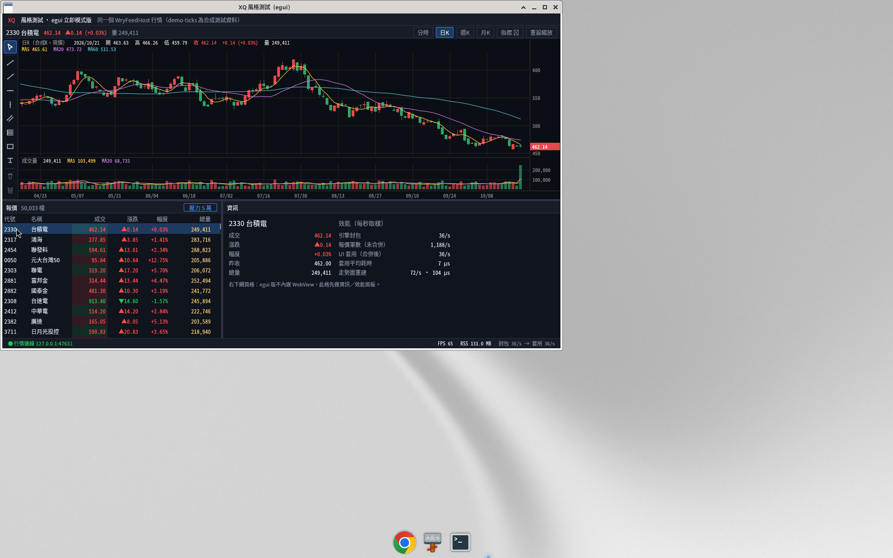
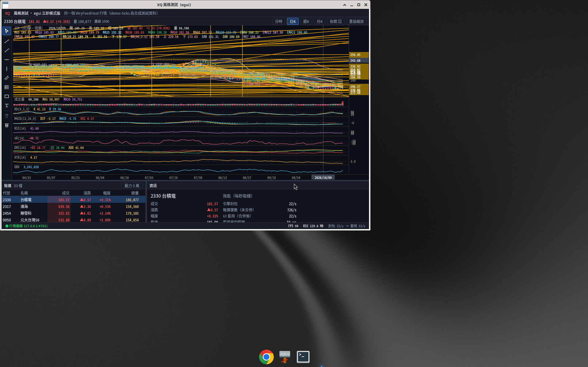

# egui-xq-demo — XQ 風格看盤（Rust + egui／eframe 立即模式版）

與 [`gpui-xq-demo`](https://github.com/tina-moneydj/gpui-xq-demo)（GPUI 原生繪圖）、[`wry-xq-demo`](https://github.com/tina-moneydj/wry-xq-demo)（tao + wry，HTML/JS）
**同版面、接同一個行情來源**：`WryFeedHost`（.NET，`127.0.0.1:47631`）。協議 crate `xq-feed` 直接沿用 gpui-xq-demo 的（Cargo git 依賴，鎖定 rev）。
走勢圖的狀態、指標、畫線邏輯（`model.rs`／`indicators.rs`／`drawings.rs`／`series.rs`）是從 GPUI 版**原樣移植**，三版算的東西一樣，只差畫面框架。



| 5 萬列報價表壓測 | 重圖表（20 疊加＋8 副圖＋1000 畫線） |
|---|---|
|  |  |

## 功能（與 GPUI 版對照）

- 版面：上＝走勢圖、左下＝報價表、右下＝資訊／效能格；**上下、左右分隔線都可拖曳**；底部狀態列（連線、FPS、RSS、封包→套用）。
- 報價表：代號／名稱／成交／漲跌／幅度／總量，漲紅跌綠；自己做的虛擬化（`ScrollArea::show_viewport`，只為可見列產生圖元），
  「壓力 5 萬」加 5 萬列合成資料；點列切換走勢圖代號。
- 走勢圖：分時／日K／週K／月K、滾輪縮放、拖曳平移、重設縮放；主圖疊加最多 20 個（MA／EMA／布林／SAR）、副圖 8 種；
  「指標 ▾」選單（egui 內建元件做的，外觀比 GPUI 版陽春）；十字線＋讀值；每個「代號｜週期」的設定與畫線存到
  `~/.local/share/egui-xq-demo/state.json`（`XQ_EGUI_STATE` 可改）。
- 畫線：左側工具列 8 種工具＋刪除／全部清除；點選、拖曳整條或控制點、Delete、Esc、文字輸入。
  壓測注入的 1000 條畫線會畫出來、也能 hit-test（同 GPUI 的 64px 格狀空間索引）。

### 和 GPUI 版還不一樣的地方（parity gaps）

| 項目 | 狀況 |
|---|---|
| 成交明細範例模組（`XQ_TAPE`） | 沒做 |
| `XQ_NO_VIEW_CACHE`／`XQ_LAYER_MODE`／`XQ_DEBUG` | 沒做（egui 沒有 view cache 的概念；改成自己快取 Mesh） |
| 指標選單、工具列外觀 | 功能相同、外觀較簡單（egui 內建按鈕／勾選框） |
| 單元測試 | 只帶過來 `series`／`indicators` 原有的測試，沒有協議與畫線的測試 |
| 右下網頁格 | 同 GPUI，不做（放資訊格） |
| 局部重畫 | **做不到**：egui 每次重畫都是整個視窗重新送 GPU。這版做的是「沒事不重畫」＋「沒變的圖層沿用快取的三角形」 |

## 建置／執行

```bash
export PATH="$HOME/.cargo/bin:$PATH"
cargo build --release                      # rust-toolchain.toml＝stable（eframe 0.37 要 rustc ≥ 1.95）
DISPLAY=:2 XQ_METRICS=1 ./target/release/egui-xq-demo
XQ_RENDERER=wgpu ./target/release/egui-xq-demo   # 預設 glow（OpenGL），見下方「glow vs wgpu」
```

環境變數（與 GPUI 版同名同義，所以 `gpui-xq-demo/scripts/bench-*.sh` 可以直接驅動）：

| 變數 | 用途 |
|---|---|
| `XQ_FEED_ADDR` | 行情位址（預設 127.0.0.1:47631） |
| `XQ_METRICS=1` | 每秒印 fps／rss／封包／套用耗時 |
| `XQ_BENCH=1` | 第一幀／第一筆報價／第一個重圖表畫出後印 `BENCH ...` |
| `XQ_PERIOD=T/D/W/M` | 啟動週期 |
| `XQ_TOP_FRAC=0.56` | 上方走勢圖佔比 |
| `XQ_GROUP_STRESS=1`（＋`XQ_STRESS_TICK_HZ`／`_TICK_MS`／`_SCROLL_MS`） | 5 萬列＋合成跳價＋捲動壓測，印 `GROUPPERF|{json}` |
| `XQ_CHART_STRESS=1`（＋`XQ_CHART_DRAWINGS`／`_WARM_MS`／`_PHASE_MS`） | 重圖表壓測，印 `CHARTPERF|{json}`、`CHARTPHASE|...` |
| `XQ_TICK_BENCH=1` | 高頻進價量測（搭配 `xq-tickgen`），印 `TICKBENCH|{json}` |
| `XQ_RENDERER=glow/wgpu` | 繪圖後端（預設 glow） |
| `XQ_DEBUG_REPAINT=1` | 印每一幀是誰要求重畫的（找多餘重畫用） |

## 架構與效能做法

```
src/bridge.rs     ← 背景執行緒合併（同代號只留最新）；Inbox 由空變非空才喚醒 UI，UI ≥16ms 才套用一次
src/table.rs      ← 報價表：自己虛擬化、可見列整批三角化成一個 Mesh 快取（列、捲動位置、選取、hover 沒變就沿用）
src/chart.rs      ← 走勢圖：plot／draw／live 三層各自快取 Mesh；平移時畫線層整批位移不重建；壓測驅動
src/model.rs …    ← 從 GPUI 版移植（版面、互動、指標增量、畫線幾何／空間索引）
src/gfx.rs        ← Sink：把矩形／線段／文字收集起來，一次三角化成 egui Mesh
src/tickbench.rs  ← 高頻量測（present＝下一幀開始，同 GPUI on_next_frame／wry 兩次 rAF，都是上界）
src/main.rs       ← 版面、分隔線、狀態列、資訊格、FPS/RSS 取樣、GROUPPERF 壓測
```

- **沒事不重畫**：沒有行情、沒有輸入就不畫（只有每秒一次的狀態列取樣）。行情進來時背景執行緒用
  `request_repaint_after(距離上次套用滿 16ms 的時間)` 叫醒 UI，所以行情再快也最多 ~60 次/秒。
- **避開 egui 的「多畫一幀」**：egui 的 `request_repaint()`（延遲 0）會排**兩次**重畫（讓東西穩定用），
  所以本程式一律用 `request_repaint_after(1µs)`；報價表也關掉 egui 的慣性捲動／捲軸動畫——實測跳價時約 60% 的幀是 `ScrollArea` 的慣性計算叫的。
  修掉後一般看盤 FPS 從 37 降到 19（＝每秒行情包數，一包一幀）。
- **快取三角形**：egui 每幀都要把圖形變成三角形（tessellate）。這版把沒變的圖層（K 棒＋指標、1000 條畫線、報價表可見列）
  三角化一次存成 `Arc<Mesh>`，下一幀直接沿用；只有資料、尺度、版面或字型改了才重建。
- 字型：Noto Sans CJK TC（mmap，不複製進記憶體）。

### glow vs wgpu

eframe 0.37 兩個後端都編進去，用 `XQ_RENDERER` 切換。同一台機器（沒有 GPU：glow＝Mesa llvmpipe OpenGL，wgpu＝Vulkan lavapipe）
重圖表壓測 2 次中位數（原始檔：[docs/bench/2026-10-21/renderer/](docs/bench/2026-10-21/renderer/)）：

| 重圖表 | glow | wgpu |
|---|---|---|
| FPS 跳價／十字線／平移 | **56.1／55.2／55.6** | 51.1／48.6／57.1 |
| CPU 扣軟體繪圖 (%) | **49.7／50.0／49.4** | 55.7／57.0／46.1 |
| RSS (MB) | **134／142／141** | 169／162／169 |

glow 記憶體少約 30 MB、FPS 大多較高，所以**預設 glow**，三方比較也用 glow。
（GPUI 在這台走 Vulkan lavapipe；egui 用 wgpu 時一樣走 lavapipe，數字差不多，可用 `EGUI_RENDERER=wgpu` 重跑比較。）

<!--PERF-->
