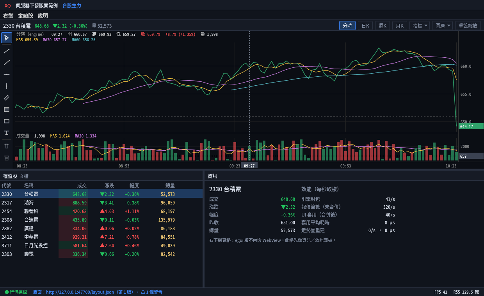
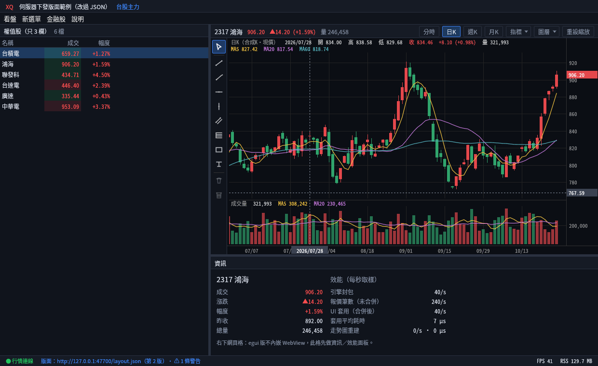
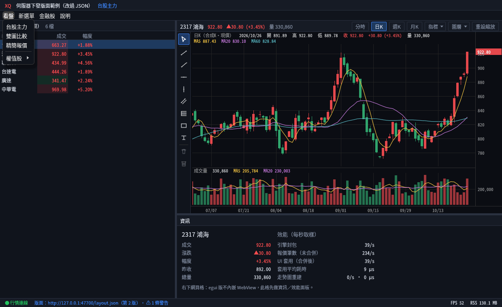
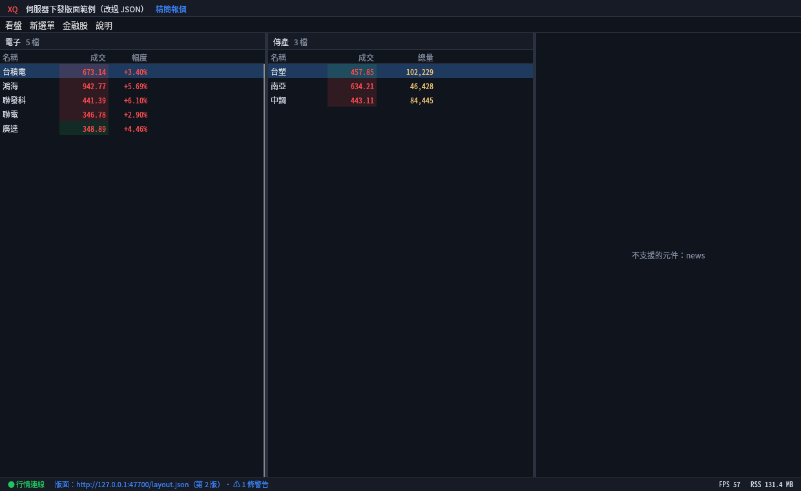
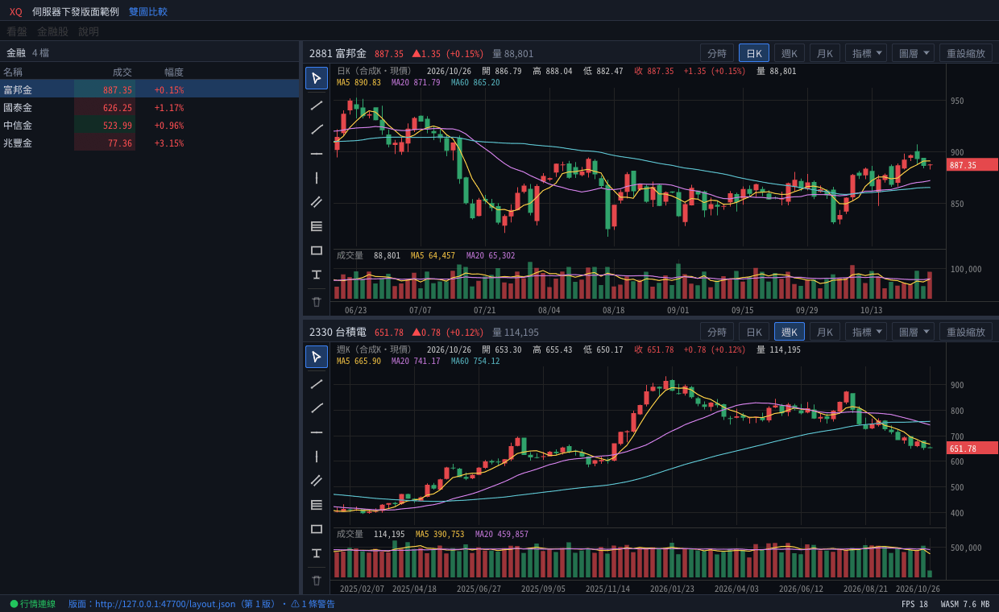

# 伺服器下發版面＋頂部選單（樣品，2026-10-26）

> 三層做法的**第 2 層**：報價表、走勢圖這些高頻元件內建在程式裡，伺服器送一份 JSON 決定
> **頂部選單**、**有哪些頁**、**每頁擺哪些元件、怎麼分割**、**報價表顯示哪些欄位**。改 JSON 不用重編譯、不用重開，約 1 秒內畫面就換。
> 第 1 層（低頻頁面用網頁）在這裡是選單的 `url` 項目；第 3 層（從伺服器推新邏輯／腳本）之後再說。

## 怎麼跑

```bash
# 1. 行情（任一個）：WryFeedHost --demo-ticks，或 gpui-xq-demo 的 xq-demofeed
# 2. 版面伺服器：每個請求都重新讀檔，所以直接改 layouts/demo.json 存檔就會生效
cargo run --release --example layout-server -- layouts/demo.json --port 47700
# 3. app 開版面模式（不設 XQ_LAYOUT_URL＝原本的版面，什麼都不變）
XQ_LAYOUT_URL=http://127.0.0.1:47700/layout.json ./target/release/egui-xq-demo
# 也可以直接讀本機檔：XQ_LAYOUT_URL=layouts/demo.json

# 網頁版（wasm）：同一份 JSON，網址參數帶 XQ_LAYOUT_URL（瀏覽器 fetch，範例伺服器已回 CORS 標頭）
bash web/build.sh && xq-ws-bridge --www dist/web
# 開 http://127.0.0.1:47632/index.html?XQ_LAYOUT_URL=http://127.0.0.1:47700/layout.json
```

| 環境變數 | 說明 |
|---|---|
| `XQ_LAYOUT_URL` | `http://…` 或本機檔案路徑。沒設＝原本的固定版面。壓測模式（`XQ_BENCH`／`XQ_TICK_BENCH`／`XQ_CHART_STRESS`／`XQ_GROUP_STRESS`）一律不開 |
| `XQ_LAYOUT_POLL_MS` | 輪詢間隔，預設 1000（100–60000） |

## 畫面

| 起始頁「台股主力」 | 改 JSON 存檔後（不重開） |
|---|---|
|  |  |

| 伺服器下發的頂部選單 | 第三頁：兩張報價表＋新版元件降級成佔位格 |
|---|---|
|  |  |

## JSON 格式（version 1）

完整範例：[`layouts/demo.json`](../layouts/demo.json)。

```jsonc
{
  "version": 1,
  "title": "伺服器下發版面範例",      // 標題列
  "start": "tw",                       // 起始頁 id
  "menu": [                            // 頂部選單（最多 3 層、共 64 項）
    { "label": "看盤", "items": [
      { "label": "台股主力", "page": "tw" },        // 切頁
      { "separator": true },
      { "label": "權值股", "items": [                // 子選單
        { "label": "台積電", "symbol": "2330" }      // 連動的走勢圖／資訊格換代號
      ]}
    ]},
    { "label": "說明", "items": [
      { "label": "XQ 官網", "url": "https://www.xq.com.tw" }  // 系統瀏覽器開（只收 http/https）
    ]}
  ],
  "pages": [
    { "id": "tw", "title": "台股主力",
      "root": { "split": "col", "sizes": [0.56, 0.44], "children": [   // col＝上下、row＝左右
        { "widget": "chart", "symbol": "2330", "period": "T" },        // T 分時／D 日K／W 週K／M 月K
        { "split": "row", "sizes": [0.42, 0.58], "children": [
          { "widget": "quotes", "title": "權值股",
            "symbols": ["2330", "2317", { "symbol": "2454", "name": "聯發科" }],
            "columns": ["symbol", "name", "price", "change", "pct", "volume"] },  // 挑欄位、排順序
          { "widget": "info" }
        ]}
      ]}
    }
  ]
}
```

- 元件：`chart`（走勢圖）、`quotes`（報價表）、`info`（資訊格）。走勢圖 `link`（預設 true）＝點報價表或選單代號時跟著換；`false`＝固定看自己的代號（例如比較圖）。
- 點報價表一列 → 所有連動的走勢圖、資訊格換代號（和原本版面一樣）。
- 狀態列顯示版面來源、第幾版、警告數（滑過看全文）或錯誤。

## 同一份 JSON 給桌面、網頁、手機

格式本身不分平台；各平台要不一樣的地方用兩個欄位寫在同一份檔案裡：

```jsonc
{ "id": "tw", "title": "台股主力",
  "root":  { /* 桌面、網頁的擺法 */ },
  "roots": { "mobile": { "split": "col", "children": [ /* 手機單欄：上圖下表 */ ] } } },   // 某平台另給擺法，沒寫就用 root
{ "id": "compare", "platforms": ["desktop", "web"], ... }                                  // 只給某些平台（空＝全部）
{ "label": "某選單項目", "symbol": "2330", "platforms": ["mobile"] }                        // 選單項目也可以限定
```

- 平台名稱：`desktop`、`web`、`mobile`。指向「這個平台沒有的頁」的選單項目會安靜略過；分組裡全部被略過就不顯示該分組。
- 程式端：`xq_layout::parse_for(json, Platform::Mobile)`（桌面版用 `parse`＝Desktop、網頁版用 Web）。

| 平台 | 現況 |
|---|---|
| 桌面（Windows／Mac／Linux） | ✅ 可用 |
| 網頁（wasm） | ✅ 可用（Chromium 實測：載入版面、選單切頁都正常，截圖如下） |
| 手機 App（iOS／Android） | 格式與解析已支援（`roots.mobile`、測試涵蓋）；**畫面還沒接**：手機版 `mobile/` 是自己的單畫面導覽，要把版面畫面接進去，下一步做 |



## 容錯與上限（舊版程式收到新版 JSON 也不當掉）

| 狀況 | 行為 |
|---|---|
| 伺服器連不上、JSON 壞掉、型別錯、沒有任何頁 | 沿用上一份好的版面，狀態列顯示紅字錯誤；伺服器恢復後自動換回 |
| 認不得的元件（例如新版的 `news`） | 畫「不支援的元件」佔位格，記警告 |
| 認不得的欄位、週期、分割方向 | 略過或用預設值，記警告 |
| 選單指向不存在的頁、網址不是 http(s)、沒有動作 | 該項略過，記警告 |
| 超過上限 | 截掉並警告：頁 32、分割 6 層、每頁 16 格、每頁走勢圖 6 張、每張報價表 300 檔、選單 64 項／3 層、標籤 40 字、整份 256 KB |

## 程式在哪裡

| 檔案 | 內容 |
|---|---|
| `crates/xq-layout` | 純邏輯（不依賴 egui）：解析、驗證、上限、降級、分割計算；`cargo test -p xq-layout` |
| `src/layout_feed.rs` | 背景執行緒抓 JSON（http 或檔案），內容有變才解析；UI 每幀只 `take()` 一次 |
| `src/layout_view.rs` | 照版面畫標題列、頂部選單、各格、狀態列；行情由 `Terminal::apply_feed` 每幀套用一次 |
| `examples/layout-server.rs` | 範例伺服器（只用標準函式庫） |

效能：換頁／換版面才重建元件（走勢圖用小池子重用、不讀寫存檔）；每幀只多一次分割計算（重用 Vec，不配置）。
實跑（Linux 無 GPU、Xvfb）：41 FPS、`apply_feed` 平均 7–9 µs、RSS 約 125–131 MB，與原版面同一個量級。

## 還沒做（正式版要補）

- **推送**：樣品用輪詢；正式版應該由伺服器主動推（例如行情連線多一種訊息，要改 xq-feed 協議，需和 WryFeedHost 一起改）。
- **https／簽章**：樣品只收 http（不加 TLS 依賴）；正式版走公司既有連線，版面 JSON 應該簽章或至少驗來源。
- **使用者自訂**：分隔線目前固定照 JSON 比例，不能拖；之後可把使用者調整存在本機、蓋在伺服器版面上。
- **手機 App**：把版面畫面接進 `mobile/`（解析已支援 `roots.mobile`）。
- 更多內建元件（成交明細、新聞等）：元件做進程式後，JSON 就能擺；舊版程式看到會顯示佔位格。
