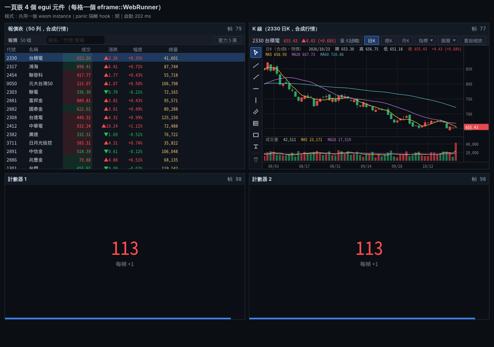

# web：一頁嵌 4 個 egui 元件可行性（2026-10-25）

範例：[`examples/web-multi/`](../examples/web-multi/)｜原始數據與截圖：[`docs/bench/web/2026-10-25-multi/`](bench/web/2026-10-25-multi/)

## 結論先看

**有條件可行。** 同一個 html 頁面用一般 html 版面（2×2 grid、每格有標題）放 4 個 `<canvas>`，各啟動一個 `eframe::WebRunner`，
四個元件都畫得出來、一起持續更新、滑鼠只影響自己那格，主控台沒有錯誤；四個共用同一份 wasm 時，頁面總下載量跟只放一個元件一樣（gzip 約 **4.2 MB**）。

條件有三個（都已在範例裡處理）：

1. **panic 會互相拖垮，要自己換 panic hook。** eframe 的 `WebRunner::new()` 每次都「串接」安裝全域 panic hook，任一個元件 panic，四個 runner 都被標成已 panic、**一起停**（實測確認）。
   繞法：全部 `start()` 之後呼叫一次 `isolate_panics()`（換成只寫 console 的 hook），之後一個 panic 只停那一格，其他三格照跑（實測連續兩格 panic，第三格仍在跑）。
   要更徹底的隔離可以讓每個元件各自一個 wasm instance（同一份檔案只下載、編譯一次），代價是 wasm 記憶體約 2.4 倍。
2. **移除元件要呼叫 `destroy()`。** 只把 canvas 從 DOM 拿掉，那個 runner 還在背景每幀照畫（實測幀數繼續增加），會白白吃 CPU。
3. **panic 過的元件不會自己復原**，那一格會停在最後一幀；共用 instance 時它的記憶體也收不回來。要恢復得重新載入頁面（或那個元件用獨立 instance 再重建，未實作）。

> 這台沒有 GPU：Chromium 153 無頭模式，WebGL2 走 ANGLE＋SwiftShader（軟體繪圖）。**這次只做可行性，不是效能量測**；幀數、記憶體數字都只供參考。



## 驗證結果

| 項目 | 結果 | 證據 |
|---|---|---|
| 能不能跑 | ✅ 四格都有畫出東西：報價表 50 列、K 線（2330 日K＋MA＋量）、兩個計數器 | `1-four-widgets.png` |
| 四個都持續更新 | ✅ 3 秒前後幀數：報價表 104→193、K 線 102→192、計數器 1 126→216、計數器 2 126→216 | `results.json` → `shared.alive` |
| 主控台 | ✅ 載入與執行期間 0 個 panic／錯誤（只有我們故意觸發的 panic 之後才有） | `console-shared.log` |
| 滑鼠互不干擾 | ✅ 點報價表第 3 列只改報價表的選取列；滑鼠移到 K 線，十字線只出現在 K 線 | `1b-click-table-hover-chart.png` |
| 移除一格（`destroy()`＋拿掉 canvas） | ✅ 其他三格照跑（計數器 2 停在 251，其他三格 3 秒內各 +110～139 幀） | `shared.afterRemoveC2`、`2-shared-…png` |
| 只拿掉 canvas、不呼叫 `destroy()` | ⚠️ 其他三格照跑，但**被拿掉的那格也還在跑**（K 線 60→168 幀），要記得 `destroy()` | `removeNoDestroy.after` |
| 一格 panic（eframe 原本行為） | ❌ **四格全停**，四個 `has_panicked()` 都是 true；同一個 panic 訊息在 console 印 4 次（每個 runner 的 hook 各印一次） | `sharedNoIsolate`、`3-noisolate-panic-c1.png`、`console-shared-noisolate.log` |
| 一格 panic（換 hook 之後） | ✅ 只停 panic 的那格；其他格 3 秒內各 +120 幀 | `shared.afterPanicC1` |
| 第二格又 panic | ✅ 也只停那格（報價表停在 484），K 線 501→621 照跑 | `shared.afterSecondPanicTable` |
| 每格各自 wasm instance、一格 panic | ✅ 只停那格（不用換 hook，各 instance 的 hook 本來就分開） | `separate.afterPanicC1` |
| 啟動時間（頁面載入到四格都 start 完，檔案在本機） | 共用 instance 約 200 ms；各自 instance 約 290 ms | `*.boot.readyMs` |

### 下載大小

wasm 已經包含報價表、走勢圖、指標、畫線的程式碼，加上**中文字型子集**（Noto Sans TC 子集 3.0 MB，gzip 後 2.5 MB，佔大部分）。

| 檔案 | 原始 | gzip -9 |
|---|---:|---:|
| `xq_web_multi_bg.wasm`（wasm-opt -O3） | 7.39 MB（7,393,974 B） | **4.18 MB**（4,179,088 B） |
| `xq_web_multi_bg.wasm`（未最佳化） | 7.89 MB | 4.18 MB |
| `xq_web_multi.js`（wasm-bindgen 膠水） | 87 KB | 13 KB |
| `index.html` | 5.6 KB | 2.6 KB |

| 頁面總下載量（伺服器開 gzip，CDP 量到的實際傳輸） | 位元組 | 請求 |
|---|---:|---|
| 1 個元件 | **4.22 MB**（4,217,635 B） | html＋js＋wasm 各 1 次 |
| 4 個元件，共用一個 instance | **4.22 MB**（4,217,635 B） | 同上：wasm 只下載 1 次 |
| 4 個元件，各自一個 instance | 4.26 MB（4,258,870 B） | wasm 1 次（`compileStreaming` 一次、instance 化 4 次）；js 膠水 4 次（每次 13.7 KB，用不同 query 載入才是獨立模組） |

對照：完整主畫面的網頁版（README「網頁版」）gzip 也是約 4.2 MB，因為大頭都是字型。

### 記憶體（無頭環境，僅供參考）

每種設定開新分頁、跑 5 秒、強制 GC 後量，3 次取中位數（3 次數字幾乎一樣）。JS heap 取自 CDP `Performance.getMetrics`；wasm 記憶體是線性記憶體大小（`WebAssembly.Memory.buffer.byteLength`，各自 instance 時四個加總）。
**沒有量瀏覽器行程的 RSS／PSS、也沒有量 GPU 記憶體。**

| 設定 | JS heap 已用 | JS heap 總計 | wasm 記憶體 |
|---|---:|---:|---:|
| 1 個 runner（報價表） | 1.8 MB | 2.8 MB | 7.4 MB |
| 1 個 runner（計數器） | 1.8 MB | 2.6 MB | 10.4 MB |
| 4 個 runner，共用一個 instance | 1.9 MB | 3.1 MB | **15.1 MB** |
| 4 個 runner，各自一個 instance | 2.9 MB | 3.3 MB | **35.8 MB** |

- wasm 線性記憶體只會長、不會縮，數字是「到目前為止的最高水位」，以 64 KB 頁為單位。
- 只有計數器時反而比只有報價表大，原因沒查（猜是 48 px 大字的字型貼圖，沒驗證）。

## 怎麼做的

- `examples/web-multi/` 是獨立 crate（同 `mobile/` 的做法，不加進根目錄建置）：報價表、走勢圖用 `#[path]` 直接引用 `src/table.rs`、`src/chart.rs` 等，**沒改任何 `src/` 程式碼**。
- wasm 匯出 `start(canvas, kind)` → `Widget`（`frames()`、`destroy()`、`has_panicked()`、`panic_next_frame()`），還有 `isolate_panics()`、`wasm_memory_bytes()`。JS 端在 `index.html` 呼叫 4 次。
- 行情：每個元件在自己裡面跑一份合成行情，規則與 `WryFeedHost --demo-ticks`／`xq-demofeed` 相同（每 25 ms 每檔 ±0.15% 隨機走、量加 10～400）；UI 每幀最多套用一次（累積的 25 ms 步合併成一包）。**不是真實行情，也沒接 WebSocket**。
- 網址參數：`?mode=separate`（各自 instance）、`?isolate=0`（不換 hook，重現 eframe 原本行為）、`?only=table,c1`（只啟動部分元件）。

```bash
# 工具同根目錄網頁版：rustup target add wasm32-unknown-unknown；cargo install wasm-bindgen-cli --version 0.2.129；wasm-opt 可省略
WASM_OPT=/path/to/wasm-opt ./examples/web-multi/build.sh        # 輸出到 dist/web-multi/
python3 -m http.server -d dist/web-multi 8080                     # 瀏覽器開 http://127.0.0.1:8080/
node examples/web-multi/verify.js dist/web-multi 輸出資料夾       # 無頭 Chromium 驗證（需要 Playwright）
```

## 遇到的問題和繞法

| 問題 | 原因 | 繞法 |
|---|---|---|
| 一格 panic，四格全停 | `PanicHandler::install()` 用 `take_hook` 串接前一個 hook：第 4 個 runner 的 hook 會依序呼叫第 3、2、1 個，每個 runner 都把自己標成已 panic，之後所有事件都直接 return | 全部 `start()` 之後呼叫 `isolate_panics()` 換掉 hook。panic 的那格在 wasm 裡是 `unreachable` trap，它的 `RefCell` 永遠保持借用中，所以之後的事件、畫面都自動略過，不會碰到壞掉的狀態。注意：之後若再 `start()` 新元件，eframe 又會串接一次，要再呼叫一次 |
| panic 後 console 會有 `[pageerror] unreachable` | wasm32 的 panic 是 abort（trap），JS 那邊看到的是 RuntimeError | 預期行為；正式產品應該在頁面上把那格標成「元件錯誤」，並回報 |
| 只拿掉 canvas，元件還在跑 | runner 持有 canvas 參考，`requestAnimationFrame` 不會因為 canvas 離開 DOM 而停 | 一律先呼叫 `Widget.destroy()`（退訂事件、取消 rAF、釋放 WebGL 資源） |
| 各自 instance 時 JS 膠水要載 4 次 | wasm-bindgen `--target web` 的膠水模組把 wasm instance 存在模組層級變數，同一個 URL 的 ES module 只會有一份 | 用不同 query 載入（`xq_web_multi.js?inst=…`），wasm 本身用 `compileStreaming` 只下載、編譯一次 |
| K 線格寬約 620 px 時，標頭「量 …」和「分時」按鈕重疊 | `src/chart.rs` 的標頭排版是照桌面版寬度做的 | 沒修（會動到桌面版）；正式嵌入要先處理窄寬度的排版 |

## 沒驗的事

- **效能**：雲端沒有顯卡，沒做正式效能量測。無頭 SwiftShader 下 4 格都約 30 幀／秒，不代表真實電腦。
- **真的瀏覽器／顯卡**：只跑了 Chromium 153 無頭版；沒試 Edge、Firefox、Safari、手機瀏覽器，也沒試有 GPU 的電腦。
- **WebGL context 上限**：每格各自一個 WebGL2 context；瀏覽器每頁有上限（Chromium 一般說法是 16 個，超過會把最舊的丟掉），這次只開 4 個，沒測上限。
- **鍵盤與輸入法**：只驗了滑鼠點擊和移動。每個 runner 會各自建一個隱藏的文字輸入框，多格之間的鍵盤焦點切換、注音／拼音組字沒測。
- **真實行情／WebSocket**：範例用 wasm 內建的合成行情。四個元件要共用一條 WebSocket 還是各開一條、`xq-ws-bridge` 一次能服務幾個 client，沒測。
- **panic 後長時間穩定性**：只驗了 panic 後 3 秒內其他格照跑、以及連續兩次 panic。依 Rust 標準庫原始碼推論，「panic 中」計數在 trap 後不會歸零，長時間下來會不會有副作用沒驗。
- **destroy 後記憶體**：沒量移除元件後 wasm 記憶體、WebGL 資源有沒有真的釋放（wasm 線性記憶體本來就不會縮）。
- **瀏覽器行程記憶體**：只量了 JS heap 與 wasm 線性記憶體，沒量 RSS／PSS、GPU 記憶體。
- **版面變化**：沒測視窗縮放、DPR 改變（拖到別的螢幕）、頁面捲動時各格的座標是否正確。
- **跨元件溝通**（例如點報價表讓 K 線換代號）：這次四格完全獨立，沒做。共用 instance 時可以用 Rust 端共享狀態，各自 instance 時只能經過 JS。
